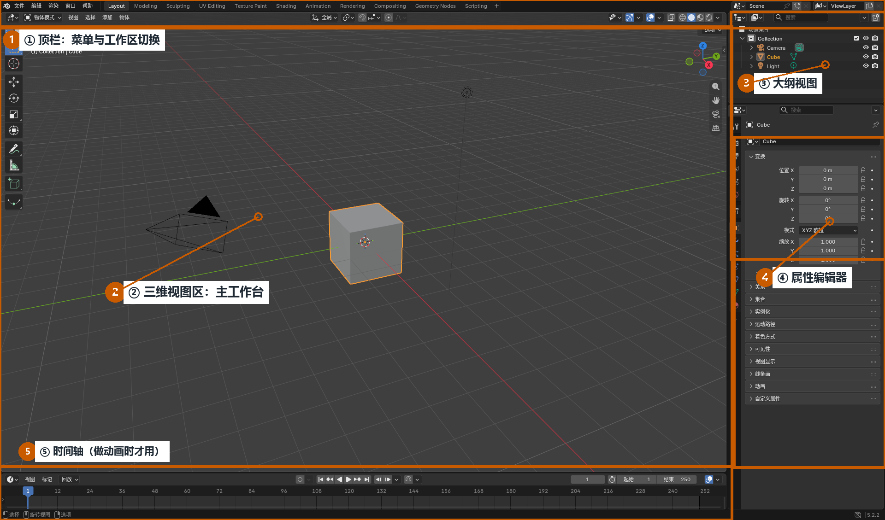

# 03 · 界面布局全解析

## 首次打开会看到什么

第一次启动 Blender，屏幕上大致是这几块：

1. **顶部：顶栏（Topbar）** —— 最左边是菜单（文件、编辑、渲染等），中间会显示当前工作区名称，右边是渲染引擎等设置。
2. **中间偏上：三维视图区（3D Viewport）** —— 最大的那块区域，就是你的"工作台"，一切建模操作都在这里进行。
3. **底部：时间轴（Timeline）** —— 做动画时才用，现在可以先忽略。

旁边还有一排标签页（工作区）：**Layout（布局）、Modeling（建模）、Sculpting（雕刻）、UV Editing、Texture Paint、Shading（着色）、Animation（动画）、Rendering（渲染）**。它们只是"预设好的界面排列"，切换到不同工作区，面板会自动换成更适合当前任务的布局。新手期主要在 **Layout** 里工作即可。

## 三个最需要认识的区域

**① 三维视图区（3D Viewport）**
你的主战场。左上角会写着当前模式（通常是 **Object Mode / 物体模式**），右上角是一组小圆球（显示模式切换）、一条坐标轴（导航 Gizmo）。

**② 大纲视图（Outliner）**
通常在右上角，列出场景里的所有对象。相当于"图层管理器"，东西多了靠它找对象、开关显示。

**③ 属性编辑器（Properties）**
通常在最右侧，一列竖向的图标标签。每个图标是一个分类，新手最常用这几个：

| 图标（分类） | 作用 |
|-------------|------|
| 扳手（Modifier Properties） | 给对象加"修改器"（如倒角、细分） |
| 红色方块（Material Properties） | 给对象上材质、调颜色 |
| 灯泡（Light Properties） | 调灯的亮度、颜色 |
| 摄像机（Object Properties） | 调对象的位置、旋转、缩放数值 |
| 打印机（Output Properties） | 设置渲染输出的分辨率、格式 |

## 视图导航 Gizmo：右上角的小工具

视图区右上角有一组小圆球和坐标轴。用鼠标拖动它们也能旋转/平移视角，但**新手更推荐用鼠标中键直接操作**（见下一章），效率更高。

## 界面乱了怎么办

这是一个新手必学的"后悔药"：

- 不小心关掉了某个面板？把鼠标移到区域边缘，光标变成"双向箭头"时**右键拖动**就能缩放面板大小。
- 区域被拖乱了？每个区域左上角/右上角有一个小图标，可以拆分或合并区域。
- 整个界面被改得面目全非？菜单栏 **File → Defaults → Load Factory Settings**（加载出厂设置）一键还原。
- 只是切错了工作区？直接点顶部标签回到 **Layout** 就行。

> 💡 **实用建议**：新手期不要急着折腾界面布局，先用默认布局把操作练熟。

---

下一章：[04 · 视图导航与基本操作](04-视图导航与基本操作.md)
