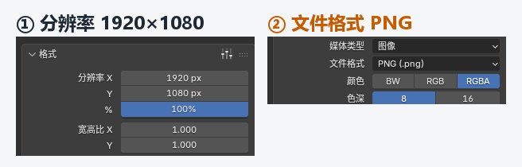
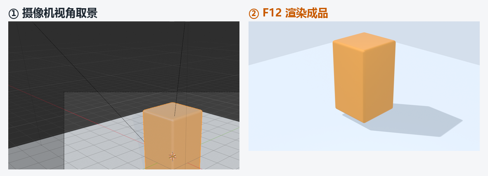

# 08 · 渲染入门：把作品"拍"成图片

建模 + 上色完成后，就到了最有成就感的环节——渲染成图。

## 渲染前，先摆好"相机"和"灯"

三维世界和现实摄影一样，需要三样东西：**被拍的对象（模型）、摄像机、光**。

**默认场景里已经有一台摄像机和一盏灯**，但你自己新建的场景可能没有。检查方法：

- 看右上角**大纲视图**里有没有 `Camera` 和 `Light`；
- 没有的话，在大纲视图或视图区按 `Shift + A` → 添加 `Camera` 和 `Light`。

**调整摄像机视角：**

1. 小键盘 `0` 进入摄像机视角（画面外围会出现取景框）；
2. 按 `N` 打开侧栏，也可以用 `G` 移动摄像机位置来调整构图；
3. 更自然的做法：先摆好你想要的观察角度，然后菜单 **View → Align View → Align Active Camera to View**，让摄像机"看向你当前的角度"。

**添加/调整灯光：**

1. `Shift + A` → `Light` → 选 `Point`（点光）、`Sun`（太阳光）或 `Area`（面光）；
2. 选中灯，在右侧点**灯泡图标**，调 **Power（强度）**；
3. 按 `G` 移动灯的位置，观察光照变化。
4. 新手技巧：用**面光 + 较大的尺寸**打光，阴影更柔和，效果更自然。

## 选择渲染引擎

| 引擎 | 特点 | 适合 |
|------|------|------|
| **EEVEE** | 快，实时预览流畅 | 新手首选、动画、快速出图 |
| **Cycles** | 物理真实，光影细腻 | 产品图、追求真实感 |

在右侧属性面板点**打印机图标（Render Properties）**，最上方 **Render Engine** 处切换。**新手建议先用 EEVEE**，速度快、不容易卡。

## 设置输出尺寸与格式

1. 右侧属性面板点**打印机图标**下半部分，或直接找 **Output Properties（输出属性）**；
2. **Resolution（分辨率）**：入门设 `1920 × 1080` 就够；
3. **Output → File Format**：选 `PNG`（带透明通道，方便后期）。

## 渲染出图

1. 按 **`F12`**，Blender 开始渲染，会弹出一个渲染窗口；
2. 等待渲染完成，画面逐渐显现；
3. 渲染完成后，在渲染窗口里点 **Image → Save As**（或 `Alt + S`），把图片保存到磁盘。

**恭喜，你的第一张 Blender 作品诞生了！**

## 渲染卡住 / 变黑 / 一片灰怎么办

| 现象 | 可能原因 | 解决 |
|------|---------|------|
| 渲染很慢 | 用了 Cycles 且采样过高 | 换 EEVEE，或降低 Samples |
| 画面全黑 | 没有灯，或灯被挡住 | 添加一盏灯并调整强度 |
| 画面全灰 | 材质没调 / 显示模式在实体预览 | 检查材质，按 `Z` 切到渲染模式 |
| 找不到摄像机视角 | 场景里没有 Camera | `Shift + A` 添加摄像机 |
| 输出是黑的/透明 | 输出格式或色彩设置问题 | 检查 File Format 与 Color 设置 |

---

下一章：[09 · 常见新手误区](09-常见新手误区.md)
