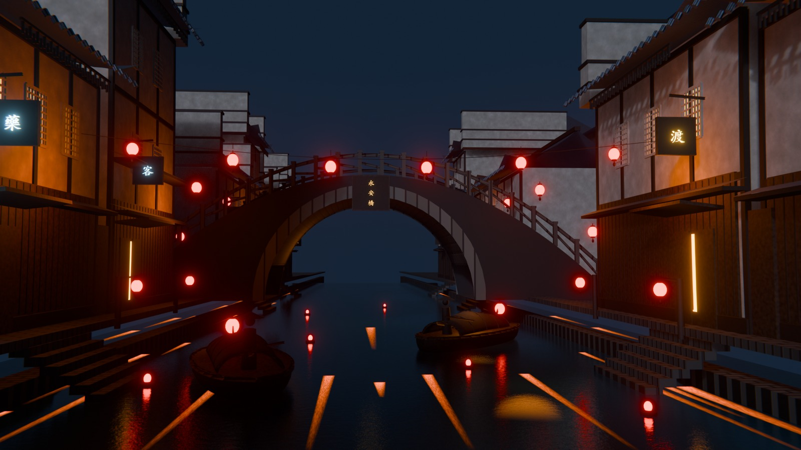
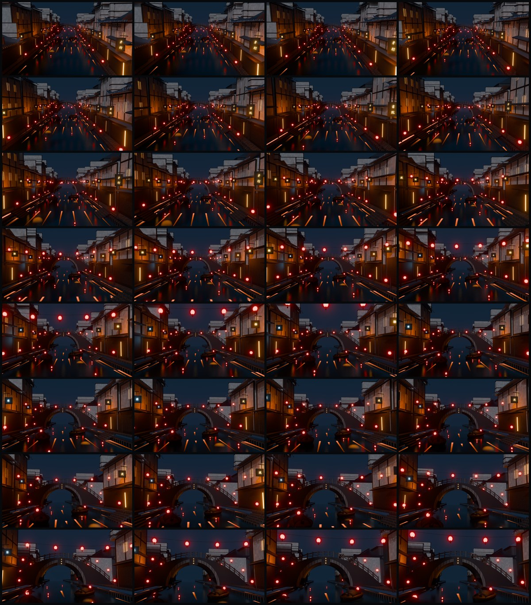

# Blender 中文学习路线

从零基础到能独立做完整项目，两条清晰的学习路径。



*上图是进阶版的贯穿案例：一条江南水巷夜景，**全部由 Python 脚本程序化生成**，没有导入任何外部模型或贴图。学完进阶版，你就能做出这样的东西。*

```
┌─────────────────────────────────────────────────────┐
│  入门版 basic/          会用 Blender                 │
│  看得懂界面 · 转得动视角 · 建得出模型 · 渲得出图    │
│         ↓  完成入门版                                │
│  进阶版 advanced/       会用 Blender 造东西          │
│  写脚本驱动 · 程序化生成 · 节点材质 · 合成后期 · 运镜 │
└─────────────────────────────────────────────────────┘
```

## 两条路径

| | [入门版](basic/README.md) | [进阶版](advanced/README.md) |
|---|---|---|
| 适合谁 | 从没用过三维软件 | 会基本操作，想提高效率 |
| 核心问题 | "这个按钮在哪？" | "怎么让 30 栋房子自动生成？" |
| 学习方式 | 鼠标 + 快捷键 | **写脚本驱动 Blender** |
| 章节数 | 10 章 + 附录 | 14 篇 |
| 贯穿案例 | 一个桌面摆件 | **江南水巷夜景**（240 帧短片） |
| 预计投入 | 2~3 小时 | 15~25 小时 |

**两版是递进关系**：进阶版默认你已掌握入门版的全部操作，不再重复讲解界面和快捷键。

## 最终效果

进阶版的产出是一个完整短片。镜头从 7 米高空俯瞰，一路推进到拱桥桥头：



▶ [**观看成片视频**](advanced/media/canal_flythrough.mp4)（H.264，10 秒，1248×704）

## 快速选择

- **完全没接触过三维软件** → 从 [入门版](basic/README.md) 开始
- **会基本操作，但想提高效率** → 直接看 [进阶版](advanced/README.md)
- **想直接看结果** → [进阶版第 13 章完整实战](advanced/13-完整实战复刻.md)

## 仓库内容

```
.
├── README.md                 ← 你在这里（总导航）
├── basic/                    入门版
│   ├── 01 ~ 10 章 + 附录
│   ├── README.md
│   ├── images/               入门版配图（8 张实机截图）
│   └── Blender入门指南.docx    完整排版成品（封面 + 目录 + 页码）
└── advanced/                 进阶版
    ├── 00 ~ 13 共 14 篇
    ├── README.md
    ├── 进阶版规划.md           设计文档（模块划分与学习路径）
    ├── images/                进阶版配图（脚本实跑渲染 + 项目成品）
    ├── media/                 成片视频
    └── scripts/               完整项目脚本 + 6 个验证脚本
```

## 配图与代码的可信度

**所有界面截图均由本地 Blender 真实操作产生**，所有渲染图都是脚本实际跑出来的，非示意图、非 AI 生成。

进阶版里每个 API 调用都在 Blender 5.2 上实测过，因此修正了一批版本差异（例如合成器改为节点组、`Action.fcurves` 被移除、`ColorBalance` 的同名 socket 陷阱等）。这些坑都写在对应章节里。

## 软件与授权

Blender 完全免费、开源、可商用，官网 blender.org 下载。本仓库内容可自由用于学习与二次创作。
