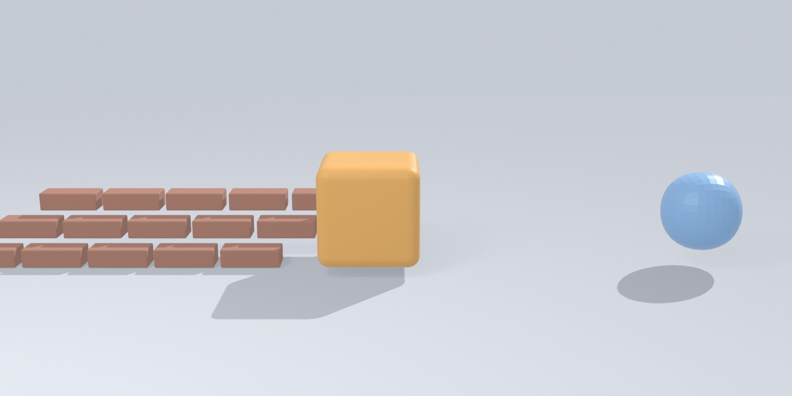

# 02 · 修改器系统

## 为什么修改器比 bmesh 更高效

bmesh 是"直接改最终数据"，修改器是"**描述一种变换，让 Blender 实时算给你看**"。

| | bmesh | 修改器 |
|---|---|---|
| 可逆性 | 改了就是改了 | 随时调整参数、随时关掉 |
| 计算时机 | 立刻 | 视口实时重算 |
| 适用 | 精确的拓扑操作 | 参数化的重复性变换 |

**经验法则**：
- 造型（挤出、倒角、细分）→ 修改器
- 拓扑修复（补洞、翻面、清理）→ bmesh
- 需要生成大量重复结构（砖墙、栏杆）→ 阵列修改器

## 修改器的执行顺序

这是最容易出错的地方。**修改器从上到下依次作用**，顺序不同结果完全不同。

```
【原始网格】
   ↓
1. 阵列（Array）—— 先复制出 20 块砖
   ↓
2. 布尔（Boolean）—— 再和墙体做差集
   ↓
3. 倒角（Bevel）—— 最后统一磨圆角
```

如果把倒角放在阵列前面，每块砖都会被倒角一次，然后布尔运算会处理 20 份倒角后的几何——既慢又容易出错。

> 💡 **经验法则**：把"增加几何量"的修改器放前面，"细化表面"的放后面。

## 四大常用修改器

### 阵列（Array）

沿一个轴重复。砖墙、栏杆、瓦片都用它。

```python
import bpy

def make_brick_wall(count=20, offset=0.5):
    bpy.ops.mesh.primitive_cube_add(size=1.0)
    brick = bpy.context.active_object
    brick.dimensions = (1.0, 0.4, 0.25)   # size 只接受单个 float，尺寸用 dimensions

    arr = brick.modifiers.new("Array", "ARRAY")
    arr.count = count
    arr.use_relative_offset = False
    arr.use_constant_offset = True
    arr.constant_offset_displace = (1.0, 0, 0)   # 每个往 x 移动 1

    # 交替错缝（砖墙的关键细节）
    arr.use_object_offset = True
    empty = bpy.data.objects.new("OffsetRef", None)
    empty.location = (0.5, 0, 0)
    bpy.context.scene.collection.objects.link(empty)
    arr.offset_object = empty
    return brick
```

**验证**：场景里出现 20 块砖，交替错开半个砖位。

### 布尔（Boolean）

用两个物体做交/并/差。用于挖洞、开窗、做栏杆剪影。

```python
def boolean_cut(target, cutter, operation="DIFFERENCE"):
    mod = target.modifiers.new("Bool", "BOOLEAN")
    mod.operation = operation
    mod.object = cutter
    mod.solver = "EXACT"       # 比 FAST 精确，慢一点
    return mod
```

> ⚠️ **布尔是"非破坏性"的**：修改器不会真的删几何，只是渲染时算出来。所以切割物体要放在隐藏的集合里，并关掉它的渲染。

### 倒角（Bevel）

```python
bevel = obj.modifiers.new("Bevel", "BEVEL")
bevel.width = 0.03
bevel.segments = 2
bevel.limit_method = "ANGLE"    # 只倒角超过一定角度的边
bevel.angle_limit = math.radians(30)
```

`limit_method = "ANGLE"` 很关键——默认的 "NONE" 会把所有边都倒角，包括本来不需要的密集网格边。

### 细分曲面（Subdivision Surface）

让模型变圆润。三种类型：

| 类型 | 效果 |
|------|------|
| Catmull-Clark | 标准平滑，边缘圆化 |
| Simple | 只细分不圆化，保留原形状 |
| Linear | 立方体那种锐利细分 |

```python
sub = obj.modifiers.new("Subdiv", "SUBSURF")
sub.subdivision_type = "CATMULL_CLARK"
sub.levels = 2        # 视口（实时）
sub.render_levels = 3 # 渲染（更细）
```

> ⚠️ **视口级别别调太高**。级别 2 = 面数 ×16，级别 3 = ×64。视口设 2、渲染设 3 是常规配置。

## 修改器 vs 应用修改器

```python
# 应用（烘焙进网格，不可逆）
bpy.ops.object.modifier_apply(modifier="Array")

# 保持（动态，可继续调参数）
# —— 什么都不做即可
```

**什么时候应用？**
- 需要导出到不支持修改器的格式时
- 后续用 bmesh 精确修改该几何时
- 想减少内存占用时

**什么时候不应用？**
- 还想调参数
- 几何是布尔切割的结果（应用后 cutter 还在，会造成困惑）

## 修改器的编程接口

```python
obj = bpy.data.objects.get("Brick")

# 新增
mod = obj.modifiers.new(name="Bevel", type="BEVEL")

# 读取
print(mod.width, mod.segments)

# 修改
mod.width = 0.05

# 遍历
for m in obj.modifiers:
    print(m.name, m.type, m.show_render)

# 调整顺序（关键！）
bpy.ops.object.modifier_move_to_index(modifier="Bevel", index=0)

# 开关
mod.show_viewport = False
mod.show_render = True
```

## 用修改器 + 空物体做参数化控制

空物体（Empty）可以当"参数面板"用，把它们的位置连到修改器参数上：

```python
ctrl = bpy.data.objects.new("CTRL_BrickCount", None)
ctrl.empty_display_size = 0.5
bpy.context.scene.collection.objects.link(ctrl)

# 空物体自定义属性
ctrl["count"] = 20

# 驱动器：count 属性 → 阵列数量
fcu = ctrl.driver_add('["count"]')
drv = fcu.driver
drv.type = 'SCRIPTED'
var = drv.variables.new()
var.name = "c"
var.type = 'SINGLE_PROP'
var.targets[0].id = ctrl
var.targets[0].data_path = '["count"]'
drv.expression = "max(1, int(c))"
```

现在在 Blender 里拖动空物体的自定义属性 `count`，砖墙数量实时变化。

**这是 Blender 程序化建模的精髓**：把参数和控制对象分离，场景变成可调的系统。

## 三种修改器的实际效果



上图是同一段脚本渲染的结果，从左到右：

- **左：阵列** —— 一个砖块复制成错缝的墙体（横向阵列 5 次 + 纵向阵列 3 次，交错偏移半个砖位）
- **中：倒角** —— 一个立方体被磨出圆角，`segments=6` 让圆角足够平滑
- **右：细分曲面** —— 一个立方体被 Catmull-Clark 细分 3 级，最终趋近球体

注意中间的立方体：它的**倒角是在细分之外单独控制的**。如果先细分再倒角，圆角会被细分规则"吃掉"，边缘重新变得模糊——这就是"修改器顺序决定结果"最直观的例子。

## 本章要点回顾

- 修改器是参数化的、可逆的，优先用它做造型
- **顺序决定结果**：增加几何量的在前，细化表面的在后
- 阵列用 `use_object_offset` 实现错缝
- 布尔的 cutter 要隐藏渲染
- 细分视口级别 2、渲染级别 3 是安全配置
- 用空物体 + 驱动器做参数化控制

## 下一章预告

下一章讲**程序化曲面**——用数学函数生成中式起翘屋面这类有曲率的形状。这是江南水巷项目视觉上最关键的部分。

---

[← 目录](README.md) ｜ [← 上一章](01-bmesh网格编程.md) ｜ [下一章：程序化曲面 →](03-程序化曲面.md)
