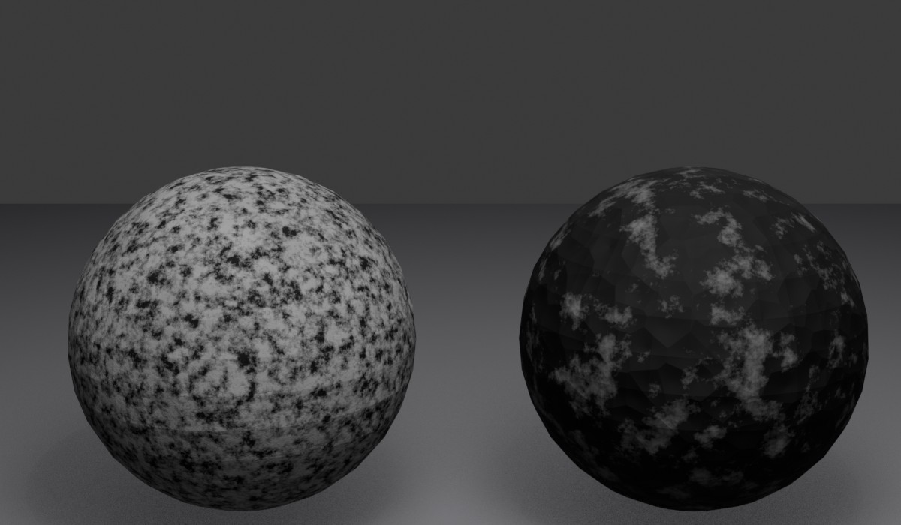

# 06 · 节点编辑器思维

## 把材质当电路图读

材质节点是**有向图**：数据从左流到右，中间被加工。

```
[纹理坐标] → [噪波] → [色阶] → [BSDF] → [输出]
                ↓
             [凹凸] →(法线)──→[BSDF]
```

三条主线，记住就够：

1. **颜色线**：什么颜色 → Base Color
2. **法线线**：凹凸细节 → Normal
3. **数值线**：粗糙度、金属度等标量

## 节点组的层次

一个可维护的材质节点树应该有清晰分区：

```
输入区（左）      计算区（中）        输出区（右）
─────────────   ──────────────      ──────────────
Texture Coord    Noise/Wave          Principled BSDF
Object Info     ColorRamp                ↓
              Bump/Math              Material Output
```

**摆放约定**：输入节点在左（x ≈ -800），输出节点在右（x ≈ +600），中间按数据流从左到右。这样别人接手时能一眼看懂。

## 读一个现成材质的顺序

不要从左往右逐个节点看。按这个顺序：

1. **先看输出**：Material Output 连的是谁？（通常是 Principled BSDF）
2. **看 BSDF 的输入**：Base Color 接什么？Normal 接什么？
3. **往上追**：Base Color 接的是 ColorRamp → Noise → Texture Coordinate
4. **看有没有 Bump**：Normal 输入接的是 Bump 节点

## 搭建节点树的代码模板

写脚本时，用函数封装每个节点，比手写一长串 `nodes.new()` 清晰得多：

```python
import bpy

def new_mat(name):
    m = bpy.data.materials.new(name)
    if m.node_tree is None:
        m.use_nodes = True
    nt = m.node_tree
    nt.nodes.clear()
    out = nt.nodes.new("ShaderNodeOutputMaterial")
    out.location = (600, 0)
    return m, nt, out


def add_bsdf(nt, out, base=(0.5, 0.5, 0.5, 1), rough=0.6, metal=0.0,
             emit=None, emit_str=0.0, spec=0.5, alpha=1.0, loc=(200, 0)):
    b = nt.nodes.new("ShaderNodeBsdfPrincipled")
    b.location = loc
    b.inputs["Base Color"].default_value = base
    b.inputs["Roughness"].default_value = rough
    b.inputs["Metallic"].default_value = metal
    if "Specular IOR Level" in b.inputs:
        b.inputs["Specular IOR Level"].default_value = spec
    if "Alpha" in b.inputs:
        b.inputs["Alpha"].default_value = alpha
    if emit is not None:
        # 自发光插槽名在不同版本可能不同
        key = "Emission Color" if "Emission Color" in b.inputs else "Emission"
        b.inputs[key].default_value = emit
        b.inputs["Emission Strength"].default_value = emit_str
    nt.links.new(b.outputs[0], out.inputs["Surface"])
    return b


def add_texcoord(nt, loc=(-800, 0)):
    t = nt.nodes.new("ShaderNodeTexCoord")
    t.location = loc
    return t


def add_noise(nt, scale=5.0, detail=6.0, rough=0.55, dims="3D", loc=(-550, 0)):
    n = nt.nodes.new("ShaderNodeTexNoise")
    n.location = loc
    n.noise_dimensions = dims
    n.inputs["Scale"].default_value = scale
    n.inputs["Detail"].default_value = detail
    n.inputs["Roughness"].default_value = rough
    return n


def add_ramp(nt, stops, loc=(-300, 0)):
    """stops = [(位置, (r,g,b,a)), ...]"""
    r = nt.nodes.new("ShaderNodeValToRGB")
    r.location = loc
    cr = r.color_ramp
    while len(cr.elements) > 1:
        cr.elements.remove(cr.elements[-1])
    cr.elements[0].position = stops[0][0]
    cr.elements[0].color = stops[0][1]
    for pos, col in stops[1:]:
        e = cr.elements.new(pos)
        e.color = col
    return r


def add_bump(nt, bsdf, height_out, strength=0.25, distance=0.08, loc=(-100, -320)):
    b = nt.nodes.new("ShaderNodeBump")
    b.location = loc
    b.inputs["Strength"].default_value = strength
    b.inputs["Distance"].default_value = distance
    nt.links.new(height_out, b.inputs["Height"])
    nt.links.new(b.outputs["Normal"], bsdf.inputs["Normal"])
    return b


def add_math(nt, operation="MULTIPLY", value2=1.0, loc=(-100, 0)):
    m = nt.nodes.new("ShaderNodeMath")
    m.operation = operation
    m.location = loc
    m.inputs[1].default_value = value2
    return m
```

## 为什么值得写这套模板

对比一下：

```python
# ❌ 裸写
nt.nodes.new("ShaderNodeTexNoise").inputs["Scale"].default_value = 5.0
# 十几个节点写下来，坐标全是 (0,0)，连线全靠猜
```

```python
# ✅ 用模板
noise = add_noise(nt, scale=5.0, loc=(-550, 0))
ramp  = add_ramp(nt, [(0.0, BLACK), (1.0, WHITE)], loc=(-300, 0))
nt.links.new(noise.outputs["Fac"], ramp.inputs["Fac"])
```

模板让**节点位置、连线逻辑、参数**都变得显式，生成的节点树打开就能看懂。

## 颜色空间的坑

Blender 的节点输入颜色是**线性空间**，而你给的十六进制色值是 **sRGB**。直接赋值会偏色。

```python
def _s2l(c):
    """sRGB 单通道 → 线性"""
    return c / 12.92 if c <= 0.04045 else ((c + 0.055) / 1.055) ** 2.4

def hex_to_linear(h, a=1.0):
    h = h.lstrip("#")
    r, g, b = (int(h[i:i+2], 16) / 255.0 for i in (0, 2, 4))
    return (_s2l(r), _s2l(g), _s2l(b), a)
```

**什么时候必须转？**
- 自发光颜色（Emission）—— 转了才对
- 灯光颜色（Light Color）—— 转了才对
- 漫反射颜色（Base Color）—— 影响较小但也建议转

## 完整示例：程序化白墙

```python
def mat_plaster():
    """风化白墙：噪声驱动的斑驳颜色 + 凹凸。"""
    m, nt, out = new_mat("M_Plaster")
    b = add_bsdf(nt, out, base=(0.72, 0.70, 0.66, 1), rough=0.85, loc=(200, 0))

    tc = add_texcoord(nt, loc=(-800, 0))

    # 大尺度斑驳
    n1 = add_noise(nt, scale=2.2, detail=8, rough=0.6, loc=(-560, 100))
    nt.links.new(tc.outputs["Object"], n1.inputs["Vector"])

    ramp1 = add_ramp(nt, [
        (0.35, (0.62, 0.60, 0.56, 1)),
        (0.62, (0.82, 0.80, 0.76, 1)),
    ], loc=(-330, 100))
    nt.links.new(n1.outputs["Fac"], ramp1.inputs["Fac"])

    # 细尺度污渍
    n2 = add_noise(nt, scale=14.0, detail=6, rough=0.7, loc=(-560, -180))
    nt.links.new(tc.outputs["Object"], n2.inputs["Vector"])

    ramp2 = add_ramp(nt, [
        (0.40, (0.0, 0.0, 0.0, 1)),
        (0.58, (0.55, 0.55, 0.55, 1)),
    ], loc=(-330, -180))
    nt.links.new(n2.outputs["Fac"], ramp2.inputs["Fac"])

    # 两层相乘 → 颜色
    mul = add_math(nt, "MULTIPLY", loc=(-80, 0))
    nt.links.new(ramp1.outputs["Color"], mul.inputs[0])
    nt.links.new(ramp2.outputs["Color"], mul.inputs[1])
    nt.links.new(mul.outputs[0], b.inputs["Base Color"])

    # 细噪声驱动凹凸
    add_bump(nt, b, n2.outputs["Fac"], strength=0.22, distance=0.05)
    return m
```

**验证**：把材质赋给一个立方体渲染，能看到墙面有淡淡的斑驳和颗粒感，边缘有细微凹凸。



上图左球是白墙材质（双层噪声相乘产生的斑驳），右球是青砖（Voronoi 砖缝 + 苔痕）。两者都**没有使用任何图片贴图**。

> ⚠️ **踩坑：`new_mat` 清空节点后找不到 BSDF**
>
> 上面模板里的 `new_mat()` 会 `nt.nodes.clear()`，把默认的 Principled BSDF 一起删掉。之后再写：
> ```python
> m, nt, out = new_mat("M_Ground")
> bsdf = next(n for n in nt.nodes if n.type == "BSDF_PRINCIPLED")
> # StopIteration ← 找不到！
> ```
> **正确做法**：建材质时就用 `add_bsdf()` 拿到 BSDF 的引用，后面直接用这个引用，不要再去找。

## 节点组复用

把常用逻辑封装成节点组，在多个材质间复用：

```python
def make_wear_group(name="Wear"):
    """风化遮罩：噪声 → 色阶 → 输出 Fac。"""
    ng = bpy.data.node_groups.new(name, "ShaderNodeTree")
    ng.interface.new_socket("Fac", in_out="OUTPUT", socket_type="NodeSocketFloat")
    out = ng.nodes.new("NodeGroupOutput"); out.location = (300, 0)
    n = ng.nodes.new("ShaderNodeTexNoise"); n.location = (-300, 0)
    n.inputs["Scale"].default_value = 12.0
    ng.links.new(n.outputs["Fac"], out.inputs["Fac"])
    return ng
```

在材质里用 `nt.nodes.new("ShaderNodeGroup")` 并设置 `node.node_group = wear_group`。

## 调试技巧

**看不清效果？** 临时把某个节点的结果直接连到 Material Output 的 Surface —— 这叫"**切线查看**"：

```python
nt.links.new(ramp.outputs["Color"], out.inputs["Surface"])
```

渲染出来就是那个节点的纯输出，排查问题极快。

**加注释**：给节点加标签，方便别人（和未来的你）理解：

```python
node.label = "风化斑驳"
node.name = "Weathering"
```

## 本章要点回顾

- 材质节点是有向图，三条主线：颜色、法线、数值
- 读材质从输出往回追，不要从左往右
- **写脚本一定要有节点模板函数**，否则节点树没法维护
- 颜色要转线性空间（尤其自发光和灯光色）
- 调试靠"切线查看"——把中间节点直连输出
- 常用逻辑封装成节点组复用

## 下一章预告

下一章讲**程序化纹理**——Noise、Voronoi、Wave 这些数学纹理节点，怎么组合出真实的砖墙、木纹、苔痕和水面。

---

[← 目录](README.md) ｜ [← 上一章](05-几何节点入门.md) ｜ [下一章：程序化纹理 →](07-程序化纹理.md)
