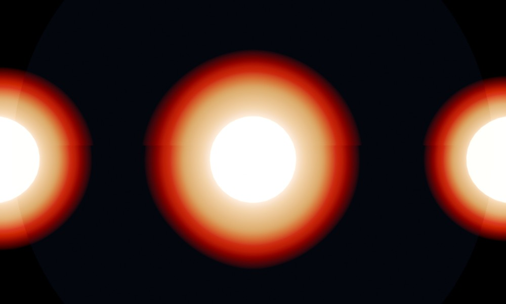

# 09 · 渲染与后期合成

## 引擎选型

| | EEVEE | Cycles |
|---|---|---|
| 算法 | 屏幕空间光栅化 | 路径追踪 |
| 速度 | 快（实时预览） | 慢 |
| 画质 | 够用，光影较平 | 真实，有光弹、软阴影、间接光 |
| 适用 | 动画、快速预览、普通出图 | 产品图、追求真实感 |

**先问自己**：这个项目需要物理正确吗？夜景配光靠美术设计而非物理模拟，EEVEE 完全够用。

```python
sc.render.engine = "BLENDER_EEVEE"     # 5.2 的枚举名
```

> ⚠️ `BLENDER_EEVEE_NEXT` 是旧版本名，5.2 用 `BLENDER_EEVEE`。

## EEVEE 的关键设置

```python
ev = sc.eevee
ev.taa_render_samples = 96          # 渲染采样（越高越干净，线性增长）
ev.taa_samples = 16                 # 视口采样（交互用，低一点）
ev.use_bloom = True                 # 5.2 可能已废弃，见合成器 Glare
ev.shadow_ray_count = 1             # 阴影光线数（性能）
ev.shadow_step_count = 4
ev.shadow_resolution_scale = 0.5    # 阴影贴图精度（性能）
ev.use_gtao = True                  # 环境光遮蔽
ev.gtao_distance = 3.0
```

**性能优化的三板斧**（夜景项目实测有效）：

```python
ev.shadow_ray_count = 1
ev.shadow_step_count = 4
ev.shadow_resolution_scale = 0.5
```

这三项能把渲染时间砍掉近一半，而视觉损失很小。

## Cycles 的采样与降噪

```python
sc.render.engine = "CYCLES"
sc.cycles.samples = 128             # 采样数
sc.cycles.use_denoising = True      # 开启降噪（关键！）
sc.cycles.use_adaptive_sampling = True
sc.cycles.adaptive_threshold = 0.01
sc.cycles.max_bounces = 8
sc.cycles.diffuse_bounces = 4
sc.cycles.glossy_bounces = 4
sc.cycles.transmission_bounces = 8
sc.cycles.caustics_reflective = False
sc.cycles.caustics_refractive = False   # 关掉焦散，省很多时间
```

**降噪是 Cycles 的救命稻草**。采样数提到 128 会有噪点，但开启降噪后，48 采样 + 降噪的效果往往比 256 采样 + 降噪还干净。

## 输出设置

```python
sc.render.resolution_x = 1920
sc.render.resolution_y = 1080
sc.render.resolution_percentage = 100
sc.render.image_settings.file_format = "PNG"
sc.render.image_settings.color_mode = "RGBA"     # RGBA 带透明通道
sc.render.filepath = "/path/to/out_"
sc.render.fps = 24
sc.frame_start = 1
sc.frame_end = 240
```

## 合成器：Blender 5.2 的重大变化

> ⚠️ **这是本教程最重要的一条踩坑记录**。

### 旧版（≤4.x）的方式

```python
# ❌ Blender 5.2 里这些都不存在了
sc.use_nodes = True
tree = sc.node_tree
tree.nodes.new("CompositorNodeMixRGB")
tree.nodes.new("CompositorNodeColorRamp")
```

### 5.2 的方式：节点组

```python
ng = bpy.data.node_groups.new("MyComp", "CompositorNodeTree")
sc.compositing_node_group = ng          # ← 挂在场景上，不是 use_nodes
ng.interface.new_socket("Image", in_out="OUTPUT",
                        socket_type="NodeSocketColor")

rl = ng.nodes.new("CompositorNodeRLayers")
out = ng.nodes.new("NodeGroupOutput")
ng.links.new(rl.outputs["Image"], out.inputs["Image"])
```

**三个关键变化**：

| 项 | 旧版 | 5.2 |
|---|---|---|
| 启用方式 | `sc.use_nodes = True` | `sc.compositing_node_group = ng` |
| 输出节点 | `CompositorNodeComposite` | `NodeGroupOutput` + interface socket |
| 混合/渐变 | `CompositorNodeMixRGB` / `CompositorNodeColorRamp` | `ShaderNodeMix` / `ShaderNodeValToRGB` |

## 完整的夜景后期链路

```python
def setup_compositor(sc):
    """后期链路：辉光 → 饱和度 → 冷暗部/暖高光 → S 曲线 → 暗角 → 镜头畸变。"""
    ng = bpy.data.node_groups.new("CanalComp", "CompositorNodeTree")
    sc.compositing_node_group = ng
    ng.interface.new_socket("Image", in_out="OUTPUT",
                            socket_type="NodeSocketColor")

    rl = ng.nodes.new("CompositorNodeRLayers")
    rl.location = (-1000, 0)

    # ① 辉光：让灯笼和招牌发光溢出
    glare = ng.nodes.new("CompositorNodeGlare")
    glare.location = (-780, 120)
    glare.inputs["Type"].default_value = "Bloom"
    glare.inputs["Quality"].default_value = "High"
    glare.inputs["Threshold"].default_value = 0.9
    glare.inputs["Smoothness"].default_value = 0.5
    glare.inputs["Strength"].default_value = 0.55
    glare.inputs["Size"].default_value = 0.55
    ng.links.new(rl.outputs["Image"], glare.inputs["Image"])

    # ② 饱和度微提
    hs = ng.nodes.new("CompositorNodeHueSat")
    hs.location = (-560, 120)
    hs.inputs["Saturation"].default_value = 1.12
    ng.links.new(glare.outputs["Image"], hs.inputs["Image"])

    # ③ 暗部偏青、亮部偏暖
    cb = ng.nodes.new("CompositorNodeColorBalance")
    cb.location = (-360, 120)
    cb.inputs["Type"].default_value = "Lift/Gamma/Gain"
    lifts = [i for i in cb.inputs if i.name == "Lift"]
    gains = [i for i in cb.inputs if i.name == "Gain"]
    if lifts:
        lifts[0].default_value = (0.002, 0.007, 0.015, 1.0)   # 暗部微偏青
    if gains:
        gains[0].default_value = (1.05, 1.00, 0.94, 1.0)      # 高光偏暖
    ng.links.new(hs.outputs["Image"], cb.inputs["Image"])

    # ④ S 曲线提对比
    cur = ng.nodes.new("CompositorNodeCurveRGB")
    cur.location = (-160, 120)
    c = cur.mapping.curves[3]
    while len(c.points) > 2:
        c.points.remove(c.points[1])
    c.points[0].location = (0.0, 0.0)
    c.points[1].location = (1.0, 1.0)
    c.points.new(0.26, 0.20)
    c.points.new(0.74, 0.80)
    cur.mapping.update()
    ng.links.new(cb.outputs["Image"], cur.inputs["Image"])

    # ⑤ 暗角：椭圆遮罩模糊后作为混合因子
    mix = ng.nodes.new("ShaderNodeMix")
    mix.data_type = "RGBA"
    mix.blend_type = "MIX"
    mix.location = (140, 60)
    mix.inputs[7].default_value = (0.010, 0.016, 0.030, 1.0)   # 暗角颜色
    ng.links.new(cur.outputs["Image"], mix.inputs[6])            # A = 画面

    ell = ng.nodes.new("CompositorNodeEllipseMask")
    ell.location = (-300, -260)
    ell.inputs["Operation"].default_value = "Add"
    ell.inputs["Value"].default_value = 1.0
    ell.inputs["Position"].default_value = (0.5, 0.5)
    ell.inputs["Size"].default_value = (0.95, 0.95)
    blur = ng.nodes.new("CompositorNodeBlur")
    blur.location = (-100, -260)
    blur.inputs["Size"].default_value = 0.22
    blur.inputs["Type"].default_value = "Gaussian"
    ng.links.new(ell.outputs["Mask"], blur.inputs["Image"])

    vig = ng.nodes.new("ShaderNodeMath")
    vig.operation = "MULTIPLY"
    vig.location = (20, -260)
    vig.inputs[1].default_value = 0.22
    ng.links.new(blur.outputs["Image"], vig.inputs[0])
    ng.links.new(vig.outputs[0], mix.inputs[0])

    # ⑥ 镜头畸变
    lens = ng.nodes.new("CompositorNodeLensdist")
    lens.location = (340, 60)
    lens.inputs["Distortion"].default_value = -0.012
    lens.inputs["Dispersion"].default_value = 0.006
    ng.links.new(mix.outputs[2], lens.inputs["Image"])

    gout = ng.nodes.new("NodeGroupOutput")
    gout.location = (560, 60)
    ng.links.new(lens.outputs["Image"], gout.inputs["Image"])
    sc.render.use_compositing = True
```

### 三个必须注意的细节

**① `ShaderNodeMix` 在合成器里的插槽编号**

`ShaderNodeMix` 是通用节点，在合成器里 **A=6、B=7**（不是直觉上的 0 和 1）：

```python
mix.inputs[6]   # A —— 要被混合的原图
mix.inputs[7]   # B —— 混进去的颜色
mix.inputs[0]   # Factor —— 混合比例
```

**接反的话整幅画面会变成纯色。**

**② ColorBalance 的同名 socket 有两个，必须按 type 匹配**

5.2 的 `CompositorNodeColorBalance` 里，`Lift` / `Gamma` / `Gain` 各有**两个**输入插槽：一个 VALUE（float，整体强度）和一个 RGBA（颜色偏移）。

```python
# ❌ 错误：按 name 匹配会拿到第一个 VALUE 型
lifts = [i for i in cb.inputs if i.name == "Lift"]
lifts[0].default_value = (0.002, 0.007, 0.015, 1.0)
# TypeError: NodeSocketFloatFactor.default_value expected a float type, not tuple

# ✅ 正确：加上 type == "RGBA" 过滤
lifts = [i for i in cb.inputs if i.name == "Lift" and i.type == "RGBA"]
gains = [i for i in cb.inputs if i.name == "Gain" and i.type == "RGBA"]
```

**③ Blur 的 Size 是两分量向量**

```python
blur.inputs["Size"].default_value = (0.22, 0.22)   # (X, Y)
```

传三个分量会报 `sequences of dimension 0 should contain 2 items, not 3`。

**④ EllipseMask 的输出不用取反**

实测 `CompositorNodeEllipseMask` 输出的是"**椭圆内为 0、椭圆外为 1**"，直接当暗角因子用即可，**不要再取反**。

**⑤ Glare 的参数是 socket 输入**

旧版是 `glare.glare_type = "BLOOM"`，5.2 改成 socket：

```python
glare.inputs["Type"].default_value = "Bloom"     # Bloom / Fog Glow / Streaks / Ghosts
glare.inputs["Quality"].default_value = "High"
```



上图是上面这条完整链路的真实渲染结果：三个发光球经过 Bloom 溢出、S 曲线提对比、椭圆暗角压暗四角、镜头畸变后输出的画面。

## 输出视频序列

```python
sc.render.image_settings.file_format = "PNG"
sc.render.filepath = "/path/to/frames/f_"
bpy.ops.render.render(animation=True)
```

**为什么输出 PNG 序列而不是直接出视频？**

- 渲染中断可以接着渲，不用从头来
- 序列可以随时重新合成、调色
- 避免编码器差异带来的画质损失

> ⚠️ **本机 Blender 5.2 编译版不含 FFmpeg**，`file_format` 枚举里没有 `FFMPEG`，不能直接出视频。需要成片时用外部工具（ComfyUI / ffmpeg）合成。

## 命令行批量渲染

```bash
# 单帧
blender -b scene.blend -P render.py -- --out ./out --frame 165 --res 2400x1350

# 序列
blender -b scene.blend -P render.py -- --out ./out --mode frames --count 32
```

脚本里：

```python
def render_still(sc, path, frame=1, res=(1920,1080), samples=64):
    sc.frame_set(frame)
    sc.render.resolution_x, sc.render.resolution_y = res
    sc.eevee.taa_render_samples = samples
    sc.render.filepath = path
    bpy.ops.render.render(write_still=True)
```

## 性能预算参考

本机（Intel 核显，15.5GB RAM，无独显）实测：

| 设置 | 耗时/帧 |
|------|--------|
| 1280×720 / 48 采样 | ~10s |
| 1600×900 / 56 采样 | ~25-30s |
| 2400×1350 / 96 采样 | ~40s |

240 帧 × 40s ≈ 2.7 小时。有独显的话会快一个数量级。

## 本章要点回顾

- EEVEE 够用就别用 Cycles；夜景靠美术不靠物理
- **Cycles 必须开降噪**，48 采样 + 降噪常常比 256 采样更干净
- 阴影三项优化能砍掉近一半时间
- **5.2 合成器改成了节点组**（`sc.compositing_node_group`）
- `ShaderNodeMix` 在合成器里 A/B 是 **6/7** 号插槽
- EllipseMask 输出"内 0 外 1"，不要取反
- 输出 PNG 序列而非直接出视频，便于中断续渲

## 下一章预告

下一章进入**模块四 · 动画与运镜**——关键帧的本质、缓动的节奏、六段式推进镜头，以及怎么让水面流动起来。

---

[← 目录](README.md) ｜ [← 上一章](08-灯光系统.md) ｜ [下一章：关键帧与运镜 →](10-关键帧与运镜.md)
