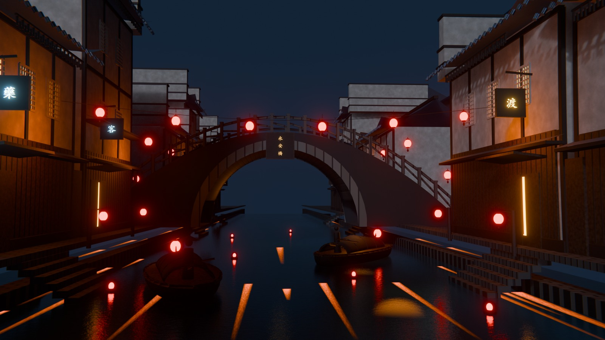
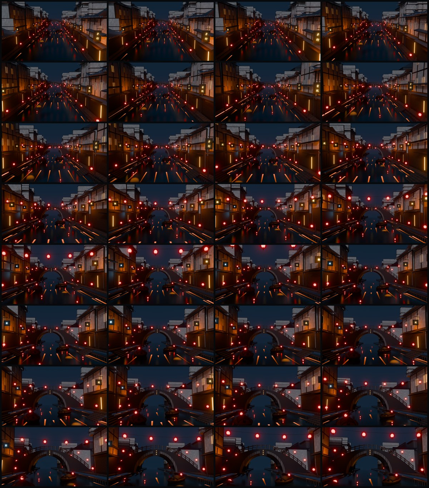

# 13 · 完整实战复刻

最后一章，把前面 12 章组装成一个完整的 240 帧短片项目。

## 项目目标

**江南水巷夜景**：一条南北走向的河道，两岸约 30 栋中式民居，一座石拱桥，跨河灯串、河灯、乌篷船，中文发光招牌。镜头从 7 米高空俯瞰一路推进到 2.25 米逼近拱桥。全长 240 帧（24fps = 10 秒）。

最终产出：一张主图 + 32 张帧序列。



*这就是学完本教程后的目标产物。注意画面里的每一个元素——马头墙、木格窗、瓦当、灯笼、招牌上的楷体字、水面上一道道倒影光柱——全部由脚本生成，没有导入任何模型文件。*

镜头推进过程（全片 240 帧缩略图墙）：



*从上到下依次是时间推进：起始高空俯瞰整条河道，中段下降到水面高度，末段逼近拱桥。这张帧墙就是排查运镜是否平滑的标准方法——把 32 帧拼成一张，一眼就能看出速度曲线有没有突变。*

## 项目结构

```
canal_town/
├── canal_build.py       主脚本（1685 行，一次性生成整个场景）
└── out/
    ├── canal_town.blend
    ├── hero.png
    └── frames/
```

## 完整主脚本

```python
# -*- coding: utf-8 -*-
"""河畔夜话 · Canal Town at Night
从零程序化重建一条江南水巷夜景。
Usage:
  blender -b --factory-startup --python build_scene.py -- --out <dir>
  ... --mode hero --frame 165 --res 2400x1350 --samples 96
  ... --mode frames --count 32 --res 1600x900 --samples 64
"""

import bpy, bmesh, math, os, sys, random, time
from mathutils import Vector, Matrix

# ---------------- CONFIG ----------------
SEED = 20261031
FPS = 24
FRAME_START, FRAME_END = 1, 240

RIVER_HALF = 6.6          # 水面半宽 (m)
QUAY_Z = 1.05             # 河岸地面高度
BANK_X = 6.78             # 建筑临水立面 x
BRIDGE_Y = 16.5           # 石拱桥中心 y
BRIDGE_R = 4.15           # 拱券半径
EXPOSURE = 2.35
FONT_PATH = "C:/Windows/Fonts/STKAITI.TTF"

rng = random.Random(SEED)
GLOW_POINTS = []          # 所有发光体，用于生成水面反射光柱

# ---------------- UTILS ----------------
def log(*a):
    print("[canal]", *a); sys.stdout.flush()

def fcurves_of(idblock):
    """Blender 5.x slotted-action 兼容。"""
    ad = getattr(idblock, "animation_data", None)
    if not ad or not ad.action:
        return []
    act = ad.action
    try:
        if hasattr(act, "fcurves") and len(act.fcurves):
            return list(act.fcurves)
    except Exception:
        pass
    out = []
    for layer in getattr(act, "layers", []):
        for strip in getattr(layer, "strips", []):
            for cb in getattr(strip, "channelbags", []):
                out.extend(getattr(cb, "fcurves", []))
    return out

def _s2l(c):
    return c / 12.92 if c <= 0.04045 else ((c + 0.055) / 1.055) ** 2.4

def hexc(h, a=1.0):
    h = h.lstrip("#")
    r, g, b = (int(h[i:i+2], 16) / 255.0 for i in (0, 2, 4))
    return (_s2l(r), _s2l(g), _s2l(b), a)

def new_collection(name, parent=None):
    coll = bpy.data.collections.new(name)
    (parent or bpy.context.scene.collection).children.link(coll)
    return coll

def link(obj, coll):
    for c in list(obj.users_collection):
        c.objects.unlink(obj)
    coll.objects.link(obj)
    return obj

# ---------------- MATERIALS ----------------
def new_mat(name):
    m = bpy.data.materials.new(name)
    if m.node_tree is None: m.use_nodes = True
    nt = m.node_tree
    nt.nodes.clear()
    out = nt.nodes.new("ShaderNodeOutputMaterial"); out.location = (500, 0)
    return m, nt, out

def _bsdf(nt, out, base=(0.5,0.5,0.5,1), rough=0.6, metal=0.0,
          emit=None, emit_str=0.0, alpha=1.0):
    b = nt.nodes.new("ShaderNodeBsdfPrincipled"); b.location = (150, 0)
    b.inputs["Base Color"].default_value = base
    b.inputs["Roughness"].default_value = rough
    b.inputs["Metallic"].default_value = metal
    if "Alpha" in b.inputs: b.inputs["Alpha"].default_value = alpha
    if emit is not None:
        key = "Emission Color" if "Emission Color" in b.inputs else "Emission"
        b.inputs[key].default_value = emit
        b.inputs["Emission Strength"].default_value = emit_str
    nt.links.new(b.outputs[0], out.inputs["Surface"])
    return b

def _color_ramp(nt, stops, loc=(-200, 0)):
    r = nt.nodes.new("ShaderNodeValToRGB"); r.location = loc
    cr = r.color_ramp
    while len(cr.elements) > 1: cr.elements.remove(cr.elements[-1])
    cr.elements[0].position = stops[0][0]; cr.elements[0].color = stops[0][1]
    for pos, col in stops[1:]:
        e = cr.elements.new(pos); e.color = col
    return r

def _noise(nt, scale=5.0, detail=6.0, rough=0.55, loc=(-500, 0), dims="3D"):
    n = nt.nodes.new("ShaderNodeTexNoise"); n.location = loc
    n.noise_dimensions = dims
    n.inputs["Scale"].default_value = scale
    n.inputs["Detail"].default_value = detail
    n.inputs["Roughness"].default_value = rough
    return n

def _texcoord(nt, loc=(-750, 0)):
    t = nt.nodes.new("ShaderNodeTexCoord"); t.location = loc
    return t

def _bump(nt, bsdf, height_out, strength=0.25, distance=0.08):
    b = nt.nodes.new("ShaderNodeBump"); b.location = (-150, -320)
    b.inputs["Strength"].default_value = strength
    b.inputs["Distance"].default_value = distance
    nt.links.new(height_out, b.inputs["Height"])
    nt.links.new(b.outputs["Normal"], bsdf.inputs["Normal"])
    return b

# ---------------- 几何辅助 ----------------
def add_roof_surface(mb, cx, cy, wy, dx, z_eave, z_ridge, ov=0.85,
                     curl=0.55, mat=0, seg_t=7, seg_y=5):
    """中式起翘屋面（见第 03 章）。"""
    half = dx / 2 + ov
    y0 = cy - wy / 2 - 0.45
    y1 = cy + wy / 2 + 0.45
    for s in (-1, 1):
        rows = []
        for j in range(seg_y + 1):
            y = y0 + (y1 - y0) * j / seg_y
            row = []
            for i in range(seg_t + 1):
                t = i / seg_t
                x = cx + s * half * t
                z = z_ridge - (z_ridge - z_eave) * (1 - (1 - t) ** 1.7)
                ey = max(0.0, abs(y - cy) - (wy / 2 + 0.45 - 1.05)) / 1.05
                z += curl * (ey ** 2.2) * (t ** 2.4)
                row.append((x, y, z))
            rows.append(row)
        mb.grid(rows, mat=mat, smooth=True, flip=(s < 0))

def add_tile_ends(mb, cx, cy, wy, dx, z_eave, ov=0.85, mat=0,
                  spacing=0.34, r=0.058):
    """檐口一排瓦当（圆头滴水）。"""
    half = dx / 2 + ov
    y0 = cy - wy / 2 - 0.45
    y1 = cy + wy / 2 + 0.45
    y = y0 + 0.12
    while y < y1 - 0.05:
        for s in (-1, 1):
            x = cx + s * half
            mb.cyl((x, y, z_eave + 0.03), (x + s * 0.07, y, z_eave - 0.10),
                   r, 8, mat, smooth=True)
        y += spacing

# ---------------- 构建场景 ----------------
def build_scene(outdir):
    sc = bpy.context.scene
    sc.frame_start, sc.frame_end = FRAME_START, FRAME_END
    sc.render.fps = FPS

    C_ARCH = new_collection("建筑")
    C_PROP = new_collection("道具")
    C_LIGHT = new_collection("灯光")
    C_CAM = new_collection("相机")

    M = build_materials()
    build_water(C_ARCH, M)
    build_bridge(C_ARCH, M)
    build_bank_rows(C_ARCH, M)
    build_lanterns(C_PROP, M)
    build_lights(C_LIGHT)
    build_camera(C_CAM, sc)
    setup_render(sc)
    setup_compositor(sc)

    bpy.ops.wm.save_as_mainfile(filepath=os.path.join(outdir, "canal_town.blend"))
    log("SCENE BUILT")
```

> 上面只是**结构骨架**，帮助你看清模块划分。**完整脚本（1685 行，可直接运行）在 [`scripts/canal_build.py`](scripts/canal_build.py)**，包含房屋批量生成、拱桥实体、乌篷船放样、反射光柱、后期合成等全部实现。

## 各章知识点的对应关系

| 章节 | 在项目中的体现 |
|------|--------------|
| 01 bmesh | 屋面/瓦当/挂落的网格生成、拱券实体 |
| 02 修改器 | 栏杆阵列、布尔开窗 |
| 03 程序化曲面 | 中式起翘屋面 |
| 04 曲线与文字 | 灯串垂弧、中文招牌 |
| 05 几何节点 | 散点装饰 |
| 06 节点编辑器 | 材质节点树的组织规范 |
| 07 程序化纹理 | 白墙风化、青砖、苔痕、水面 |
| 08 灯光系统 | 月光 + 天光 + 70 盏灯笼 |
| 09 渲染与后期 | 完整后期链路 |
| 10 关键帧与运镜 | 六段式推进 + 手持抖动 |
| 11 约束与驱动器 | 船摇橹、水面流动 |
| 12 工程化 | 集合组织、命令行渲染、脚本嵌 blend |

## 运行

`canal_build.py` 是**一体化脚本**：每次运行都会从零程序化生成整个场景，再按 `--mode` 决定输出什么。不需要先存 blend 再加载。

```bash
# ① 只生成场景并保存 .blend（不渲染）
blender -b --factory-startup --python canal_build.py -- --out ./out

# ② 出主图（2400×1350，第 165 帧）
blender -b --factory-startup --python canal_build.py -- \
    --out ./out --mode hero --frame 165 --res 2400x1350 --samples 96

# ③ 出 32 帧序列
blender -b --factory-startup --python canal_build.py -- \
    --out ./out --mode frames --count 32 --res 1600x900 --samples 64

# ④ 快速构图预览（3 帧低采样，用来确认运镜）
blender -b --factory-startup --python canal_build.py -- --out ./out --mode preview
```

> 💡 **注意字体路径**：脚本顶部 `FONT_PATH` 指向 `C:/Windows/Fonts/STKAITI.TTF`（楷体）。非 Windows 系统需要改成你自己的中文字体路径，或把招牌文字去掉。

## 性能与产出

本机实测（Intel 核显，无独显）：

| 阶段 | 耗时 |
|------|------|
| 生成场景 | ~20s |
| 单帧 2400×1350 / 96 采样 | ~40s |
| 单帧 1600×900 / 64 采样 | ~25-30s |
| 32 帧序列 | ~15 分钟 |
| 240 帧全序列 | ~2.7 小时 |

**产出**：

- `canal_town.blend`（579 物体 / 337 网格 / 72 文字对象）
- `hero.png` 2400×1350
- 32 张实际动画帧 1600×900
- 帧墙缩略图 `contact_sheet.png`

- 帧墙缩略图（把 32 帧拼成一张对比图）

## 缩略图墙：快速检查整段动画

```python
def make_contact_sheet(frame_paths, out_path, cols=4, thumb_w=480):
    """把多帧拼成一张网格图，快速检查整段动画。"""
    from PIL import Image
    imgs = [Image.open(p).convert("RGB") for p in frame_paths]
    tw = thumb_w
    th = int(tw * imgs[0].height / imgs[0].width)
    rows = (len(imgs) + cols - 1) // cols
    pad = 8
    sheet = Image.new("RGB", (cols*tw + pad*(cols+1),
                              rows*th + pad*(rows+1)), (24, 24, 26))
    for i, im in enumerate(imgs):
        t = im.resize((tw, th), Image.LANCZOS)
        x = pad + (i % cols) * (tw + pad)
        y = pad + (i // cols) * (th + pad)
        sheet.paste(t, (x, y))
    sheet.save(out_path)
```

**这是排查动画问题的利器**——一眼就能看出运镜是否平滑、有没有穿模。

## 成片

▶ [**观看成片视频**](media/canal_flythrough.mp4)（H.264 / 10 秒 / 1248×704，由 Blender 渲染首尾帧后经图生视频补帧生成）

## 学完这一章，你得到了什么

1. **一套完整的程序化三维场景生产流程**：建模 → 材质 → 灯光 → 运镜 → 渲染 → 交付
2. **一份可运行的真实项目**：[`scripts/canal_build.py`](scripts/canal_build.py)，1685 行，重跑即得同一场景
3. **一套可复现的工程方法**：固定种子、集合组织、命令行批量渲染
4. **排错能力**：知道每类问题该查哪一章

## 接下来做什么

| 方向 | 建议 |
|------|------|
| 加角色 | 骨骼 + 权重 + 动作捕捉 |
| 加流体/布料 | 几何节点 + 模拟缓存 |
| 更高画质 | 换 Cycles + HDRI + 光追 |
| 做交互式 | 导出 glTF / FBX |
| 做短片 | 音频 + 时间线剪辑 + 字幕 |

**再往上，就是把这一整套流程用几何节点或 Geometry Nodes 重新实现一遍**——那才是 Blender 程序化能力的完全体。

---

[← 目录](README.md) ｜ [← 上一章](12-场景工程化.md) ｜ [返回总目录 →](../README.md)
