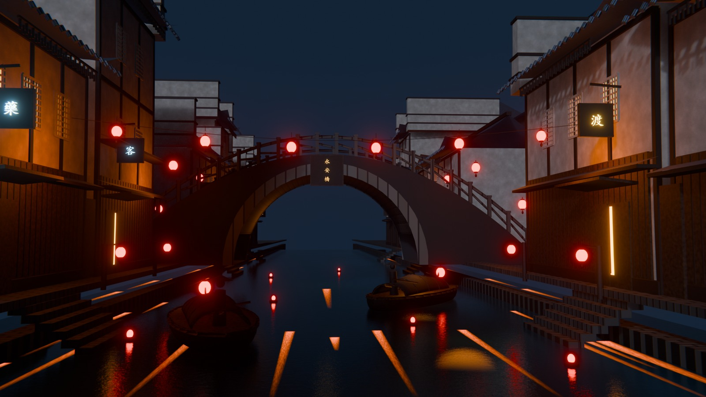
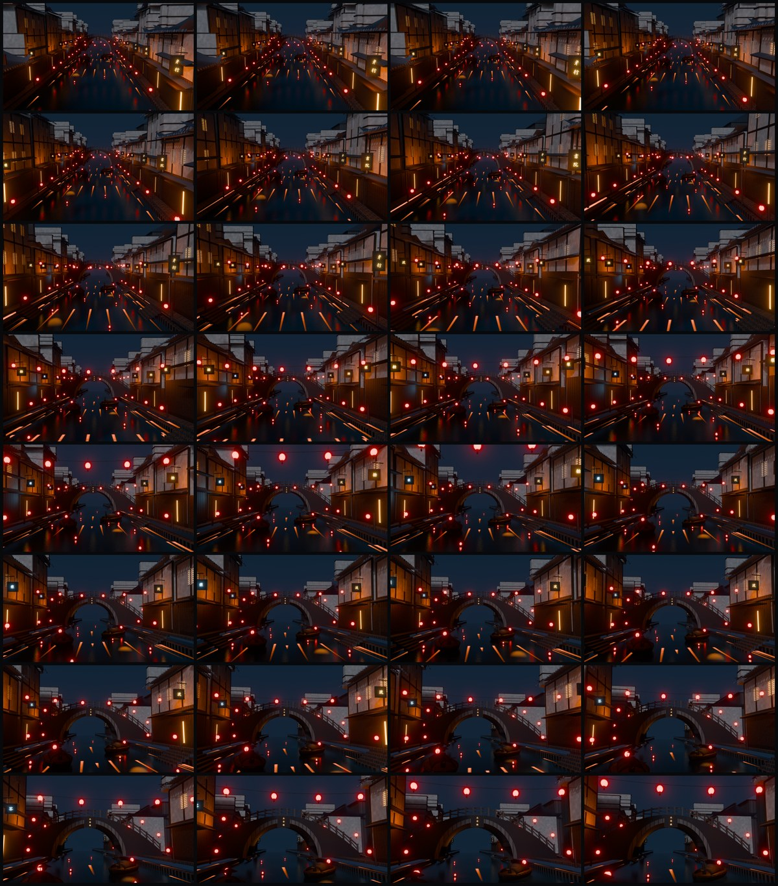

# Blender 进阶教程

> 从"会操作 Blender"到"会用 Blender 造东西"。
> 贯穿案例：**江南水巷夜景** —— 一个 240 帧的程序化短片。

> 学完本教程后 → [**高级版：雕刻 / 物理 / 绑定 / UV 烘焙 / 插件开发**](../pro/README.md)

## 这版教程和入门版的区别

| | 入门版 | 进阶版 |
|---|---|---|
| 目标 | 会用 Blender | 会用 Blender **造东西** |
| 核心问题 | "这个按钮在哪？" | "怎么让 30 栋房子自动生成？" |
| 学习方式 | 鼠标 + 快捷键 | **写脚本驱动 Blender** |
| 贯穿案例 | 一个桌面摆件 | 江南水巷夜景完整短片 |

一句话概括跃迁：

> 入门版教你**手动做一个模型**；进阶版教你**写一个脚本，自动做一千个**。

## 前置要求

- ✅ 已完成 [入门版](../basic/README.md)，掌握界面、物体/编辑模式、G/R/S、修改器基础
- ✅ 会一点 Python（变量、函数、列表、循环即可，不需要面向对象）
- ✅ Blender 4.x（建议 5.2 LTS）

## 五条能力线

| 模块 | 章节 | 你会学到 | 实战产出 |
|------|------|---------|---------|
| 一 · 程序化建模 | 01–06 | `bpy` / bmesh / 修改器 / 曲面 / 曲线 / 几何节点 | 自动生成 30 栋民居 |
| 二 · 程序化材质 | 07–08 | 节点编辑器 / 程序化纹理 / 色彩管理 | 无贴图的白墙、青砖、水面 |
| 三 · 灯光与渲染 | 09–10 | 光源物理 / 引擎选型 / 后期链路 | 夜景光照 + 一条后期链 |
| 四 · 动画与运镜 | 11 | 关键帧 / 缓动 / 约束 / 驱动器 | 六段式推进运镜 |
| 五 · 工程化 | 12–13 | 场景组织 / 批量渲染 / 完整复刻 | 240 帧成片 |

## 阅读方式

每章都是"**概念 → 代码 → 验证 → 扩展**"四段式：

1. **概念**：这一节要解决什么问题（几分钟读完）
2. **代码**：可直接运行的最小示例
3. **验证**：怎么确认做对了（看什么输出）
4. **扩展**：往江南水巷项目里加什么

所有示例都可以这样运行：

```bash
blender -b --factory-startup --python <脚本>.py -- --out ./out
```

## 贯穿案例预览

学完之后你会做出这样一张图——一条完整的江南水巷夜景，**全部由 Python 脚本程序化生成，没有使用任何外部模型或贴图素材**：



*2400×1350，第 165 帧，EEVEE 渲染。石拱桥、两岸 30 栋民居、跨河灯串、红灯笼、乌篷船、水面倒影光柱——都是脚本算出来的。*

它还会动起来。这是全片 240 帧的缩略图墙，能看到镜头从 7 米高空一路推进到桥头：



完整制作链路：河道 → 石拱桥 → 30 栋民居 → 灯笼招牌 → 乌篷船 → 灯光 → 运镜 → 240 帧渲染。

## 目录

### 模块一 · 程序化建模

| 章节 | 内容 |
|------|------|
| [00 · 导读](00-导读.md) | 环境准备、Blender 的 Python 模型、第一个脚本 |
| [01 · bmesh 网格编程](01-bmesh网格编程.md) | 绕过界面直接操作顶点、边、面 |
| [02 · 修改器系统](02-修改器系统.md) | 倒角/阵列/布尔/细分，顺序与正确用法 |
| [03 · 程序化曲面](03-程序化曲面.md) | 用数学函数生成中式起翘屋面 |
| [04 · 曲线与文字](04-曲线与文字.md) | 样条曲线、挤出、字体对象、招牌生成 |
| [05 · 几何节点入门](05-几何节点入门.md) | 可视化编程代替代码，撒一片瓦当 |

### 模块二 · 程序化材质

| 章节 | 内容 |
|------|------|
| [06 · 节点编辑器思维](06-节点编辑器思维.md) | 把材质当电路图读，节点树的结构 |
| [07 · 程序化纹理](07-程序化纹理.md) | Noise / Voronoi / Wave 造真实质感 |

### 模块三 · 灯光与渲染

| 章节 | 内容 |
|------|------|
| [08 · 灯光系统](08-灯光系统.md) | 光源类型、色温、冷暖对比、夜景布光 |
| [09 · 渲染与后期合成](09-渲染与后期合成.md) | 引擎选型、采样降噪、完整后期链路 |

### 模块四 · 动画与运镜

| 章节 | 内容 |
|------|------|
| [10 · 关键帧与运镜](10-关键帧与运镜.md) | 插值、缓动、图编辑器、六段式推进镜头 |
| [11 · 约束与驱动器](11-约束与驱动器.md) | 跟随、路径约束、公式驱动属性 |

### 模块五 · 工程化与完整实战

| 章节 | 内容 |
|------|------|
| [12 · 场景工程化](12-场景工程化.md) | 集合组织、链接数据、命令行批量渲染 |
| [13 · 完整实战复刻](13-完整实战复刻.md) | 把前 12 章组装成一个 240 帧短片 |

---

[← 返回总目录](../README.md) ｜ [先看入门版 →](../basic/README.md)
