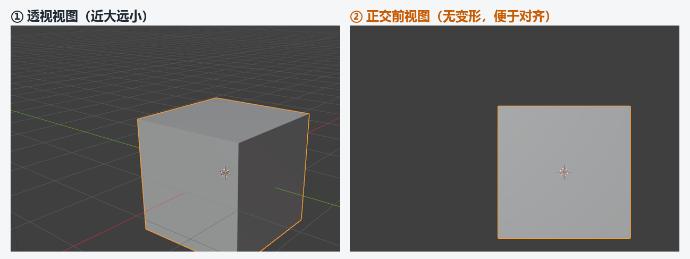

# 04 · 视图导航与基本操作

这一章是整份指南的核心。**只要你把这一章练熟，就已经比 80% 的初学者上手更快了。**

## 视图导航：先学会"看"

三维世界里你必须先能自由地"看"，才能谈操作。视图导航只有三个动作：**旋转、平移、缩放**。

| 操作 | 鼠标操作 | 效果 |
|------|---------|------|
| 旋转视角（Orbit） | 按住**鼠标中键**拖动 | 绕着场景旋转观察 |
| 平移视角（Pan） | **Shift + 鼠标中键**拖动 | 画面左右上下平移 |
| 缩放视角（Zoom） | **滚动滚轮** / Ctrl + 中键拖动 | 拉近拉远 |

**为什么用中键？** 因为鼠标左键要用来"选择"，右键要用来"叫出菜单"，中键专门留给视角操作，分工明确、互不打架。

**练习步骤：**

1. 打开 Blender，默认场景里有一个立方体。
2. 按住鼠标中键拖动，感受视角旋转（画面整体绕中心转）。
3. 按住 Shift + 中键拖动，感受平移。
4. 滚动滚轮，拉近拉远。
5. 反复练 2 分钟，直到三个动作不用思考就能做出来。

## 标准视图：一键切到"正视图/侧视图/俯视图"

有时你不需要随意转动，而是想精准地从正前方看物体。用**小键盘数字键**一键切换：



| 按键 | 切到什么视图 |
|------|------------|
| 小键盘 `1` | 前视图（Front） |
| 小键盘 `3` | 右视图（Right） |
| 小键盘 `7` | 顶视图（Top，俯视） |
| 小键盘 `0` | 摄像机视图（从摄像机角度看） |
| 小键盘 `5` | 在"透视/正交"之间切换 |
| 小键盘 `.`（小数点） | 把视角聚焦到当前选中的物体 |

> ⚠️ **没有小键盘怎么办？** 笔记本用户可没有独立数字小键盘。解决办法：菜单栏 **Edit → Preferences → Input**，勾选 **Emulate Numpad**（模拟小键盘），之后用主键盘上方的数字键即可。或者用鼠标点右上角的坐标轴小圆球。

**正交视图是什么？** 透视视图像人眼，远近有大小变化；正交视图则**没有透视变形**，物体不管远近都一样大，方便精准对齐。做建筑、机械、UI 类建模时常用。

## 选择：一切操作的起点

在 Blender 里，**"先选中，再操作"** 是铁律。

| 选择方式 | 操作 |
|---------|------|
| 单击选择 | 左键点击对象（默认设置下，左键即选择） |
| 取消全部选择 | 在空白处点击，或按 `Alt + A` |
| 加选 / 减选 | 按住 `Shift` 再点，可加选或取消某个对象 |
| 框选 | 按 `B`，然后用左键拖出一个框 |
| 刷选（圈选） | 按 `C`，然后拖动鼠标涂抹 |
| 全选 | `A` |
| 反选 | `Ctrl + I` |

> ⚠️ **常见困惑**：为什么我点不中对象？先确认你在 **Object Mode（物体模式）**，并且没有被其他面板挡住。另外，Blender 2.8 之后默认"左键选择"，如果你看到的是老教程里用右键选择，那是旧版本设置，不影响本指南。

## 移动、旋转、缩放：三大变换

选好对象后，用三个字母键就能操作：**G（移动）、R（旋转）、S（缩放）**。它们的用法完全一致：

```
按字母键 → 移动鼠标 → 左键确认 / 右键或 Esc 取消
```

| 操作 | 快捷键 | 说明 |
|------|-------|------|
| 移动 | `G`（Grab） | 按后移动鼠标即可拖动对象 |
| 旋转 | `R`（Rotate） | 按后移动鼠标旋转对象 |
| 缩放 | `S`（Scale） | 按后移动鼠标放大缩小 |

**精确控制：按轴约束**

随意拖动很难对准方向，先用鼠标转向没用。正确姿势是**先按轴约束，再输入数值**：

| 组合 | 效果 |
|------|------|
| `G` 然后按 `X` | 只在 X 轴方向上移动 |
| `R` 然后按 `Z` | 绕 Z 轴旋转 |
| `S` 然后按 `Y` | 只在 Y 轴方向上缩放 |
| `G` 然后按 `Shift + Z` | 在 XY 平面上移动（排除 Z 轴） |

**输入精确数值：**

1. 按 `G` 开始移动；
2. 按 `X` 约束到 X 轴（此时不要点鼠标）；
3. 直接用键盘输入数字，比如 `2`，表示沿 X 轴移动 2 个单位；
4. 按 **回车** 确认。

同理，`R Z 90 回车` 表示绕 Z 轴旋转 90 度；`S 2 回车` 表示整体放大到 2 倍。

## 重置变换：把对象"归位"

| 快捷键 | 效果 |
|-------|------|
| `Alt + G` | 清除位置（回到原点） |
| `Alt + R` | 清除旋转 |
| `Alt + S` | 清除缩放（恢复原始大小） |

新手最常遇到的问题是"模型被拖得乱七八糟回不去"，这三个快捷键就是救命稻草。

## 小练习：把操作串起来

1. 打开 Blender，点选默认立方体。
2. 按 `S`、输入 `2`、回车，把立方体放大一倍。
3. 按 `G`、按 `X`、输入 `3`、回车，把它沿 X 轴移到右侧。
4. 按 `R`、按 `Z`、输入 `45`、回车，绕 Z 轴旋转 45 度。
5. 按 `Alt + G`、`Alt + R`、`Alt + S`，把它还原。
6. 用鼠标中键旋转视角，确认它确实回到了原点。

练完这一步，你已经掌握了 Blender 最核心的"手上功夫"。

---

下一章：[05 · 常用快捷键速查](05-常用快捷键速查.md)
