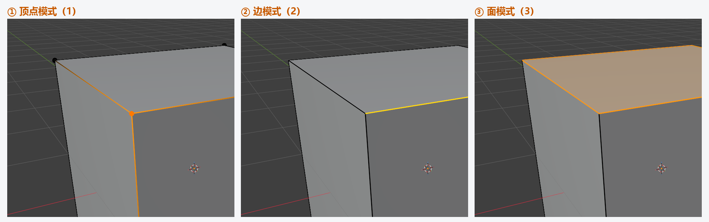
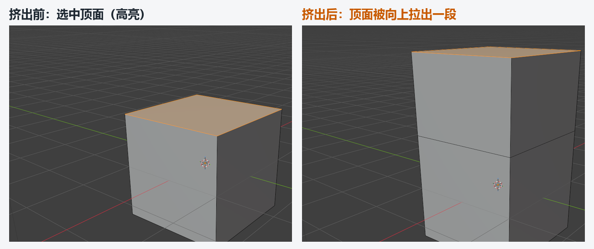
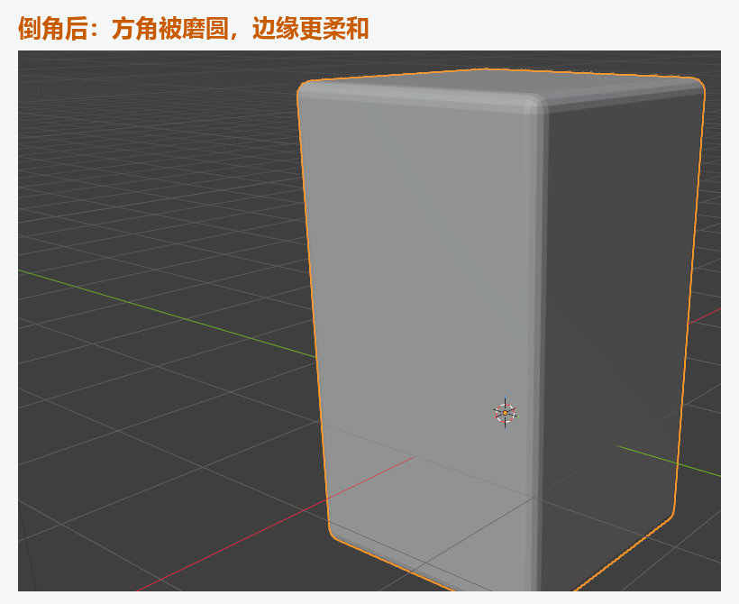

# 06 · 基础建模流程：从零做出你的第一个模型

前面都是"准备功夫"，现在正式开始做东西。我们用一个**完整的小案例**串起建模全流程——目标是做一个**简约的小方块桌面摆件**。

## 认识"物体模式"与"编辑模式"

这是新手最重要的一个分水岭，务必理解：

- **物体模式（Object Mode）**：把对象当成一个"整体"来操作。移动、旋转、缩放、复制都在这里做。
- **编辑模式（Edit Mode）**：进入对象的"内部"，对它的**顶点、边、面**逐个操作，也就是真正"捏形状"的地方。

用 `Tab` 键在两者之间切换。**切错模式是新手最高频的错误之一**。

> ⚠️ 记住：**`Tab` 是切换模式，不是切换对象**。想切换对象就直接左键点别的物体。

## 步骤一：整理初始场景

打开 Blender，默认有个立方体。先用它练手。

1. 左键点选立方体；
2. 在视图区左上角确认显示的是 **Object Mode**；
3. 如果立方体不在视野中央，按小键盘 `.` 聚焦它。

## 步骤二：进入编辑模式，认识点线面

1. 按 `Tab` 进入编辑模式（此时模型变成了"线框"样子）；
2. 左上角会多出三个小图标：**顶点 / 边 / 面**，对应快捷键 `1` `2` `3`；
3. 分别按 `1`、`2`、`3`，观察选择对象的变化：
   - 顶点模式：选中角上的**点**；
   - 边模式：选中两个点之间的**线**；
   - 面模式：选中由边围成的**面**。

**三维建模的本质，就是在"点、线、面"上做加减法。** 理解了这句话，建模就不再神秘。

## 步骤三：用"挤出"把立方体拉高

1. 按 `3` 进入面模式；
2. 左键点击立方体的**顶面**（选中会变亮），按 `7` 切到顶视图方便观察，再按 `1` 切回前视图；
3. 按 `E`（挤出），然后按 `Z` 约束到 Z 轴，往上移动鼠标；
4. 左键确认。

你会发现立方体"长高"了一截。这就是挤出——**从一个面拉出新的一段**，是建模中最常用的操作。

## 步骤四：用"环切"加中线，再用"缩放"收窄

1. 按 `Ctrl + R`，光标移到立方体上会出现一条紫色预览线；
2. 滚动滚轮可以增加切线数量；
3. 单击左键确认切一条，然后拖动调整位置，再单击确认；
4. 按 `2` 进入边模式，选中刚切出的那圈边；
5. 按 `S` + `Y` 输入 `0.6` 回车，把这部分收窄。

这样就做出了一个"腰部收细"的造型。

## 步骤五：用"倒角"做出圆角

直角太生硬，我们给它磨个圆角：

1. 按 `2`（边模式），选中立方体**竖着的四条边**（按住 Shift 加选）；
2. 按 `Ctrl + B`，然后移动鼠标拉出倒角；
3. 滚动滚轮增加细分段数，让圆角更平滑；
4. 左键确认。

## 步骤六：加"细分曲面"让模型更圆润（可选）

如果你想要更柔和的造型，可以用修改器：

1. 按 `Tab` 回到物体模式；
2. 在右侧属性面板点**扳手图标**（Modifier Properties）；
3. 点击 **Add Modifier → Generate → Subdivision Surface（细分曲面）**；
4. 把 **Levels Viewport** 设为 2，观察模型变得圆润。

> ⚠️ **细分会把模型面数成倍增加**，视口级别不要调太高，否则软件会卡。

## 步骤七：常用建模操作总览

| 操作 | 快捷键 | 用途 |
|------|-------|------|
| 挤出 | `E` | 从面/边拉出新几何 |
| 内插面 | `I` | 在面内部再缩出一个面 |
| 环切 | `Ctrl + R` | 给物体加一圈边线 |
| 倒角 | `Ctrl + B` | 把直角磨成圆角 |
| 合并 | `M` | 把多个顶点合并成一个 |
| 连接 | `F` | 用顶点/边生成面 |
| 切割 | `K` | 手动切出一条线 |
| 分离 | `P` | 把选中部分从物体上分离 |
| 平滑着色 | 右键 → Shade Smooth | 让曲面看起来更顺滑 |

## 保存你的作品

- **`Ctrl + S`**：保存（首次会弹出保存对话框，选好位置和文件名）。
- Blender 的工程文件后缀是 **`.blend`**，**它保存的是整个工程（含场景、材质、灯光），不是导出的图片**。导出的图片是另一回事，见下一章。

---

下一章：[07 · 材质入门](07-材质入门.md)
