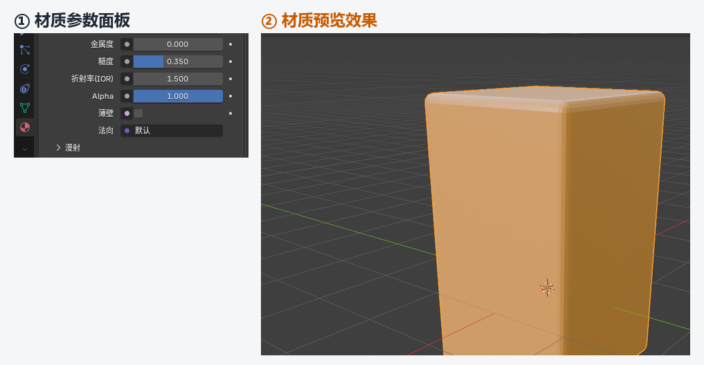

# 07 · 材质入门：给模型"上色"

模型建好了，但它还是灰白色的。我们要给它上材质。

## 什么是材质

**材质（Material）** 定义了物体表面"看起来是什么样"——它是红色的塑料、还是反光的金属、还是透明的玻璃。新手先从最简单的"颜色材质"入手即可。

## 给物体添加一个材质

1. 在物体模式下，左键选中你的模型；
2. 在右侧属性面板点**红色方块图标**（Material Properties）；
3. 点击 **New（新建）** 按钮，Blender 会自动创建一个默认材质；
4. 此时面板里出现一堆参数，别被吓到，重点看这几个：
   - **Base Color（基础颜色）**：点它旁边的色块，就能改颜色；
   - **Metallic（金属度）**：0 = 塑料感，1 = 金属感；
   - **Roughness（粗糙度）**：0 = 镜面光滑，1 = 哑光粗糙；
   - **Emission（自发光）**：让物体自己发光。

**操作步骤：**

1. 点 **Base Color** 的色块 → 在弹出的取色器里选一个你喜欢的颜色 → 关闭取色器；
2. 把 **Roughness** 调到 `0.4` 左右，让表面带点柔和的反射；
3. 观察左侧视图里的模型——如果没变化，把视图显示模式切到"材质预览"或"渲染"模式（按 `Z` 选）。

## 一个小技巧：做出常见质感

| 参数 | 塑料 | 金属 | 磨砂玻璃 |
|------|------|------|---------|
| Base Color | 任意 | 灰/银 | 白/浅色 |
| Metallic | 0 | 1.0 | 0 |
| Roughness | 0.3 ~ 0.5 | 0.1 ~ 0.3 | 0.1 |
| Transmission | 0 | 0 | 0.9 |

> 💡 **先调三个参数（颜色、金属度、粗糙度），就能覆盖 80% 的入门需求**，其余的以后慢慢学。

## 给不同部位上不同颜色

如果想给模型的不同面用不同颜色：

1. 进入编辑模式，选中要单独上色的面；
2. 在材质面板点 **+** 新建第二个材质槽；
3. 点 **Assign（指定）**，把这个材质分配给选中的面；
4. 之后分别调整两个材质的颜色即可。

---

下一章：[08 · 渲染入门](08-渲染入门.md)
