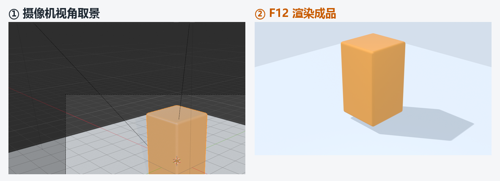
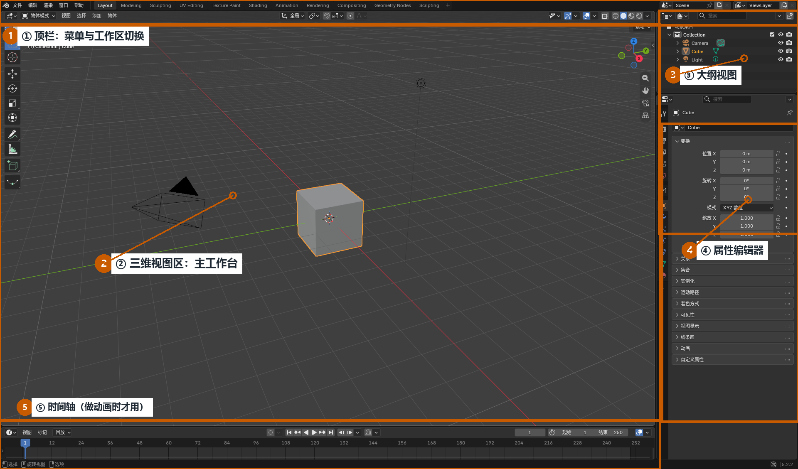

# Blender 零基础入门指南

一份面向零基础新人的 Blender 入门教程，从第一次打开软件，到独立建模、上材质、渲染出第一张作品。

> 学完本指南后 → [**进阶版：用脚本造东西**](../advanced/README.md)
> 想要雕刻 / 物理 / 绑定 / 插件 → [**高级版：专业功能模块**](../pro/README.md)

## 关于本指南

- **适用人群**：从未用过三维软件的新手
- **软件版本**：Blender 4.x（文中快捷键自 2.8 起通用；配图由 Blender 5.2 实机截取）
- **学习时间**：跟着做一遍约 2～3 小时，建议拆成 3～4 次
- **前置要求**：会用鼠标键盘即可，无需三维基础。建议配一个带中键滚轮的鼠标
- **软件获取**：blender.org 免费下载，开源、可商用

## 章节目录

按顺序阅读，每一步的产物都是下一步的基础。

| 序号 | 章节 | 你将学到 |
|------|------|---------|
| 01 | [写在前面](01-写在前面.md) | 学习目标、时间预期、准备工作 |
| 02 | [认识 Blender](02-认识-Blender.md) | Blender 是什么、能做什么、两个核心概念 |
| 03 | [界面布局全解析](03-界面布局全解析.md) | 五大区域、工作区、界面还原 |
| 04 | [视图导航与基本操作](04-视图导航与基本操作.md) | 旋转/平移/缩放视角、选择、G/R/S 变换 |
| 05 | [常用快捷键速查](05-常用快捷键速查.md) | 分类整理的几十个高频快捷键 |
| 06 | [基础建模流程](06-基础建模流程.md) | 从立方体到成品的完整案例 |
| 07 | [材质入门](07-材质入门.md) | 基础色/金属度/粗糙度三参数 |
| 08 | [渲染入门](08-渲染入门.md) | 相机、灯光、引擎、F12 出图 |
| 09 | [常见新手误区](09-常见新手误区.md) | 8 个高频踩坑点与正解 |
| 10 | [学习建议与 FAQ](10-学习建议与FAQ.md) | 学习路线、资料来源、常见问题 |
| 附 | [核心快捷键总表](附录-核心快捷键总表.md) | 一页纸速查表 |

## 配套 Word 文档

需要完整排版（封面 + 目录 + 页码）的版本，直接下载仓库根目录的 **`Blender入门指南.docx`**，可用 Word / WPS 打开。

## 配图说明

本指南所有界面截图均由本地 Blender **真实操作**产生，非示意图或 AI 生成。图中橙色描边与编号用于标注重点区域。

