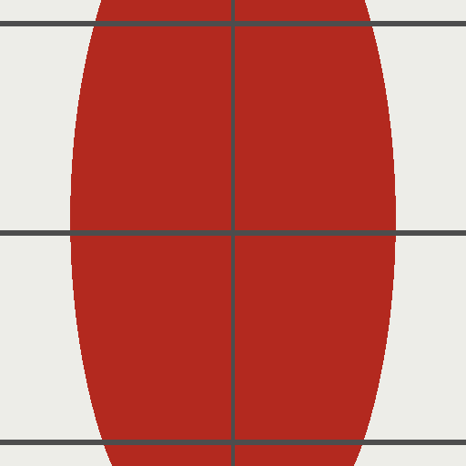

# 01 · 参考分析：先把比例定下来

建模的第一步不是动手捏形状，而是**看懂你要做的东西**。这一步花 10 分钟，能省掉后面 1 小时的返工。

## 目标

确定苹果的比例基准：宽高比、顶部凹坑深度、肩部位置。此时**不建任何模型**。

打开本案例的 [阶段 1 快照](blends/01_reference.blend)，会看到一个图片空物体 `REF_Apple_Proportion`——这就是比例参考板。

*参考图由脚本绘制，含中线与三条水平基准线。*

## 步骤一：导入参考图

自己从零做时：

1. `Add → Image → Reference`，选择一张苹果正面照片。
2. 选中图片空物体，在物体属性里把 `Empty Display Size` 设为 3.0。
3. 按小键盘 `1` 切到前视图，确认图片正对你；`3` 侧视图、`7` 顶视图分别检查。
4. 勾选 `Show In Front`，避免建模时参考图被模型挡住。

> ⚠️ **别用带强透视的照片当唯一参考**。透视会让远处的部分看起来偏小，照着捏出来的比例是错的。正、侧两个正交视图能对上，才算合格。

## 步骤二：量出比例基准

用 Measure 工具在参考图上量：

| 测量项 | 本案例数值 |
|--------|-----------|
| 宽 : 高 | ≈ 1.25 : 1 |
| 顶部凹坑深度 | ≈ 高度的 12% |
| 最大宽度位置 | 高度的 65% 处（偏上） |

把这三个数记在纸上或便签里。后面每一步都以它们为准。

## 步骤三：拆解体块

在参考图上画几条结构线（可用 Grease Pencil，或直接口头描述）：

- 整体是一个**上宽下窄**的球体；
- 顶部有一个**浅凹坑**，花梗从坑底长出；
- 底部有一个**更小的凹坑**；
- 侧面轮廓有 5 道浅浅的纵向棱（苹果的"瓣"）。

这一步叫**体块拆解**：把复杂形状简化成几个基本几何体。苹果 = 球体 + 顶部凹陷 + 五瓣起伏。

## 本阶段自检

- 三个正交视图里轮廓都能对上参考图；
- 比例基准已量化成数字，不是"看着差不多"；
- 体块拆解能用一句话说清。

→ 完成后进入 [02 · 基础形体](02-基础形体.md)。
