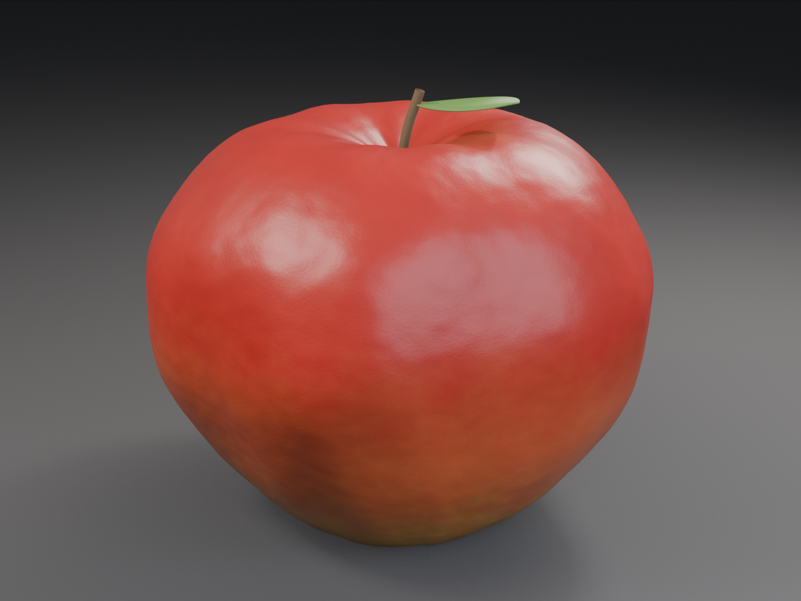

# 实战案例：写实红苹果静物

一个从零到成品的完整案例，把 [入门版](../../basic/README.md) 建模、材质、渲染三块知识串成一条线。全程只用 Blender 内置功能，不依赖 AI 生成工具、不导入外部模型或贴图。



*最终效果：1400×1050，EEVEE 96 采样。*

## 为什么做这个案例

- **形状简单，流程完整**：苹果的轮廓容易上手，但六阶段一个不缺——参考、体块、拓扑、材质、灯光、优化全覆盖。
- **全部程序化**：果皮颜色、毛孔、叶脉都由内置节点生成，参考图也是脚本画的，仓库里不留任何外部素材依赖。
- **可对照拆解**：六个阶段的 `.blend` 快照都在 [blends/](blends/) 目录，做到哪一步卡住，直接打开对应快照看答案。

> 学完本案例 → 继续练硬表面：[复古收音机](../radio/README.md)、[科幻无人机](../drone/README.md)、[六轴机械臂](../arm/README.md)；想提高效率、让脚本替你建模，看 [进阶版](../../advanced/README.md)；想做角色、物理、插件，看 [高级版](../../pro/README.md)。

## 章节目录

按顺序做，每一步的产物都是下一步的起点。

| 序号 | 章节 | 核心操作 | 关键概念 |
|------|------|---------|---------|
| 01 | [参考分析](01-参考分析.md) | 导入比例参考图、正交视图对齐 | 比例基准、剪影优先 |
| 02 | [基础形体](02-基础形体.md) | UV Sphere 变形、比例编辑 | 体块、对称轴、应用缩放 |
| 03 | [拓扑与雕刻](03-拓扑与雕刻.md) | 四边面环线、细分、云纹位移 | 极点、环线走向、非破坏性修改器 |
| 04 | [材质贴图](04-材质贴图.md) | ColorRamp 渐变、Bump 毛孔 | 程序化纹理、Principled 参数 |
| 05 | [灯光渲染](05-灯光渲染.md) | 三点布光、EEVEE 设置 | 面积光、色彩管理、降噪 |
| 06 | [优化导出](06-优化导出.md) | 清理拓扑、减面、glTF 导出 | 非流形、法线、贴图打包 |

## 配套资源

```
cases/apple/
├── README.md              ← 你在这里
├── 01 ~ 06 章节文档
├── images/
│   ├── fig_final.png      最终渲染
│   └── fig_reference.png  程序化生成的比例参考图
├── blends/
│   └── 01 ~ 06 阶段快照（可直接打开对照）
└── scripts/
    └── build_apple.py     一键重建全部快照与渲染图
```

重建命令（在案例目录下执行）：

```
"C:/Program Files/Blender Foundation/Blender 5.2/blender.exe" -b -P scripts/build_apple.py
```

脚本用 Blender 5.2 实测通过，后台渲染约 18 秒出图。

## 相关阅读

- [基础建模流程](../../basic/06-基础建模流程.md) — 本章用到的点线面、挤出、环切
- [材质入门](../../basic/07-材质入门.md) — 本章节点材质的前置知识
- [渲染入门](../../basic/08-渲染入门.md) — 相机、灯光、引擎的基础说明
