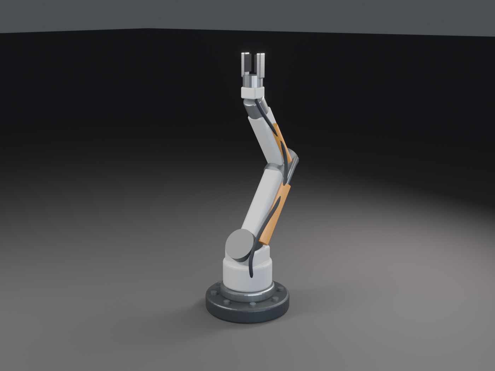

# 实战案例：六轴机械臂

第四个完整案例，也是**层级装配**的代表作。前面练的是"零件摆在哪"，这一章练"零件怎么连起来动"——关节父子链、局部坐标、姿态调整。这是走向角色骨骼绑定的最后一站。



*最终效果：1400×1050，EEVEE 96 采样 + 轻辉光。*

## 为什么做这个案例

- **层级思维**：六个关节串成父子链，转动肩关节，后面所有部件自动跟随。这正是骨骼绑定的核心原理。
- **局部坐标**：每个零件建在关节的局部空间里，不用手算世界坐标。
- **机械细节**：液压杆、线缆束、夹爪指垫、状态灯——这些是让模型"像真的会动"的关键。
- **与无人机互补**：无人机练的是径向重复（并列关系），机械臂练的是链式层级（从属关系）。

> 前置建议：[科幻无人机](../drone/README.md) 的装配经验会让你更容易理解本案例。

## 章节目录

| 序号 | 章节 | 核心操作 | 关键概念 |
|------|------|---------|---------|
| 01 | [参考分析](01-参考分析.md) | 侧视拆解、定关节轴 | 自由度、关节链 |
| 02 | [基础形体](02-基础形体.md) | 底座+臂段占位 | 分段比例 |
| 03 | [拓扑与层级](03-拓扑与层级.md) | 父子空物体、局部坐标、线缆 | FK 正向运动学 |
| 04 | [材质贴图](04-材质贴图.md) | 工业白、安全橙、金属、橡胶 | 工业配色分区 |
| 05 | [灯光渲染](05-灯光渲染.md) | 车间布光、完整取景 | 高光控制、构图 |
| 06 | [优化导出](06-优化导出.md) | 姿态检查、动画、导出 | 层级导出、骨骼预留 |

## 配套资源

```
cases/arm/
├── README.md + 01~06 六章
├── images/    侧视参考图 + 最终渲染
├── blends/    6 个阶段快照（03 起含完整关节层级）
└── scripts/   一键重建脚本
```

重建命令：

```
"C:/Program Files/Blender Foundation/Blender 5.2/blender.exe" -b -P scripts/build_arm.py
```

## 相关阅读

- [科幻四轴无人机](../drone/README.md) — 径向重复装配
- [复古收音机](../radio/README.md) — 硬表面基础
- [高级版](../../pro/README.md) — 骨骼绑定与物理
