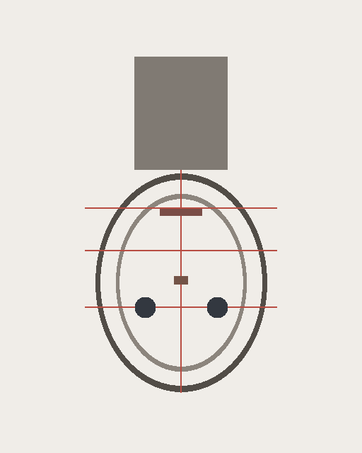

# 01 · 参考分析：三庭五眼定位五官

人物建模的第一件事不是捏脸，而是**定基准线**。

打开 [阶段 1 快照](blends/01_reference.blend)，对照正面参考图。

## 步骤一：三庭五眼

- **三庭**：发际线→眉、眉→鼻底、鼻底→下巴，三段大致等长；
- **五眼**：脸宽约等于五只眼睛的宽度，眼距约等于一只眼。

本案例的量化基准：

| 项目 | 数值 |
|------|------|
| 头部半径 X/Y/Z | 0.76 / 0.80 / 0.88 |
| 头部中心高度 | z = 2.35 |
| 眼睛 X 位置 | ±0.26 |
| 眼睛 Z 位置 | 中心 + 0.11 |
| 嘴 Z 位置 | 中心 − 0.33 |

## 步骤二：正面 vs 侧面

- 正面决定五官的**左右位置与宽度**；
- 侧面决定鼻梁高度、下巴前伸、颅骨后凸。

只看正面会做出"纸片脸"，只看侧面会做出五官错位。两个正交视图交叉验证。

## 步骤三：明确哪些是"体块"

先把头看成椭球，再把五官拆成可独立调整的部件：眼球、鼻梁、鼻头、嘴唇、耳朵、发帽。参数化建模就是把这些部件的位置写成数字。

## 本阶段自检

- 三庭五眼基准线已画出；
- 五官的关键坐标已量化；
- 能从正面和侧面两个方向描述头部体块。

→ 进入 [02 · 基础形体](02-基础形体.md)。
