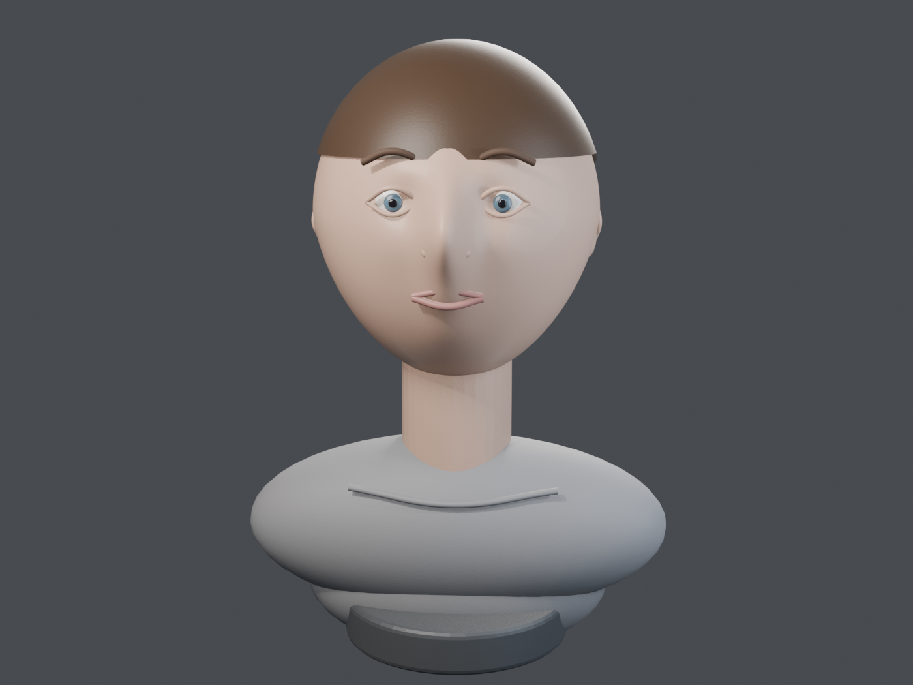

# 实战案例：人物胸像

第五个完整案例，也是能力阶梯的终点。它把有机曲面、层级骨架、面部拓扑三件事合在一起——为角色建模和骨骼蒙皮打基础。



*最终效果：参数化起形 + 五官组件 + 预留骨架，EEVEE 96 采样。*

## 为什么做这个案例

- **参数化塑形**：头部不是手捏出来的，而是用球面坐标 + 高斯函数算出鼻梁、颧骨、下颌、眼窝——改参数就能改脸型。
- **面部拓扑**：整个头部是连续四边面网格，极点只在头顶和下巴，符合动画变形要求。
- **层级骨架预留**：内嵌 Root → Spine → Neck → Head 四节骨骼，为后续蒙皮做准备。
- **五官组件化**：眼球、虹膜、瞳孔、眼睑、眉毛、嘴唇、耳朵各自独立，方便单独调整。

> 前置建议：先做 [机械臂](../arm/README.md)，理解父子层级后再看骨架会更顺。

## 章节目录

| 序号 | 章节 | 核心操作 | 关键概念 |
|------|------|---------|---------|
| 01 | [参考分析](01-参考分析.md) | 正面基准线、五官定位 | 三庭五眼 |
| 02 | [基础形体](02-基础形体.md) | 头/颈/肩体块 | 头部比例 |
| 03 | [拓扑与五官](03-拓扑与五官.md) | 参数化头面、五官组件、骨架 | 四边面、高斯塑形、骨骼层级 |
| 04 | [材质贴图](04-材质贴图.md) | 皮肤、眼球、头发、石座 | 次表面散射 |
| 05 | [灯光渲染](05-灯光渲染.md) | 肖像布光与正面构图 | 柔光、曝光 |
| 06 | [优化导出](06-优化导出.md) | 蒙皮准备、减面、导出 | 顶点组、骨骼导出 |

## 配套资源

```
cases/bust/
├── README.md + 01~06 六章
├── images/    正面参考图 + 最终渲染
├── blends/    6 个阶段快照（03 起含完整头部网格与骨架）
└── scripts/   一键重建脚本
```

重建命令：

```
"C:/Program Files/Blender Foundation/Blender 5.2/blender.exe" -b -P scripts/build_bust.py
```

## 相关阅读

- [六轴机械臂](../arm/README.md) — 链式层级
- [科幻无人机](../drone/README.md) — 径向装配
- [写实红苹果](../apple/README.md) — 有机曲面与四边面环线
- [高级版](../../pro/README.md) — 骨骼绑定、蒙皮权重与表情

## 关于写实度

本案例是**参数化起形**教程：五官结构清晰、拓扑规范、可直接进入雕刻细化。若要达到照片级写实，还需在 Sculpt 模式下手工雕刻皮肤细节、毛孔与真实发丝——那是高级版的内容。
