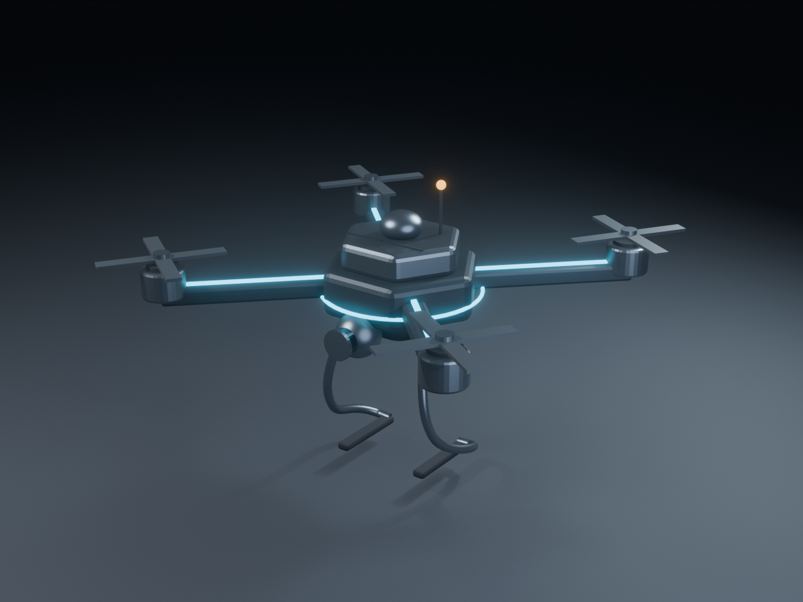

# 实战案例：科幻四轴无人机

第三个完整案例，把前两个案例的能力合并，再补上**复合装配**的新技能：对称布局、径向重复、层级化零件、发光材质与辉光后期。



*最终效果：1400×1050，EEVEE 96 采样 + Glare Bloom。*

## 为什么做这个案例

- **有机 + 硬表面的结合**：机身是倒角多面体，机臂与电机是硬表面，云台和传感器是曲面——三种语言放在一个模型里。
- **装配思维**：不再是一个连续网格，而是几十个零件按层级组合。这是走向角色绑定的前置训练。
- **径向重复**：四臂、四电机、八片桨叶靠角度计算生成，学会用规律代替手工复制。
- **发光与后期**：LED 灯带 + 合成器 Bloom，让模型从"摆件"变成"科幻道具"。

> 前置建议：先做 [写实红苹果](../apple/README.md) 和 [复古收音机](../radio/README.md)。

## 章节目录

| 序号 | 章节 | 核心操作 | 关键概念 |
|------|------|---------|---------|
| 01 | [参考分析](01-参考分析.md) | 顶视图拆解、定轴距 | 对称布局、功能模块 |
| 02 | [基础形体](02-基础形体.md) | 机身+四臂占位 | 径向重复、角度计算 |
| 03 | [拓扑与细节](03-拓扑与细节.md) | 倒角、桨叶、云台、起落架 | 装配层级、曲线管件 |
| 04 | [材质贴图](04-材质贴图.md) | 碳纤维、枪金属、发光材质 | 多材质分区、Emission |
| 05 | [灯光渲染](05-灯光渲染.md) | 夜景布光与 Glare Bloom | 发光后期、色彩对比 |
| 06 | [优化导出](06-优化导出.md) | 零件合并、LOD、导出 | 装配体交付 |

## 配套资源

```
cases/drone/
├── README.md + 01~06 六章
├── images/    顶视参考图 + 最终渲染
├── blends/    6 个阶段快照
└── scripts/   一键重建脚本
```

重建命令：

```
"C:/Program Files/Blender Foundation/Blender 5.2/blender.exe" -b -P scripts/build_drone.py
```

## 相关阅读

- [写实红苹果](../apple/README.md) — 有机曲面
- [复古收音机](../radio/README.md) — 硬表面
- [进阶版](../../advanced/README.md) — 用脚本把重复建模自动化
