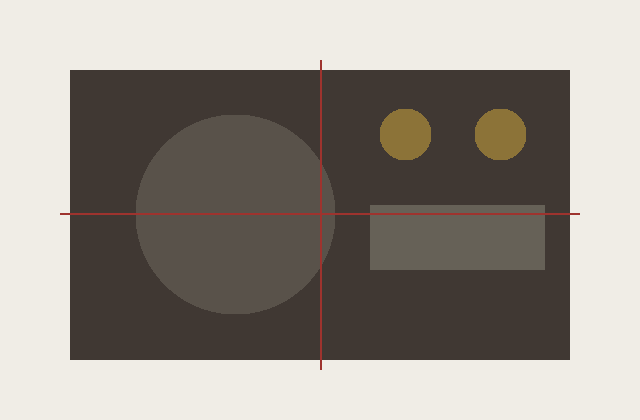

# 01 · 参考分析：把正面拆成模块

硬表面建模的关键是**先分块，再动手**。复古收音机看起来复杂，其实正面只有四个功能区。

打开 [阶段 1 快照](blends/01_reference.blend)，对照程序化生成的比例参考图。

## 步骤一：识别功能模块

从左到右，正面依次是：

1. **喇叭区**：左侧大圆，直径约为机身高度的 45%；
2. **调谐窗**：右上矩形，显示刻度与指针；
3. **旋钮区**：右下两个圆柱旋钮，调台与音量；
4. **铭牌与螺丝**：补充真实感的小细节。

侧面是木质箱体，顶部有提手，底部四个支脚。

## 步骤二：量关键比例

| 项目 | 本案例数值 |
|------|-----------|
| 机身宽 : 高 : 深 | 3.4 : 2.1 : 1.3 |
| 喇叭直径 | 1.2（约机高 57%） |
| 调谐窗宽 : 高 | 1.2 : 0.44 |
| 旋钮直径 | 0.33 |

把这几个数记下来。硬表面的美感来自**比例关系**，不是随意堆细节。

## 步骤三：确定做哪些真实开孔

硬表面和有机模型最大的区别：**孔是真的**。

- 喇叭孔：在前面板上切一个圆孔，布面退到孔后；
- 调谐窗：切一个矩形孔，玻璃与刻度盘退到孔后；
- 旋钮底座：用叠加的圆柱表现，不必切孔。

> ⚠️ 别把所有细节都做成几何体。螺丝、刻度线这类小东西做实体没错，但网布纹理、木纹用材质做更省面数也更真实。

## 本阶段自检

- 能用四个模块描述正面；
- 关键比例已量化；
- 明确哪些孔要做成真孔、哪些细节交给材质。

→ 进入 [02 · 基础形体](02-基础形体.md)。
