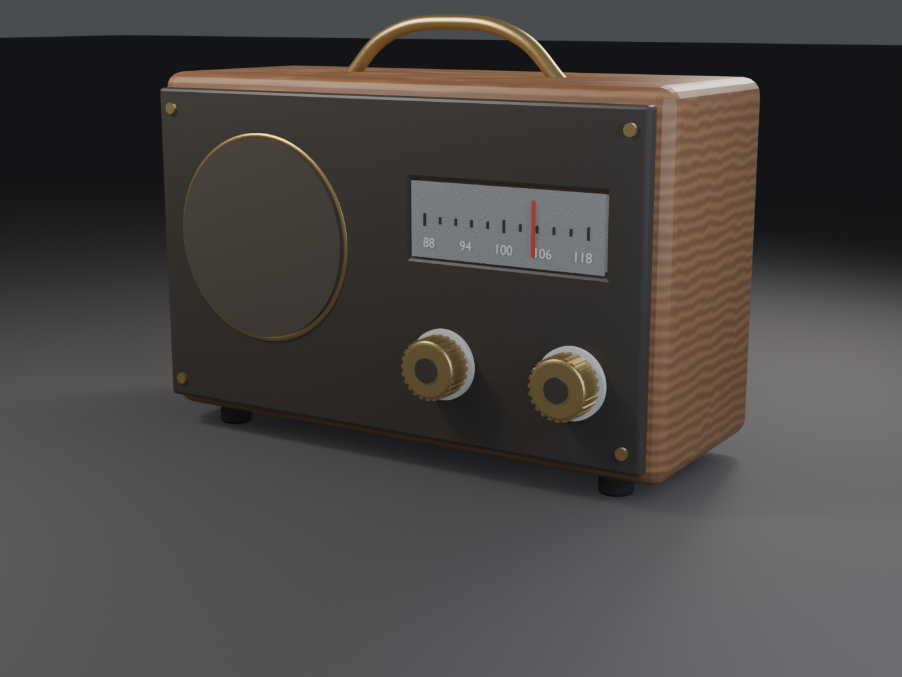

# 实战案例：复古收音机（硬表面写实）

第二个完整案例，把硬表面建模的核心技术集中练一遍：倒角、布尔开孔、加权法线、阵列细节、多材质搭配。全程只用 Blender 内置功能，不依赖 AI 生成工具或外部素材。



*最终效果：1400×1050，EEVEE 96 采样。*

## 为什么做这个案例

苹果练的是有机曲面，这个案例练的是**硬表面**：

- **结构可拆解**：木壳、前面板、喇叭开孔、调谐窗、旋钮、提手、支脚，每一块都能单独推敲。
- **补齐关键技术**：Bevel 控制高光、Boolean 开出真实的孔、Weighted Normal 保住大平面、曲线做提手。
- **材质对比鲜明**：胡桃木、胶木、网布、黄铜、玻璃、橡胶——六种材质放在一起最容易看出参数差异。

> 前置建议：先做 [写实红苹果](../apple/README.md)，掌握建模、材质、灯光的基本流程。

## 章节目录

| 序号 | 章节 | 核心操作 | 关键概念 |
|------|------|---------|---------|
| 01 | [参考分析](01-参考分析.md) | 拆解正面布局、定比例 | 功能模块划分、对称与层次 |
| 02 | [基础形体](02-基础形体.md) | 盒子与圆柱搭大形 | 体块拼装、非等比缩放 |
| 03 | [拓扑与细节](03-拓扑与细节.md) | 倒角、布尔开孔、加权法线 | 硬表面高光、开孔、滚花 |
| 04 | [材质贴图](04-材质贴图.md) | 木纹、网布、黄铜、玻璃 | 程序化纹理、金属与透射 |
| 05 | [灯光渲染](05-灯光渲染.md) | 三点布光与构图 | 面积光、曝光控制 |
| 06 | [优化导出](06-优化导出.md) | 清理、减面、导出 | 材质槽、非流形、LOD |

## 配套资源

```
cases/radio/
├── README.md + 01~06 六章
├── images/    参考图 + 最终渲染
├── blends/    6 个阶段快照（可打开对照）
└── scripts/   一键重建脚本
```

重建命令：

```
"C:/Program Files/Blender Foundation/Blender 5.2/blender.exe" -b -P scripts/build_radio.py
```

脚本在 Blender 5.2 实测通过，后台渲染约 16 秒出图。

## 相关阅读

- [基础建模流程](../../basic/06-基础建模流程.md)
- [材质入门](../../basic/07-材质入门.md)
- [渲染入门](../../basic/08-渲染入门.md)
- [写实红苹果](../apple/README.md) — 有机曲面的对照案例
