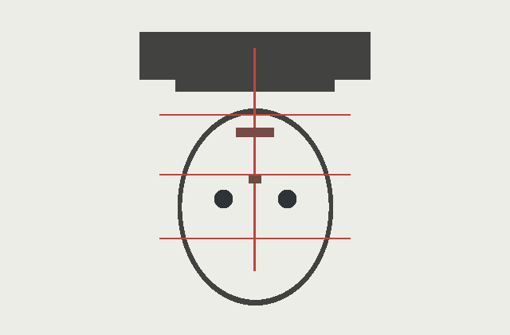

# 01 · 参考分析：先规划骨架与表情

绑定的第一步不是加骨骼，而是想清楚角色怎么动。

## 关节自由度

| 关节 | 自由度 | 作用 |
|------|--------|------|
| Root | 位移 + 旋转 | 整体移动 |
| Spine | 俯仰 | 上身前倾 |
| Neck | 俯仰 + 旋转 | 头部朝向 |
| Head | 俯仰 + 旋转 | 点头转头 |
| Jaw | 俯仰 | 张嘴 |
| Eyelid.L / R | 俯仰 | 眨眼 |

## 表情清单

| 表情 | 实现 |
|------|------|
| 张嘴 | Jaw 骨旋转 |
| 微笑 | 头部 + 嘴唇形态键 |
| 闭眼 | 眼球压扁 + 眼睑形态键 |

骨骼命名用 `.L` / `.R` 后缀，Blender 的镜像与对称权重都依赖它。

## 自检

- 关节清单已列；每个表情有实现机制；命名带左右后缀。

→ [02 · 基础形体](02-基础形体.md)
