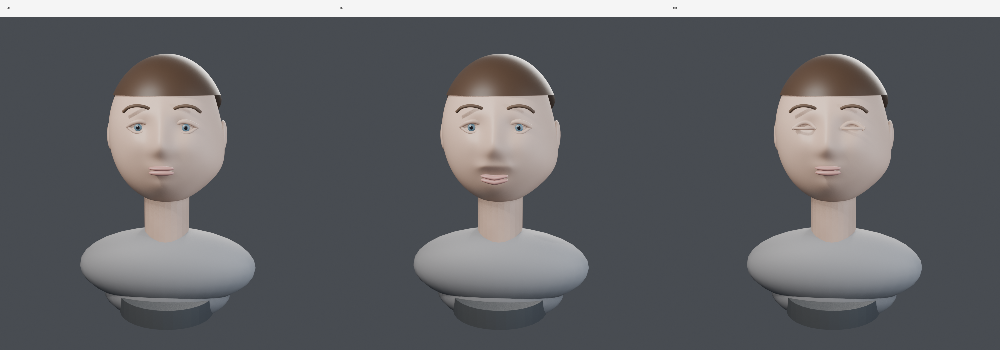

# 实战案例：角色绑定与表情系统

第七个案例，深入角色制作：半身角色的完整骨架、手动蒙皮权重、形态键表情与驱动器控制。高级版 04 章讲了 IK 基础，这里讲**能让角色真的做表情**的完整链路。



*中性 / 微笑 / 闭眼，同一套骨架与控制器驱动。*

## 为什么做这个案例

- **完整骨架**：Root → Spine → Neck → Head，加 Jaw 与双侧 Eyelid 骨。
- **手动蒙皮权重**：按顶点高度和位置计算 Spine/Neck/Head/Jaw 权重，不依赖自动权重。
- **表情系统**：Jaw 骨旋转控制张嘴；形态键控制微笑与闭眼；自定义属性 + 驱动器统一操控。
- **可扩展**：在这套骨架上加手臂、IK 手柄、更多形态键，就能长成完整角色。

> 前置：[六轴机械臂](../arm/README.md) + [高级版 04](../../pro/04-角色绑定与蒙皮.md)。

## 章节目录

| 序号 | 章节 | 核心操作 | 关键概念 |
|------|------|---------|---------|
| 01 | [参考分析](01-参考分析.md) | 骨架规划、表情清单 | 关节与自由度 |
| 02 | [基础形体](02-基础形体.md) | 半身体块、绑定前检查 | 绑定拓扑要求 |
| 03 | [骨架搭建](03-骨架搭建.md) | 骨骼链、姿态模式 | 父子层级、旋转模式 |
| 04 | [蒙皮权重](04-蒙皮权重.md) | 顶点组、Armature 修改器 | 权重分配、形变测试 |
| 05 | [表情系统](05-表情系统.md) | 形态键、驱动器、控制空物体 | 自定义属性、驱动表达式 |
| 06 | [动画与交付](06-动画与交付.md) | 关键帧、烘焙、导出 | 动作、形变限制 |

## 配套资源

```
cases/rigging/
├── README.md + 01~06 六章
├── images/    骨架参考 + 表情对比图
├── blends/    6 个阶段快照
└── scripts/   一键重建脚本
```

重建：`"C:/Program Files/Blender Foundation/Blender 5.2/blender.exe" -b -P scripts/build_rigging.py`

## 相关阅读

- [六轴机械臂](../arm/README.md) — 链式层级
- [人物胸像](../bust/README.md) — 参数化面部
- [数字雕刻](../sculpt/README.md) — 雕刻起形
- [高级版 04](../../pro/04-角色绑定与蒙皮.md) — IK 基础
