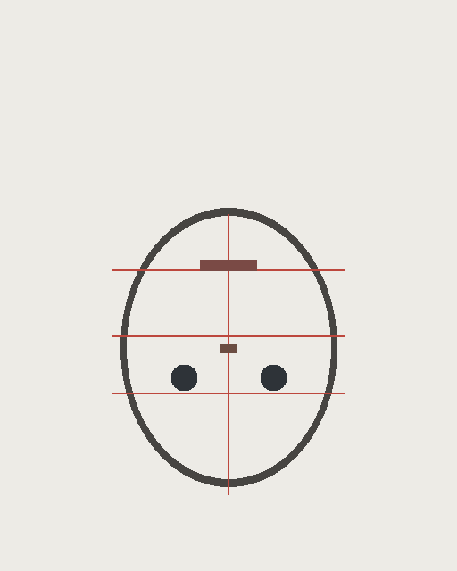

# 01 · 参考分析：雕刻前先观察

雕刻最忌讳"边看边雕"。先定标准，再动手。

打开 [阶段 1 快照](blends/01_reference.blend)，对照参考图。

## 步骤一：三庭五眼复核

- 发际线→眉、眉→鼻底、鼻底→下巴，三段等长；
- 脸宽约五只眼，眼距约一只眼。

## 步骤二：拆解雕刻层次

把要雕的东西按尺度分三级：

| 级别 | 内容 | 雕刻笔刷 |
|------|------|---------|
| 大形 | 颅骨、下颌、颧骨、鼻梁走向 | Grab、Move、Clay |
| 中形 | 眼窝、鼻翼、唇线、肌肉起伏 | Clay Strip、Crease、Inflate |
| 细节 | 皱纹、毛孔、皮肤纹理 | Crease、Pinch、Texture Brush |

> ⚠️ 顺序不能乱。大形没定就雕细节，等于在错的地基上装修。

## 步骤三：找"面"而不是"线"

新手雕刻喜欢沿着轮廓线一根根抠。正确做法是**先雕面**：把额头、颧骨、脸颊当成一块块体积去塑造，线（如唇线、双眼皮）是面的交界，最后自然出现。

## 本阶段自检

- 三庭五眼基准明确；
- 雕刻内容已分三级；
- 能用"面"的语言描述头部结构。

→ 进入 [02 · 基础形体](02-基础形体.md)。
