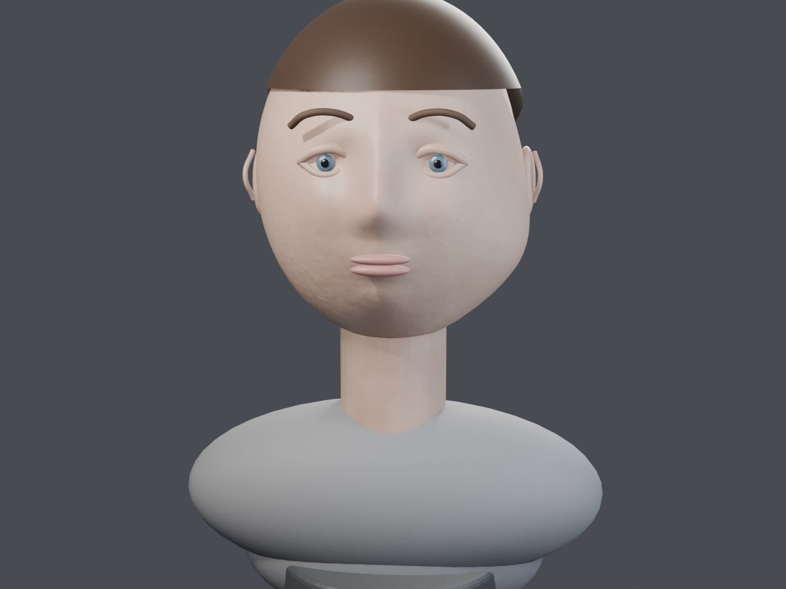

# 实战案例：数字雕刻流程（头部胸像）

第六个案例，也是**手工雕刻工作流的入口**。前面五个案例用参数与脚本生成形体；这一章讲的是：如何准备一个可雕刻的工程，以及每级雕刻该做什么。



*最终效果：雕刻起形工程 + 分层皮肤材质，EEVEE 96 采样。*

## 这个案例的定位（先读）

**脚本不能替代手工雕刻。** 本案例的工程里，头部网格已经就绪、多级细分与位移层已搭好——但真正的笔触（Clay 堆肌肉、Crease 刻结构、Smooth 收表面）需要你在 Sculpt 模式下亲手完成。

脚本渲染的成品是**雕刻起形**：结构准确、拓扑规范、皮肤干净，可以继续往写实推进。照片级写实需要数小时手工雕刻，这不是脚本能给的。

> 前置建议：先做 [人物胸像](../bust/README.md)，理解参数化塑形与骨架后再来雕刻。

## 章节目录

| 序号 | 章节 | 核心操作 | 关键概念 |
|------|------|---------|---------|
| 01 | [参考分析](01-参考分析.md) | 正面基准线、形体拆解 | 雕刻前的观察 |
| 02 | [基础形体](02-基础形体.md) | 体块起形 | 大形优先 |
| 03 | [雕刻分层](03-雕刻分层.md) | 体素重建、多级细分、位移层 | 大形/中形/细节三级 |
| 04 | [皮肤材质](04-皮肤材质.md) | 三层噪声、SSS、毛孔 | 分层皮肤 |
| 05 | [灯光渲染](05-灯光渲染.md) | 肖像布光 | 雕刻成果展示 |
| 06 | [手工雕刻指南](06-手工雕刻指南.md) | 笔刷流程、纹理、烘焙 | 从起形到写实 |

## 配套资源

```
cases/sculpt/
├── README.md + 01~06 六章
├── images/    参考图 + 起形渲染
├── blends/    6 个阶段快照（03 起含完整雕刻层级）
└── scripts/   一键重建脚本
```

重建命令：

```
"C:/Program Files/Blender Foundation/Blender 5.2/blender.exe" -b -P scripts/build_sculpt.py
```

## 相关阅读

- [人物胸像](../bust/README.md) — 参数化起形与骨架
- [高级版](../../pro/README.md) — 骨骼绑定、物理与完整角色流程
