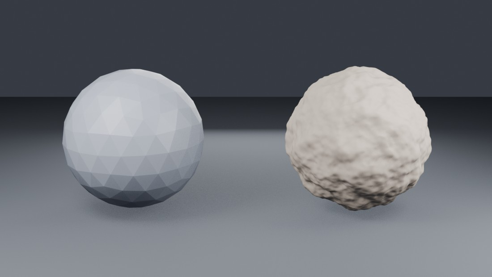

# 01 · 雕刻与重拓扑

> 雕刻不是"把方块捏成形状"，而是两件事：**先造出足够密且均匀的网格，再在上面推动细节**。
> 这一章讲前者（重拓扑）和后者的可编程版本（位移纹理）。



左：162 个顶点的球，表面是一块块平面。
右：同一个球经过体素重拓扑 + 位移后，94,170 个顶点，表面有了真实的起伏。

---

## 它解决什么问题

手工建模适合"规整的、有明确结构的"东西：桌子、房子、机械零件。
但角色、岩石、树皮、布料褶皱这类**有机形态**，用挤出和环切做是在受罪。

雕刻的流程是：

1. 起一个粗略形状（球、立方体、甚至几个球拼起来）
2. **重拓扑**成均匀密度的网格
3. 进入 Sculpt 模式，用笔刷推拉
4. 需要更细的细节时，再加一级细分

第 2 步最关键。如果你直接在一个 162 顶点的球上雕，笔刷一动就是一大块塌陷——因为根本没有足够的顶点可推。

---

## 核心概念

### 体素重拓扑（Remesh → VOXEL）

把模型按空间网格重新"采样"成一块连续实体，再提取表面。结果是：

- 顶点**均匀分布**（不像细分那样在弯曲处堆积）
- 拓扑**干净**（不会有自交、破面）
- 适合做雕刻的起点

代价是顶点数暴涨。`voxel_size` 从 0.05 降到 0.025，顶点数大约翻四倍。

### 多级细分（Multires）

和普通 Subdivision 的区别：Multires 把细分级别**存成可回退的层级**。
你在第 2 级雕的细节，切到第 0 级改大形，再切回来细节还在。
这是雕刻工作流的核心数据结构。

### 动态拓扑（Dyntopo）

笔刷推到哪，就在哪局部加密。好处是不用提前规划密度；坏处是拓扑会变乱，不适合做最终资产。

### 位移（Displace）

用一张纹理（噪声、云、图片）驱动顶点沿法线移动。**它是雕刻的"程序化版本"**——
不需要手推，写几行代码就能批量生成岩石、地形、布纹。

---

## 可运行代码

在 Blender 里 `Shift+F4` 打开 Python 控制台，粘贴运行：

```python
import bpy

# ① 低模球（对照组）
bpy.ops.mesh.primitive_ico_sphere_add(subdivisions=3, radius=1.0, location=(-1.6, 0, 1.05))
raw = bpy.context.active_object
raw.name = "Raw"

# ② 同样的球，做重拓扑 + 位移
bpy.ops.mesh.primitive_ico_sphere_add(subdivisions=3, radius=1.0, location=(1.6, 0, 1.05))
rock = bpy.context.active_object
rock.name = "Rock"

# 体素重拓扑：voxel_size 越小越密
rm = rock.modifiers.new("Remesh", "REMESH")
rm.mode = "VOXEL"
rm.voxel_size = 0.028
rm.use_smooth_shade = True

# 噪声纹理驱动位移
tex = bpy.data.textures.new("RockNoise", "CLOUDS")
tex.noise_scale = 0.32
tex.noise_depth = 3

dsp = rock.modifiers.new("Displace", "DISPLACE")
dsp.texture = tex
dsp.strength = 0.22      # 起伏幅度
dsp.mid_level = 0.5      # 0.5 = 纹理中值不位移

# 收尾：一层次表面，让棱角变柔和
sub = rock.modifiers.new("Sub", "SUBSURF")
sub.levels = 1

# 统计真实顶点数（必须取 evaluated，data 里还是原始网格）
dg = bpy.context.evaluated_depsgraph_get()
print("raw =", len(raw.data.vertices),
      "sculpt =", len(rock.evaluated_get(dg).data.vertices))
```

输出：

```
raw = 162  sculpt = 94170
```

从 162 到 9.4 万，**差了 580 倍**。这就是"为什么必须重拓扑"的直观答案。


---

## 在界面里真正雕刻

代码只能做到"重拓扑 + 程序化位移"。**手雕必须在界面里做**，因为笔刷依赖鼠标压力与视口：

| 操作 | 快捷键 |
|---|---|
| 进入雕刻模式 | `Ctrl+Tab`（物体模式下）或在模式下拉里选 Sculpt |
| 增大/减小笔刷 | `F` / `Shift+F` |
| 常用笔刷 | `X` 切 Draw，`G` 切 Grab，`I` 切 Inflate |
| 反向（凹陷） | 按住 `Ctrl` |
| 开启动态拓扑 | 顶部 Dyntopo 按钮，或 `Ctrl+D` |
| 加细分级别 | Multires 修改器 → Subdivide |

**推荐的工作顺序**：

1. 低模摆出大形（几条边就够）
2. 加 Remesh (Voxel)，voxel_size 取模型尺寸的 1/50 左右
3. 加 Multires，先 Subdivide 两级
4. 用 Grab 拉大形，用 Draw 堆体积，用 Crease 压结构线
5. 细节不够时再 Subdivide 一级，只在需要的地方推

---

## 实测踩坑

### ① `voxel_size` 定得太小会卡死

`voxel_size=0.01` 在一个 2 米大的模型上，会产生上千万顶点。
调参时先用 `0.05` 看形态，确定后再降到 `0.02`。**先在低分辨率下把大形做对，比在高分辨率下修细节高效得多。**

### ② 顶点数要读 `evaluated_get`

```python
len(rock.data.vertices)                    # ❌ 读到的是修改器之前的原始网格
rock.evaluated_get(dg).data.vertices       # ✅ 修改器求值后的结果
```

我刚写这个脚本时就踩了：`rock.data.vertices` 一直是 42，让我以为重拓扑没生效。

### ③ 修改器顺序会改变结果

`Remesh → Displace → Subsurf` 和 `Displace → Remesh → Subsurf` 结果完全不同。
**先重拓扑，再位移**：否则位移会作用在稀疏网格上，产生锯齿状的硬边。

### ④ Remesh 会吞掉材质与 UV

体素重拓扑是重新生成拓扑，**UV 会丢失**，多材质槽的分配也会乱。
所以顺序上：重拓扑要在贴图之前做；如果已经有 UV，用 Multires 而不是 Remesh。

### ⑤ 雕刻模式和编辑模式不是一回事

- 编辑模式（`Tab`）：按点线面精确修改，适合结构
- 雕刻模式（`Ctrl+Tab`）：按笔刷推表面，适合有机形态

新手常犯的错是在编辑模式里试图"用手推"，那只能一个个拖顶点。

---

## 本章要点

- 雕刻的前提是**均匀且足够密的网格**，体素重拓扑是最快的做法
- 位移纹理是雕刻的程序化版本，可批量、可复现
- Multires 保留分级细节，适合反复修改大形
- 顶点数用 `evaluated_get` 读，修改器顺序决定成品质量

下一章把这些高模扔进物理引擎，看它们怎么互相碰撞。
