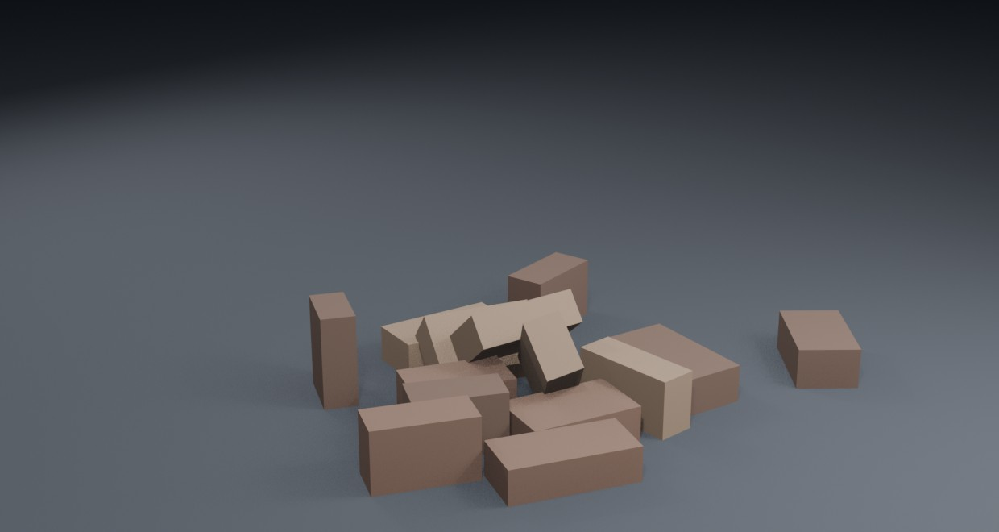
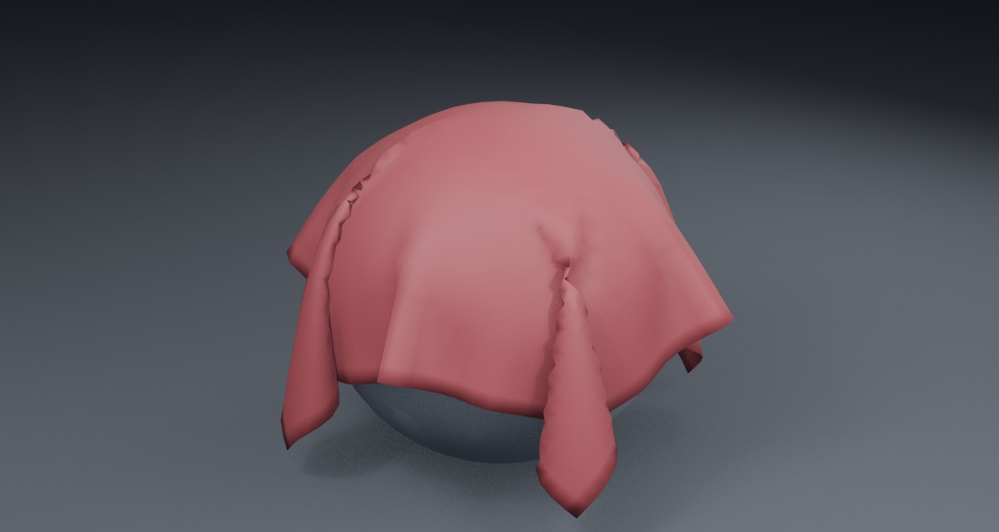

# 02 · 物理模拟：刚体与布料

> Blender 的物理不是"特效插件"，是一套**带缓存的求解器**。
> 它的脾气很一致：给物体贴标签（主动/被动）、给场景一个世界、然后**逐帧推进**。



14 块砖从空中落下，90 帧后自然堆成一堆。没有手动摆位，全是求解器算出来的。



一块 41×41 的布落在球上，靠碰撞与自重形成褶皱。

---

## 它解决什么问题

手工摆位适合"静态构图"，但凡是**结果依赖过程**的画面——坍塌、垂坠、堆叠、散落——
都必须交给求解器。你没法手工摆出 14 块砖的重力堆积，因为那是几十次碰撞的结果。

两类最常用的物理：

| 类型 | 用来做 | 关键参数 |
|---|---|---|
| 刚体 Rigid Body | 砖块、家具、碎块、机械 | 质量、摩擦、弹性 |
| 布料 Cloth | 旗帜、衣服、桌布、窗帘 | 质量、结构刚度、弯曲刚度 |

---

## 核心概念

### 三种角色

- **Active（主动）**：受重力影响会动的东西
- **Passive（被动）**：不动但会挡住别人，比如地面、墙
- **场景世界（Rigidbody World）**：全局求解设置，每帧推进一次

没有"世界"就没有重力，物体不会动。这是新手第一个卡点。

### 子步（Substeps）

物理不是每帧算一次，而是把一帧切成 N 个子步。
`substeps_per_frame = 12` 意味着每帧算 12 次。**穿模大多是因为子步太少或物体太薄。**

### 缓存（Cache）

物理求解的结果会存进缓存。播放时读缓存，不再重算。
当你改了参数却"没反应"，八成是**旧的缓存还在**——需要删除重算。

### 布料的四根"弹簧"

布料本质是一张由弹簧连成的网：

| 参数 | 作用 | 调高的效果 |
|---|---|---|
| `tension_stiffness` | 抗拉伸 | 布不会被拉长 |
| `compression_stiffness` | 抗压缩 | 布不会自己缩成一团 |
| `shear_stiffness` | 抗剪切 | 布不会斜着变形 |
| `bending_stiffness` | 抗弯折 | 布更"硬"，褶皱更大更少 |

前三个一般设成同量级（25 左右），`bending` 决定它是棉布（0.3）还是硬纸（5.0）。

---

## 可运行代码

### 刚体：14 块砖自由落体

```python
import bpy, math, random

random.seed(7)

# ① 地面 = 被动刚体
bpy.ops.mesh.primitive_plane_add(size=40)
ground = bpy.context.active_object
bpy.context.view_layer.objects.active = ground
bpy.ops.rigidbody.object_add(type='PASSIVE')
ground.rigid_body.friction = 0.9
ground.rigid_body.restitution = 0.02      # 弹性（0=不弹）

# ② 14 块砖 = 主动刚体
for i in range(14):
    w, d, h = random.uniform(.42, .62), random.uniform(.26, .36), random.uniform(.16, .24)
    bpy.ops.mesh.primitive_cube_add(
        size=1.0,
        location=(-2.6 + random.uniform(-.18, .18),
                  random.uniform(-.22, .22),
                  0.30 + i * 0.46))
    b = bpy.context.active_object
    b.scale = (w, d, h)
    b.rotation_euler = (0, 0, math.radians(random.uniform(-9, 9)))

    # 关键：把 scale 烘进网格，否则碰撞盒还是 1×1×1
    bpy.ops.object.transform_apply(location=False, rotation=False, scale=True)

    bpy.ops.rigidbody.object_add(type='ACTIVE')
    b.rigid_body.mass = 1.6
    b.rigid_body.friction = 0.85
    b.rigid_body.restitution = 0.03

# ③ 物理世界参数
sc = bpy.context.scene
rbw = sc.rigidbody_world
rbw.substeps_per_frame = 12
rbw.solver_iterations = 20
rbw.point_cache.frame_end = 90

# ④ 必须逐帧推进（后台模式尤其）
for f in range(1, 91):
    sc.frame_set(f)

print("砖块数 =", 14, "当前帧 =", sc.frame_current)
```

### 布料：披在球上

```python
import bpy, bmesh

# ① 被覆盖的球 + 碰撞体
bpy.ops.mesh.primitive_uv_sphere_add(radius=0.85, segments=48, ring_count=24,
                                     location=(2.5, 0, 0.85))
ball = bpy.context.active_object
col = ball.modifiers.new("Collision", "COLLISION")
col.settings.thickness_outer = 0.012      # 碰撞外扩，防止布穿进去

# ② 布料：直接用 bmesh 生成 40×40 网格
me = bpy.data.meshes.new("ClothMesh")
bm = bmesh.new()
bmesh.ops.create_grid(bm, x_segments=40, y_segments=40, size=1.5)
bm.to_mesh(me)
bm.free()

cloth = bpy.data.objects.new("Cloth", me)
bpy.context.scene.collection.objects.link(cloth)
cloth.location = (2.5, 0, 2.15)

# ③ 布料修改器
cm = cloth.modifiers.new("Cloth", "CLOTH")
st = cm.settings
st.quality = 7
st.mass = 0.25
st.tension_stiffness = 25
st.compression_stiffness = 25
st.shear_stiffness = 8
st.bending_stiffness = 0.55
st.air_damping = 2.0
cm.point_cache.frame_end = 90

# 加厚一点，渲染时双面更自然
sol = cloth.modifiers.new("Solid", "SOLIDIFY")
sol.thickness = 0.007

# ④ 逐帧推进
for f in range(1, 91):
    bpy.context.scene.frame_set(f)

print("布料顶点 =", len(me.vertices))
```

输出 `布料顶点 = 1681`（41×41）。

---

## 实测踩坑

### ① 后台模式直接跳末帧 = 没有模拟

```python
scene.frame_set(90)        # ❌ 物体停在初始位置
for f in range(1, 91):     # ✅ 真的会算
    scene.frame_set(f)
```

我第一次跑刚体时，渲染出来 14 块砖整齐地悬在空中——因为它们从未被求解过。
**用脚本做物理，永远写逐帧循环。**

### ② 尺寸走 `scale` 会害死碰撞

`primitive_cube_add(size=1)` 然后 `obj.scale = (2, 0.3, 0.1)`，
**视觉上**是扁砖，但刚体的碰撞形状默认取网格数据，还是 1×1×1 的立方体。
结果砖块悬空、互相弹飞。

正确做法是加一行：

```python
bpy.ops.object.transform_apply(location=False, rotation=False, scale=True)
```

（或者一开始就用 bmesh 生成正确尺寸的网格。）

### ③ 布料挂在 Subsurf 后面会塌

我最初的写法是：一个 4 顶点的平面 + Subdivision Surface 修改器 + Cloth。
结果布料在求解阶段就崩成一团，渲染出来什么都不剩。

原因是修改器顺序是 `Subsurf → Cloth`，求解器拿到的是细分**之后**的网格，
但某些情况下会退化成极薄的一片；反过来 `Cloth → Subsurf` 则是先解算 4 个顶点，同样不对。

**结论：布料的密度由网格本身决定。用 bmesh 直接生成 40×40 网格，别靠细分修改器。**

### ④ 改了参数不生效 = 缓存

物理结果存在 `.blend` 的缓存里。改完 `bending_stiffness` 后播放，还是旧结果。
要么在物理面板点 **Delete Bake**，要么把 `point_cache.frame_end` 改一下触发重算。

用脚本时，每次新建场景（`read_factory_settings`）就等于清空了缓存，不会遇到这个问题。

### ⑤ 布料边缘会有尖刺

纯 cloth 求解的布是"单层无厚度"的，边缘顶点受重力拉扯会翘成锯齿。
两个补救：

- 加 `Solidify`（厚度 0.005～0.01）
- 给网格开 `use_smooth`

### ⑥ 刚体堆不稳

三个原因，按顺序排查：

1. `solver_iterations` 太低（默认 10，复杂堆叠要到 20+）
2. `substeps_per_frame` 太少（薄物体穿模）
3. 初始位置互相**重叠**——求解器会把它们猛推开，看起来像爆炸

第 3 条最隐蔽。我一开始让砖块间距 0.30、砖高 0.24~0.36，于是有砖在起始帧就嵌在一起，
模拟一开始整堆就飞了。把间距拉到 0.46 才正常。

---

## 两个实用套路

**堆叠要"错位"**：所有砖完全对齐会形成不稳定高塔，几帧就倒。
给 x/y 加 ±0.2 的随机偏移，堆出来才像真实工地。

**布料先"落下"再"定格"**：不要从静止状态直接渲染第 1 帧，
让布自由落 60～90 帧，褶皱才自然。渲染时取 `frame_set(90)` 的状态。

---

## 本章要点

- 物理 = 主动/被动标签 + 世界 + 逐帧推进
- 尺寸必须烘进网格，否则碰撞盒是错的
- 布料密度靠网格本身，不靠细分修改器
- 参数改了没反应，先查缓存
- 堆叠不稳，先看初始有没有重叠

下一章换一种"物质"：液体和毛发。它们的求解器完全不同，但同样吃"逐帧推进"这一套。
