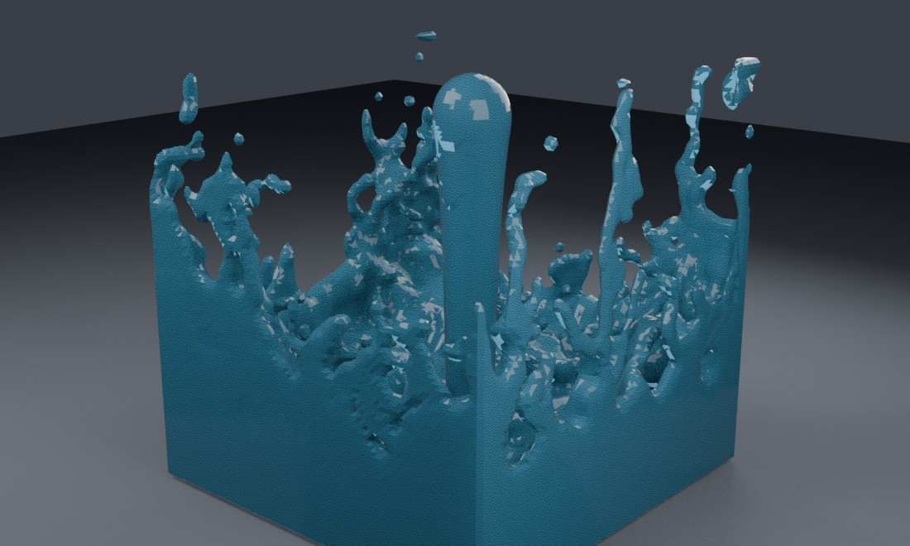
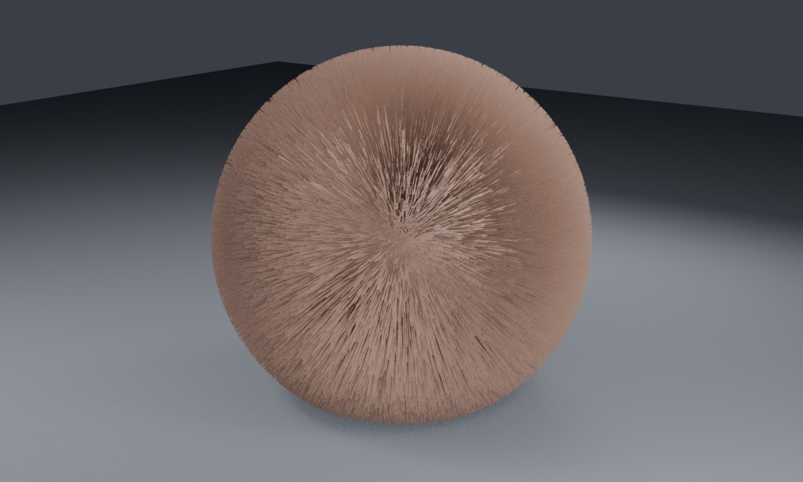

# 03 · 流体与毛发

> 这两个功能的共同点：**它们都"长"出几何**。
> 流体在求解后生成一张全新的网格，毛发的每一根都是程序生成的曲线。
> 所以它们的参数重点不是"摆在哪"，而是"长成什么样"。



70,742 顶点的液体网格，水花从注入点向四周爆开。



6,000 根母发 + 每根 6 个子发，覆盖在球面上。

---

## 它解决什么问题

**流体**：倒水、水花、水面漫过物体、酱汁、熔岩。手工做水花基本不可能——
那些细碎的液滴需要真实的表面张力与惯性。

**毛发**：毛皮、草地、地毯、绒毛、苔藓。一片草地有几万根草，用建模是折磨，
用粒子是几行参数的事。

---

## 核心概念

### 流体域（Domain）

流体必须装在一个**闭合体积**里。这个体积叫域，它同时是：

- 液体的容器边界
- 求解空间（分辨率决定精细度）
- 接收材质的对象

`resolution_max` 是域最长边的体素数。96 意味着 96³ 量级的解算格子。

### MPM 与 FLIP

Blender 的液体求解器从 4.0 起换成了 **MPM（Material Point Method）**。
它把液体离散成粒子，再用粒子重建表面网格。

对使用者的影响：
- 飞溅、黏稠度、表面张力表现更好
- 参数比旧的 FLIP 少，但有些旧参数**直接被删了**（见后面的踩坑）

### 三件套：Domain / Flow / Effector

| 对象 | 流体类型 | 作用 |
|---|---|---|
| 大立方体 | DOMAIN | 容器与解算空间 |
| 小球/管 | FLOW | 水从哪来（INFLOW）或流到哪去（OUTFLOW） |
| 障碍物 | EFFECTOR | 挡住液体，比如杯子、石头 |

### 毛发的两层结构

| 层 | 说明 |
|---|---|
| 母发（parents） | 实际被求解的 `count` 根，决定整体分布 |
| 子发（children） | 在母发之间插值出的更多发丝，只影响渲染 |

所以你会看到 `count=6000` 但渲染出几万根——因为 `rendered_child_count=6`。
**子发几乎不增加计算量，却能大幅提升密度感。**

---

## 可运行代码

### 流体：水从上方注入

```python
import bpy

# ① 域：一个 3 米见方的立方体
bpy.ops.mesh.primitive_cube_add(size=3.0, location=(0, 0, 1.5))
dom = bpy.context.active_object
dom.name = "FluidDomain"
bpy.ops.object.transform_apply(location=False, rotation=False, scale=True)

fm = dom.modifiers.new("Fluid", "FLUID")
fm.fluid_type = "DOMAIN"
ds = fm.domain_settings
ds.domain_type = "LIQUID"
ds.resolution_max = 96          # 解算精度
ds.cache_frame_start = 1
ds.cache_frame_end = 80
ds.use_mesh = True

# ② 液体材质：只能放在第一个材质槽（原因见踩坑 ②）
water = bpy.data.materials.new("M_Water")
water.use_nodes = True
wb = water.node_tree.nodes["Principled BSDF"]
wb.inputs["Base Color"].default_value = (0.07, 0.26, 0.40, 1)
wb.inputs["Roughness"].default_value = 0.08
wb.inputs["Transmission Weight"].default_value = 0.55
wb.inputs["IOR"].default_value = 1.33
dom.data.materials.append(water)

# ③ 注入源
bpy.ops.mesh.primitive_uv_sphere_add(radius=0.24, location=(0.15, 0, 2.65))
flow = bpy.context.active_object
fmod = flow.modifiers.new("Fluid", "FLUID")
fmod.fluid_type = "FLOW"
fs = fmod.flow_settings
fs.flow_type = "LIQUID"
fs.flow_behavior = "INFLOW"
fs.use_inflow = True
fs.use_initial_velocity = True
fs.velocity_coord = (0, 0, -1.5)     # 往下喷

# ④ 逐帧求解
for f in range(1, 81):
    bpy.context.scene.frame_set(f)

dg = bpy.context.evaluated_depsgraph_get()
print("液体顶点 =", len(dom.evaluated_get(dg).data.vertices))
```

输出 `液体顶点 = 70742`。

### 毛发：给球长一层毛

```python
import bpy

bpy.ops.mesh.primitive_uv_sphere_add(radius=1.0, segments=64, ring_count=40,
                                     location=(0, 0, 1.05))
ball = bpy.context.active_object

pm = ball.modifiers.new("Hair", "PARTICLE_SYSTEM")
psys = ball.particle_systems[0]
psys.seed = 11

st = psys.settings
st.type = "HAIR"                 # 不是 EMITTER
st.count = 6000                  # 母发数量
st.hair_length = 0.26
st.emit_from = "FACE"
st.use_even_distribution = True
st.root_radius = 1.0             # 根部粗细（相对值）
st.tip_radius = 0.15             # 梢部粗细

# 子发：只在渲染时存在
st.child_type = "INTERPOLATED"
st.child_percent = 3
st.rendered_child_count = 6
st.child_radius = 0.030
st.child_length_threshold = 0.4
st.clump_factor = 0.15           # 结块程度，越大越像一撮
st.roughness_1 = 0.004           # 发丝凌乱度

# 渲染质量
st.hair_step = 5
st.render_step = 4

print("母发 =", len(psys.particles), "子发 =", st.rendered_child_count)
```

---

## 实测踩坑

这章踩的坑最多——因为 MPM 流体在 4.x → 5.x 之间改了一大片 API，
网上 90% 的教程代码在这台机器上直接 `AttributeError`。

### ① `ds.material` 不存在了

旧写法：

```python
ds.material = water        # ❌ AttributeError: no attribute 'material'
```

5.x 的 `FluidDomainSettings` 已经没有材质属性。**材质只能通过域对象的材质槽传进去。**

### ② 域只认第一个材质槽，而且边界和液体共用

这条是我做了一次对照实验才确认的：

| 槽位安排 | 渲染结果 |
|---|---|
| slot0 = 玻璃，slot1 = 水 | 整块（含液体）都是玻璃色，水是白的 |
| slot0 = 水，slot1 = 玻璃 | 整块变成蓝色水体，连域边界也是蓝的 |

**结论：液体与域边界共享 slot0 的材质，不存在"给域做一层玻璃壳、里面装水"这种写法。**

想做出"玻璃容器里装水"，必须：

1. 域**只负责解算**，材质设成水
2. 另外建一个**独立的立方体**当玻璃容器，包在域外面
3. 容器不要加流体修改器

### ③ `flow_rate` 没了

```python
fs.flow_rate = 1.6         # ❌ AttributeError
fs.use_inflow = True       # ✅ 现在的写法
```

流量改由几何大小 + 速度决定，没有单独的 rate 参数。

### ④ `render_display_size` 没了，`mesh_scale` 是 int

```python
ds.render_display_size = 0.05   # ❌ AttributeError
ds.mesh_scale = 1.0            # ❌ TypeError: expected an int
ds.mesh_scale = 1              # ✅
```

顺带一提，`mesh_generator` 只有两个值：`IMPROVED` 和 `UNION`。

### ⑤ 后台模式下 `len(psys.particles)` 是 0

```python
print(len(psys.particles))     # 输出 0
```

但**渲染出来毛发是有的**。因为粒子在后台模式没被"求值实例化"，
计数为 0 不代表没生成。别被这个数字骗了——直接渲染看结果。

### ⑥ 毛发太长会变"刺球"

`hair_length=0.32` 在半径 1 的球上，视觉上就是一颗海胆。
真实毛发长度通常是**模型半径的 1/5 到 1/8**，配合 `clump_factor` 与 `roughness` 才有毛皮质感。

### ⑦ 液体渲染成不透明的塑料

EEVEE 里 `Transmission Weight` 默认不参与光线追踪，水会是死板的纯色。
两件事一起做才有效：

```python
scene.eevee.use_raytracing = True
```

然后 `Roughness` 压到 0.1 以下，`IOR` 设 1.33（水的折射率）。
即便如此，EEVEE 的水仍不如 Cycles 通透——要写实的水，用 Cycles 渲染这一帧。

---

## 流体参数速查

| 想要的效果 | 调什么 |
|---|---|
| 更细腻的水花 | `resolution_max` 调高（96 → 160） |
| 更黏稠（蜂蜜、酱汁） | 调高 viscosity 相关项 |
| 水花更大更猛 | 提高 `velocity_coord` 的模长 |
| 水面更平 | 降低注入速度，延长求解帧数 |
| 更快出结果 | 分辨率降到 64，先看形态 |

分辨率提升是**立方级**的开销：96 → 160，解算时间大约翻 4 倍。

---

## 本章要点

- 流体 = 域 + 注入源 + 逐帧求解；材质只能走 slot0
- 别给域加玻璃壁，要容器就单独建物体
- 毛发 = 母发定分布 + 子发定密度；长度取模型半径的 1/5
- 后台模式下粒子计数为 0 是正常的
- EEVEE 的透明水需要开 raytracing，写实水用 Cycles

下一章进入另一条完全不同的路：让几何体按骨骼弯曲。
