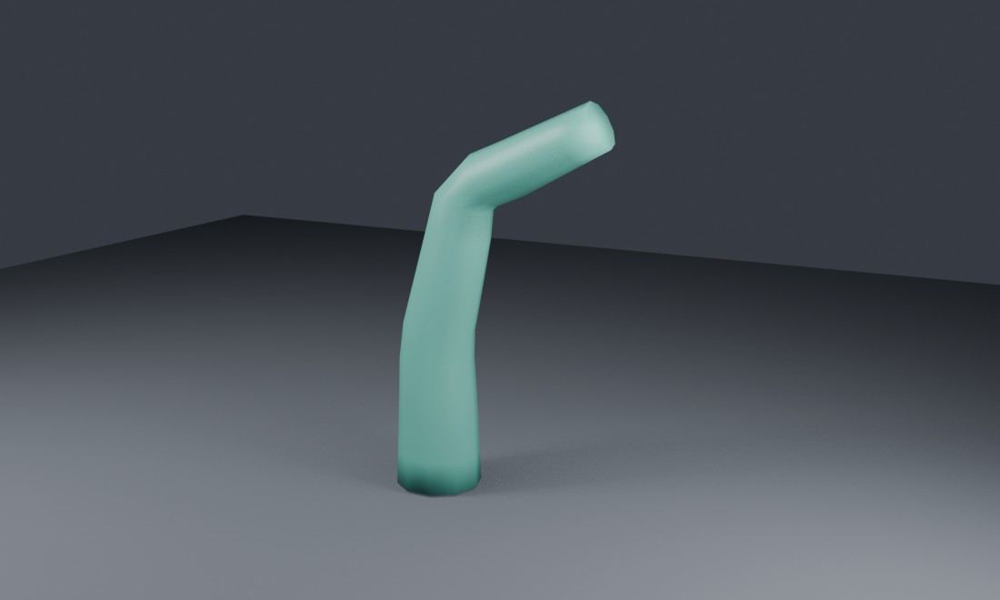

# 04 · 角色绑定与蒙皮

> 绑定的本质是：**把"动"和"形"拆开**。
> 你只操纵几根骨头，几十万个顶点自动跟着走。这叫蒙皮（skinning）。



一条三段骨骼链，末端被 IK 目标拉向斜上方，整根柱体跟着弯曲。
顶点一个都没手动碰过。

---

## 它解决什么问题

凡是"要做动画的有机体"——角色、动物、触手、旗杆、机械臂——
都必须先绑定，再摆姿势。手工移动顶点做动画是不可能的：
一帧几万个顶点，改一次要一天。

绑定之后，动画变成"转骨头"：**3 根骨头 = 3 个旋转值 = 3 条动画曲线。**

---

## 核心概念

### 骨骼（Bone）与骨骼链

一根骨骼有 `head`（起点）和 `tail`（终点）。子骨骼的 `head` 吸附在父骨骼的 `tail` 上，
用 `use_connect = True` 连起来，就形成链。

转动父骨骼，整条链跟着摆——这是 FK（正向运动学）。

### 蒙皮权重（Weight）

每个顶点对每根骨骼有一个 0～1 的权重。顶点移动 = 各骨骼变换的加权和。

- 权重全给一根骨骼 → 硬邦邦的机械感
- 权重平滑过渡 → 弯曲处自然

### 自动权重（Automatic Weights）

Blender 用"骨骼热扩散"（Bone Heat）算法分配权重：
从骨骼表面发散热量，离哪根骨头近，权重就给谁。

**它要求网格是"包住骨骼"的闭合体。** 骨骼露在网格外面、网格有破面、或者网格太薄，
都会导致 `Bone Heat Weighting: failed to find solution`。

### IK（反向运动学）

FK 是"转骨头看末端到哪"，IK 是"把末端拉到某处，自动算中间怎么弯"。

抓东西、脚踩地、手扶墙，都用 IK——因为你关心的是**末端位置**，不是中间角度。

---

## 可运行代码

```python
import bpy, bmesh, math
from mathutils import Vector

# ① 建一根 14 段、10 边的柱体（必须有纵向分段，否则弯不了）
me = bpy.data.meshes.new("Tentacle")
bm = bmesh.new()
rings, seg = 14, 10
ring_verts = []
for i in range(rings + 1):
    z = 3.6 * i / rings
    r = 0.34 * (1 - 0.45 * i / rings)        # 上细下粗
    row = []
    for s in range(seg):
        a = 2 * math.pi * s / seg
        row.append(bm.verts.new((math.cos(a) * r, math.sin(a) * r, z)))
    ring_verts.append(row)

for i in range(rings):
    for s in range(seg):
        s2 = (s + 1) % seg
        bm.faces.new((ring_verts[i][s], ring_verts[i][s2],
                      ring_verts[i + 1][s2], ring_verts[i + 1][s]))
bm.faces.new(list(reversed(ring_verts[0])))     # 封底
bm.faces.new(ring_verts[-1])                    # 封顶
bm.normal_update()
bm.to_mesh(me)
bm.free()

ob = bpy.data.objects.new("Tentacle", me)
bpy.context.scene.collection.objects.link(ob)

# ② 建 3 根骨骼的链
ad = bpy.data.armatures.new("RigData")
rig = bpy.data.objects.new("Rig", ad)
bpy.context.scene.collection.objects.link(rig)

bpy.context.view_layer.objects.active = rig
bpy.ops.object.mode_set(mode='EDIT')
prev = None
for i in range(3):
    b = ad.edit_bones.new("B%d" % i)
    b.head = (0, 0, i * 1.2)
    b.tail = (0, 0, (i + 1) * 1.2)
    if prev:
        b.parent = prev
        b.use_connect = True        # 子骨骼吸附到父骨骼末端
    prev = b
bpy.ops.object.mode_set(mode='OBJECT')

# ③ 自动权重：先选中网格，再选中骨骼（骨骼必须是 active）
bpy.ops.object.select_all(action='DESELECT')
ob.select_set(True)
rig.select_set(True)
bpy.context.view_layer.objects.active = rig
bpy.ops.object.parent_set(type='ARMATURE_AUTO')

print("顶点组 =", len(ob.vertex_groups), "骨骼 =", len(ad.bones))

# ④ IK：把末端骨骼拉向一个空物体
tgt = bpy.data.objects.new("IKTarget", None)
bpy.context.scene.collection.objects.link(tgt)
tgt.location = (1.35, 0, 2.9)

bpy.context.view_layer.objects.active = rig
bpy.ops.object.mode_set(mode='POSE')
pb = rig.pose.bones["B2"]
ik = pb.constraints.new("IK")
ik.target = tgt
ik.chain_count = 2          # 从末端往上两节参与求解
bpy.ops.object.mode_set(mode='OBJECT')

bpy.context.view_layer.update()
print("IK 已挂到", pb.name, "目标 =", ik.target.name)
```

输出 `顶点组 = 3 骨骼 = 3`，场景里那根柱子已经弯向 target 的位置。

---

## 自动权重失败了怎么办

如果看到：

```
Bone Heat Weighting: failed to find solution for one or more bones
```

三个补救办法，按推荐度排：

### 方案 A：手动顶点组（最可控）

```python
ob.parent = rig
md = ob.modifiers.new("Armature", "ARMATURE")
md.object = rig

for i in range(3):
    vg = ob.vertex_groups.new(name="B%d" % i)
    idx = [v.index for v in ob.data.vertices
           if i * 1.2 <= v.co.z <= (i + 1) * 1.2]
    if idx:
        vg.add(idx, 1.0, 'REPLACE')
```

缺点是分段处会有硬折痕——因为权重是 0/1 切换。想平滑，让交界处的顶点同时属于两组，
各给 0.5。

### 方案 B：修网格

- 检查有没有非流形（破面、孤立顶点）
- 确保骨骼**完全在网格内部**，不要戳出去
- 骨骼不要重叠在同一位置

### 方案 C：Envelope 权重

用 `type='ARMATURE_ENVELOPE'`，按骨骼的"包络半径"分配，不依赖网格质量。
粗糙但绝不失败，适合快速预览。

---

## 实测踩坑

### ① 分段不足 = 弯不动

只给柱体 2 个环，就算绑定了也只会"整体旋转"，不会弯。
**要弯曲，纵向至少每隔 0.2～0.3 米一个环。**

我的触手是 3.6 米长、14 段（每段约 0.26 米），弯曲才够顺滑。

### ② 自动权重必须"先物体、后骨骼、骨骼为活动"

```python
bpy.context.view_layer.objects.active = rig     # 关键
bpy.ops.object.parent_set(type='ARMATURE_AUTO')
```

如果 active 是网格而不是骨骼，会把骨骼当成子物体挂到网格下，权重完全不会生成。

### ③ 姿态旋转默认是四元数

```python
pb.rotation_euler = (0.5, 0, 0)     # ❌ 不生效
pb.rotation_mode = 'XYZ'            # ✅ 先切模式
pb.rotation_euler = (0.5, 0, 0)
```

Pose bone 默认 `rotation_mode = 'QUATERNION'`，写 `rotation_euler` 不会报错但也没效果。
这是静默失败，最难查。

### ④ IK 不会立即更新

设完约束后，`ob.data.vertices` 还是直的——因为形变在依赖图里。
必须 `bpy.context.view_layer.update()` 或 `frame_set()` 一次，再读结果。

### ⑤ `chain_count` 决定"弯几节"

- `chain_count = 2`：末端 + 上一节参与，前两节保持直立
- `chain_count = 0`：整条链都参与

想要"底部固定、上部弯曲"，就用 2。

### ⑥ 骨骼方向影响形变

骨骼的 `head → tail` 方向就是它的"Y 轴"。如果骨骼反着建（从下往上 vs 从上往下），
姿态旋转的正负方向会反过来，调动画时很别扭。

**统一从下往上建**，和大多数教程一致。

---

## 权重修整的三个快捷键

绑定完总要手动修权重，这三个够用：

| 操作 | 方式 |
|---|---|
| 查看某根骨骼的影响范围 | 选中骨骼 → 权重绘制模式，直接看到蓝到红的渐变 |
| 平滑权重 | Weight 菜单 → Smooth（`Shift+K`） |
| 把权重从一个组转到另一个 | Weight 菜单 → Transfer Weights |

权重绘制模式下，`F` 调笔刷大小，`Shift` 切到平滑笔刷。

---

## 本章要点

- 绑定 = 骨骼 + 权重；权重决定弯曲是否自然
- 自动权重要求网格闭合且包住骨骼
- IK 关心末端位置，FK 关心中间角度
- 姿态旋转要先设 `rotation_mode`，否则静默失败
- 纵向分段足够，才弯得动

下一章处理绑定的上游问题：模型的表面怎么贴图。
