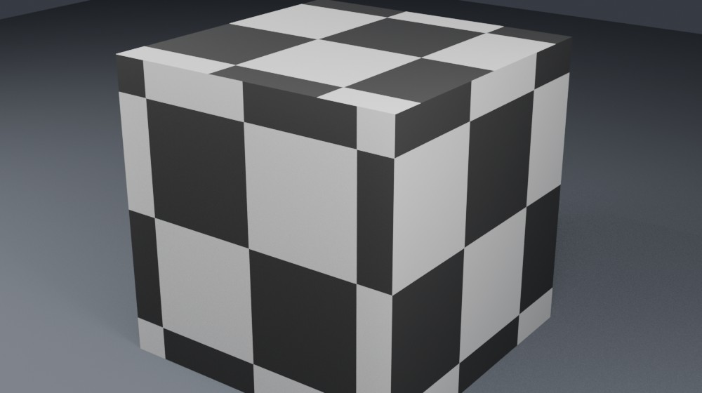
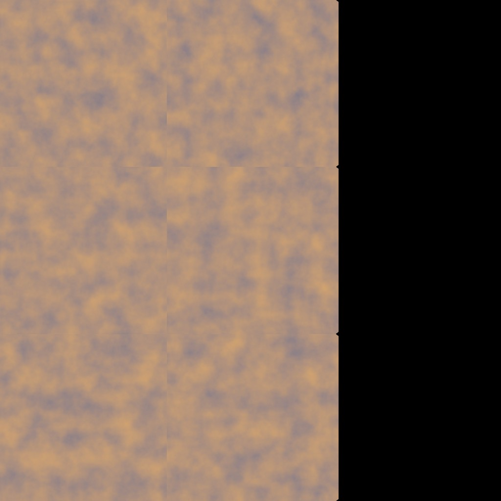

# 05 · UV 与贴图烘焙

> UV 是三维表面在二维图上的"展开图"，就像把纸盒拆平。
> 烘焙是把"算出来的颜色"永久写进一张图——程序化材质是公式，烘焙后是像素。



棋盘格是检验 UV 的标准工具：格子接近正方形 = 展开没有明显拉伸；
格子突然变形 = 那块 UV 被拉歪了。



左边那张噪声材质的颜色，被完整烘成了一张 1024×1024 的贴图，
UV 的每一块都能对上。

---

## 它解决什么问题

### UV 的问题

程序化材质（噪声、渐变、Voronoi）不需要 UV，因为它按**三维坐标**算。
但一旦你要：

- 贴一张具体图片（木纹照片、logo、脸）
- 用纹理绘制（在模型上直接画）
- 导出到游戏引擎 / 其他软件

就必须要 UV——因为图片是二维的，得告诉软件"这个顶点对应图上的哪个点"。

### 烘焙的问题

程序化材质很强，但有两个硬伤：

| 问题 | 说明 |
|---|---|
| 无法导出 | 游戏引擎、Three.js、Unity 不认识 Blender 的节点树 |
| 计算成本 | 每一帧都要重新算噪声，实时渲染会掉帧 |

烘焙 = **把节点树的计算结果拍成一张图**。之后用图片代替节点，既通用又快。

---

## 核心概念

### UV 展开的三种方式

| 方式 | 适用 | 原理 |
|---|---|---|
| Smart UV Project | 硬表面、快速 | 按面朝向自动切块并投影 |
| Unwrap（配合标记缝合线） | 角色、有机体 | 沿你标记的缝剪开再铺平 |
| Project from View | 局部细节、贴花 | 按当前视角投影 |

Smart UV 的优点是"一键出结果"，缺点是接缝位置不受控。
角色必须手工标缝（`Ctrl+E` → Mark Seam），否则脸上会横着一道接缝。

### UV 密度与拉伸

- **拉伸**：UV 里被拉长的矩形 → 贴图在模型上变形
- **密度**：UV 占用的面积比例。密度不一致 = 有的地方清晰、有的地方糊

检验方法就是在材质里接一张棋盘格，看格子是否接近正方形。

### 烘焙类型

| 类型 | 输出 | 用途 |
|---|---|---|
| Diffuse（Color only） | 基础色 | 把程序化颜色变成贴图 |
| Normal | 法线 | 把高模细节烘到低模上 |
| Ambient Occlusion | 环境遮蔽 | 增强缝隙暗部 |
| Roughness / Metallic | 单通道 | PBR 工作流 |

---

## 可运行代码

### 第一步：UV 展开

```python
import bpy, math

bpy.ops.mesh.primitive_cube_add(size=2.0, location=(0, 0, 1.0))
ob = bpy.context.active_object

# Smart UV Project 必须在编辑模式、且有选中面
bpy.context.view_layer.objects.active = ob
bpy.ops.object.mode_set(mode='EDIT')
bpy.ops.mesh.select_all(action='SELECT')
bpy.ops.uv.smart_project(angle_limit=math.radians(66), island_margin=0.02)
bpy.ops.object.mode_set(mode='OBJECT')

uv = ob.data.uv_layers.active
print("UV 层 =", uv.name, "循环数 =", len(ob.data.loops))
```

输出 `UV 层 = UVMap 循环数 = 24`（立方体 6 面 × 4 顶点）。

### 第二步：用棋盘格验证

```python
def make_checker(size=128, squares=8):
    img = bpy.data.images.new("Checker", size, size)
    px = []
    for y in range(size):
        for x in range(size):
            c = ((x * squares) // size + (y * squares) // size) % 2
            v = 0.82 if c else 0.22
            px += [v, v, v, 1.0]
    img.pixels = px
    return img

m = bpy.data.materials.new("M_UV")
m.use_nodes = True
nt = m.node_tree
bsdf = nt.nodes["Principled BSDF"]

tx = nt.nodes.new("ShaderNodeTexImage")
tx.image = make_checker()
tx.interpolation = "Closest"        # 不要模糊，网格才能看清
nt.links.new(tx.outputs["Color"], bsdf.inputs["Base Color"])
ob.data.materials.append(m)
```

### 第三步：把程序化材质烘成贴图

```python
import bpy, addon_utils, math

# 烘焙必须用 Cycles
addon_utils.enable("cycles", default_set=True)
sc = bpy.context.scene
sc.render.engine = "CYCLES"
sc.cycles.device = "CPU"
sc.cycles.samples = 6               # 烘颜色不需要高采样
sc.cycles.use_denoising = False

# 对象 + UV（承接上一步）
ob = bpy.context.active_object

# 程序化材质：噪声 → 色带
m = bpy.data.materials.new("M_Proc")
m.use_nodes = True
nt = m.node_tree
bsdf = nt.nodes["Principled BSDF"]

tex = nt.nodes.new("ShaderNodeTexNoise")
tex.inputs["Scale"].default_value = 6.0
tex.inputs["Detail"].default_value = 8.0

ramp = nt.nodes.new("ShaderNodeValToRGB")
ramp.color_ramp.elements[0].color = (0.06, 0.14, 0.30, 1)
ramp.color_ramp.elements[1].color = (0.85, 0.45, 0.12, 1)

nt.links.new(tex.outputs["Fac"], ramp.inputs["Fac"])
nt.links.new(ramp.outputs["Color"], bsdf.inputs["Base Color"])
ob.data.materials.append(m)

# 目标贴图：必须有 image 节点，且它是"活动节点"
img = bpy.data.images.new("BakedColor", 1024, 1024, alpha=False)
tnode = nt.nodes.new("ShaderNodeTexImage")
tnode.image = img
tnode.select = True
nt.nodes.active = tnode             # ← 少了这行，烘焙会报 "No active image found"

bpy.ops.object.bake(type='DIFFUSE', pass_filter={'COLOR'}, margin=12)
img.filepath_raw = "//baked_diffuse.png"
img.file_format = 'PNG'
img.save()
print("烘焙完成:", img.size[:])
```

输出 `烘焙完成: (1024, 1024)`。

---

## 实测踩坑

### ① `smart_project` 在物体模式调用会报错

```python
bpy.ops.uv.smart_project(...)      # ❌ context incorrect
```

必须先 `mode_set(mode='EDIT')` 并 `select_all(action='SELECT')`。
如果模型有多个物体，还要确保只有目标物体在编辑模式里。

### ② 烘焙报 "No active image found"

`bpy.ops.object.bake` 找的是**材质节点树里的活动图像节点**。
只创建 image 不给节点、或节点创建了但不是 active，都会失败：

```python
tnode.select = True
nt.nodes.active = tnode       # 这一行是关键
```

### ③ 烘焙出来全黑

三种原因：

1. **没有 UV** —— 检查 `ob.data.uv_layers`
2. **UV 全挤在 0 点** —— 展开失败，重新 Smart Project
3. **pass_filter 没设** —— `DIFFUSE` 类型不传 `{'COLOR'}` 会把光照也算进去

### ④ 贴图不跟着 .blend 走

`bpy.data.images.new()` 创建的图**只存在内存**，关掉 Blender 就没了。
两个办法：

```python
img.pack()                      # 打包进 .blend（推荐）
img.filepath_raw = "//tex.png"  # 或者存到 .blend 同目录
img.save()
```

`//` 表示"相对于 .blend 文件的路径"，这样换电脑也不会断。

### ⑤ UV 有接缝，贴图能看到线

Smart UV 是自动切块，接缝位置随机。三个缓解办法：

- 提高烘焙时的 `margin`（我用了 12 像素），让接缝外扩
- 在材质里用 `TexImage` 的 Extension 设为 `Extend`，减少接缝处的空白
- 关键区域手工标缝 + Unwrap

### ⑥ 烘焙很慢

CPU 烘焙 1024×1024、6 采样，这台机器约 15 秒。
想更快：

- 先降到 256 测通流程
- `samples` 降到 1（纯颜色烘焙不需要抗锯齿）
- 只烘需要的通道，别一次烘全套

---

## 一个完整的工作流建议

对"程序化材质 → 交付"这个场景，顺序应该是：

1. **建模** → 2. **UV 展开**（Smart 或手工标缝）→ 3. **做程序化材质**
4. **摆 UV 好之后**再烘焙 —— 顺序反了就要重做 UV
5. 烘焙出 Diffuse / Normal / Roughness 三张
6. 新建一个"导出用材质"，只接这三张图
7. `Pack Resources` 打包，另存 `_export.blend`

这样交付出去的文件，任何软件都能读。

---

## 本章要点

- UV 是三维到二维的映射，棋盘格是检验工具
- Smart UV 快但接缝不可控，角色要手工标缝
- 烘焙需要 Cycles + UV + 活动图像节点
- 烘焙后记得 `pack()`，否则贴图会丢
- 先 UV 再烘焙，顺序不能反

下一章换到渲染管线本身：光在空气里怎么走，颜色怎么被压进屏幕。
