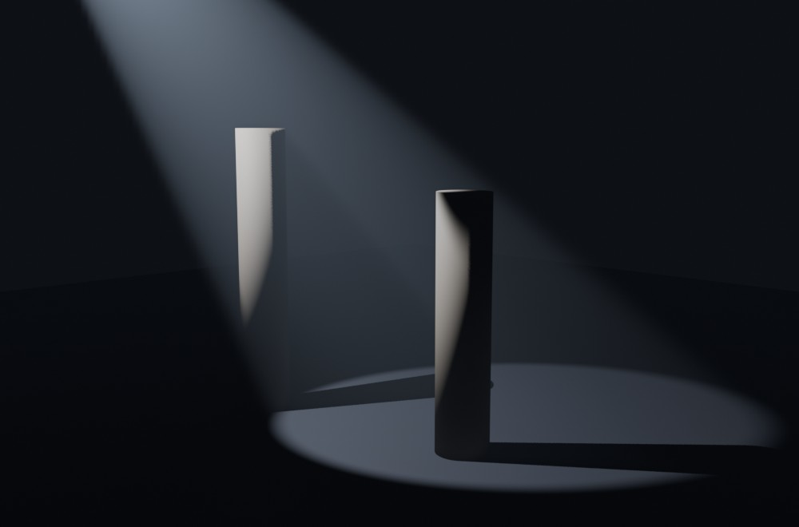
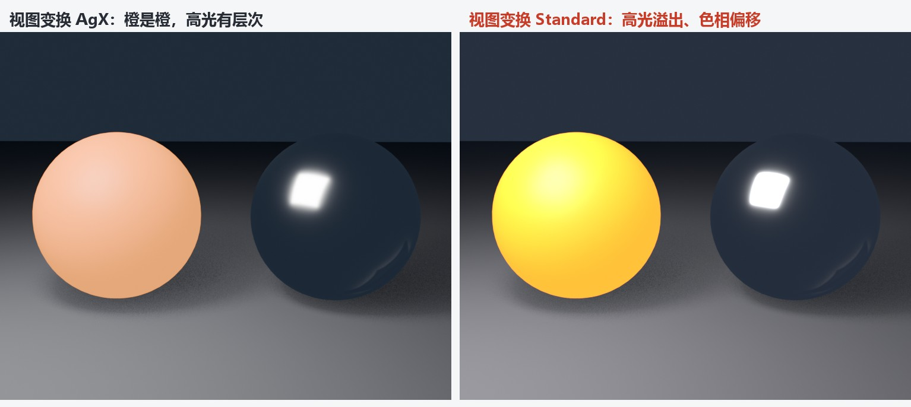

# 06 · 渲染进阶：体积光与色彩管理

> 这一章讲两件"不在物体上"的事：**光在空气里怎么走，颜色怎么被压进屏幕。**
> 前者决定氛围，后者决定你调了半天的颜色为什么最后变味。



雾里的聚光灯。看得见光柱，是因为空气把光散向摄像机——
这个现象叫丁达尔效应，在 Blender 里靠**体积材质**模拟。



同一场景、同一盏灯，只换"视图变换"，颜色完全不同。

---

## 它解决什么问题

### 体积光

没有参与介质（雾、烟、尘）的渲染，光是"看不见"的——你只看到被照亮的表面。
但真实世界里有空气，光穿过空气时会散开。这就是为什么森林里的光柱那么好看。

加了体积材质之后：

- 空气本身的散射 → 光柱
- 尘埃微粒 → 光晕
- 雾 → 空间层次与距离感

### 色彩管理

渲染出来的像素是**线性 HDR**：数值可以远大于 1（灯可以亮到 1000）。
屏幕只能显示 0～1，所以必须"压缩"。

不同的压缩方式 = 不同的 view transform：

| 视图变换 | 行为 | 适用 |
|---|---|---|
| Standard | 直接截断 | 素材/贴图核对 |
| Filmic | 柔和滚降，偏灰 | 旧版默认，现在少用 |
| AgX | 保色相、保高光层次 | 5.x 默认，写实首选 |

**AgX 最关键的特性：亮到爆的橙色高光，仍然是橙色，不会变成白点。**

---

## 核心概念

### 体积材质的三要素

| 参数 | 作用 | 典型值 |
|---|---|---|
| Density | 浓度，决定雾多厚 | 0.02～0.08 |
| Anisotropy | 散射方向性，正值偏向前方散射 | 0.2～0.5 |
| Color | 雾的颜色 | 冷白或暖白 |

`Anisotropy > 0` 时，迎着光源看会更亮——这就是逆光光柱的来源。

### 体积必须"包住光路"

这是最容易忽略的一点：体积是一块**实体空间**（一个立方体或球），
光必须穿过这块空间，才会产生散射。

如果雾盒子只包住一半，光柱就会在半空中"截断"。

### 线性 vs sRGB

- **线性**：物理计算用的数值空间，1.0 表示"比 0.5 亮一倍"
- **sRGB**：显示用的编码，把线性值做了 gamma 校正

坑在于：你在材质面板里输入的颜色是 **sRGB**，但渲染器按**线性**理解。
所以选颜色时要看"线性值"，而不是直觉。

---

## 可运行代码

### 体积光柱

```python
import bpy, math
from mathutils import Vector

# ① 暗环境
sc = bpy.context.scene
w = bpy.data.worlds.new("W")
sc.world = w
w.use_nodes = True
w.node_tree.nodes["Background"].inputs[0].default_value = (0.008, 0.009, 0.012, 1)

# ② 地面 + 两根柱子（承接光斑）
bpy.ops.mesh.primitive_plane_add(size=30)
for x, y, h in [(-1.9, -1.0, 4.2), (1.5, -0.3, 3.4)]:
    bpy.ops.mesh.primitive_cylinder_add(vertices=32, radius=0.36, depth=h,
                                        location=(x, y, h / 2))

# ③ 雾：一个包住整个场景的大立方体
bpy.ops.mesh.primitive_cube_add(size=22, location=(0, 0, 7))
fog = bpy.context.active_object
fm = bpy.data.materials.new("M_Fog")
fm.use_nodes = True
nt = fm.node_tree
for n in list(nt.nodes):
    if n.type != "OUTPUT_MATERIAL":
        nt.nodes.remove(n)

out = next(n for n in nt.nodes if n.type == "OUTPUT_MATERIAL")
vol = nt.nodes.new("ShaderNodeVolumePrincipled")
vol.inputs["Density"].default_value = 0.055
vol.inputs["Anisotropy"].default_value = 0.35
vol.inputs["Color"].default_value = (0.85, 0.90, 1.0, 1)
nt.links.new(vol.outputs["Volume"], out.inputs["Volume"])
fog.data.materials.append(fm)
fog.visible_shadow = False         # 雾盒子本身不要挡住阴影

# ④ 聚光灯，方向对准场景
sd = bpy.data.lights.new("Spot", "SPOT")
sd.energy = 14000
sd.spot_size = math.radians(30)
sd.spot_blend = 0.25
sp = bpy.data.objects.new("Spot", sd)
bpy.context.scene.collection.objects.link(sp)
sp.location = (-3.2, -4.4, 9.0)
sp.rotation_euler = (Vector((0.2, 0.4, 1.0)) - Vector(sp.location)) \
    .to_track_quat('-Z', 'Y').to_euler()

# ⑤ EEVEE 的体积设置
ee = sc.eevee
ee.use_volumetric_shadows = True      # 让柱子挡住光，产生影子光柱
ee.volumetric_end = 40.0
ee.volumetric_samples = 96            # 太低会有断层
ee.use_raytracing = True

sc.render.engine = "BLENDER_EEVEE"
sc.eevee.taa_render_samples = 64
print("体积光场景就绪")
```

### 色彩管理对比

```python
import bpy

sc = bpy.context.scene

# 同一个场景，只改视图变换，各渲染一张
for vt, fname in [("AgX", "//agx.png"), ("Standard", "//standard.png")]:
    try:
        sc.view_settings.view_transform = vt
    except Exception as e:
        print("不支持的视图变换:", vt, e)
        continue
    sc.render.filepath = fname
    bpy.ops.render.render(write_still=True)
    print("已渲染", vt)

# 恢复默认
sc.view_settings.view_transform = "AgX"
```

也可以直接读出当前配置：

```python
print(sc.view_settings.view_transform)     # 'AgX'
print(sc.view_settings.look)               # 'None'
print(sc.display_settings.display_device)  # 'sRGB'
```

---

## 实测踩坑

### ① 雾太薄 = 什么也看不见

`Density = 0.035` 时几乎没有可见光柱，只有一点点雾感。
调到 `0.055` 才出效果，`0.075` 就已经很浓了。

体积密度是**指数**级影响：0.03 和 0.06 差的不止一倍。

### ② 光锥方向算错，光打到自己身上

我一开始手写欧拉角：

```python
sp.rotation_euler = (math.radians(6), math.radians(-14), 0)   # ❌ 靠猜
```

结果光柱朝天上打。正确做法是用 `to_track_quat`：

```python
sp.rotation_euler = (target - sp.location).to_track_quat('-Z', 'Y').to_euler()
```

灯光和相机的"朝向"都是沿本地 -Z 轴，所以用 `'-Z'`；上方向用 `'Y'`。

### ③ `visible_shadow = False` 很重要

雾盒子如果不关阴影，会在地面上投出一个巨大的方形暗块——因为它是实体。
关掉之后，雾只参与散射，不参与遮挡。

### ④ 体积采样太低会有"断层"

`volumetric_samples` 默认 64，在强光柱下会看到一圈圈同心圆。
调到 96～128 干净很多，代价是渲染变慢。

### ⑤ 枚举读不到 AgX，但实际能用

```python
[e.identifier for e in RenderSettings...enum_items]   # 只返回 ['NONE']
sc.view_settings.view_transform = 'AgX'              # 但这样能设成功
```

原因是枚举在**没有场景上下文**时没被初始化。判断"这台机器支持哪些视图变换"要读
`bpy.context.scene.view_settings.bl_rna.properties['view_transform'].enum_items`，
或者直接试着赋值。别被空列表骗了。

### ⑥ AgX 会让画面"变灰"

第一次用 AgX 的人都会觉得"颜色怎么不鲜艳了"。
原因是它在高光区压缩得更平缓，中间调的对比也略低。

补救：
- `sc.view_settings.look` 选一个对比增强的 Look（如果有）
- 或者在合成器里加一层对比/S 曲线
- 或者把灯的功率降下来，让画面大部分落在中间调

**AgX 不是"更好看"，是"更不容易崩"。** 要鲜艳可以事后调，但高光爆了救不回来。

### ⑦ Standard 下橙色高光变黄白

对比图右边那个球：明明是橙色发光材质，在 Standard 下中心区域过曝成黄色，
外围还有一圈色相偏移。这就是"截断式压缩"的代价——超出 1.0 的部分全变成白色，
而橙色（R 高 G 中 B 低）先撑爆的是 R 通道，色相就歪了。

---

## 实用配方

### 电影感的丁达尔光柱

```python
vol.inputs["Density"].default_value = 0.055
vol.inputs["Anisotropy"].default_value = 0.4     # 略偏前向散射
spot.energy = 14000
spot_size = 30°
camera: 侧对光锥，而不是顺着光看
```

### 清晨薄雾

密度 0.02，Color 偏冷 (0.8, 0.86, 1.0)，配合太阳光（SUN）低角度斜射。

### 室内光束（窗户光）

用一块"窗户形状"的面光源 + 体积 0.03，模型要挡住光（`use_volumetric_shadows`），
才会出现被窗框切碎的光柱。

---

## 本章要点

- 体积光 = 包住光路的体积材质 + 足够密度 + 前向散射
- 关掉雾盒的阴影，否则地面会有方形暗块
- 灯光朝向用 `to_track_quat('-Z', 'Y')`，别手写欧拉角
- AgX 保色相与高光，Standard 会截断；写实场景用 AgX，核对贴图用 Standard
- 觉得 AgX 灰，是正常的——它换的是"不崩"而不是"鲜艳"

下一章跳出场景，看 Blender 本身怎么被扩展。
