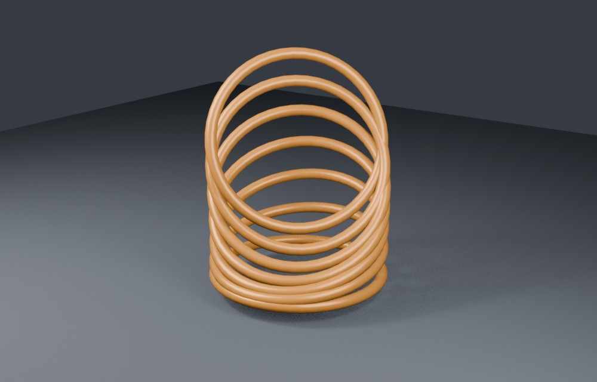

# 07 · 资产库与插件开发

> 前六章都在用 Blender；这一章开始**改 Blender**。
> 资产库解决"东西怎么复用"，插件解决"操作怎么固化"。



这个场景不是手工做的——是一个 60 行的插件，点一次按钮生成的 7 层圆环塔。

---

## 它解决什么问题

### 资产库

你有十个项目、每个项目都要用同一块木头材质、同一个窗户模型。
复制粘贴会导致：

- 改了材质要改十遍
- 文件里存了十份重复数据
- 找不到上次做的那个"很好用的石墙"

资产库 = **一个可以被所有项目引用的素材仓库**，带预览图和标签。

### 插件

有些操作你一天要做 50 遍，比如"选中所有同材质物体"、"按高度排序"、"批量加倒角"。
每次点十下菜单，一年就是几千次。

插件把这些操作**变成一个按钮**。更进一步，你还能把它分享给团队。

---

## 核心概念

### 资产标记（Asset Mark）

任何数据块都可以标成资产：物体、材质、集合、世界、几何节点组、姿态。

标记之后它会出现在 Asset Browser 里，可以拖进任何场景。

### Append vs Link

| 方式 | 数据 | 改源文件 | 适用 |
|---|---|---|---|
| Append | 复制一份进当前文件 | 不影响 | 一次性素材 |
| Link | 只引用，不复制 | 源文件改，这边跟着变 | 团队共用资产 |

Link 更省空间、更统一，但**不能直接编辑**（需要 Make Local 或 Library Override）。

### 插件三件套

| 类 | 作用 |
|---|---|
| `bpy.types.Operator` | 一个可执行的动作（按钮/菜单项） |
| `bpy.types.Panel` | 界面上的一个面板 |
| `register()` / `unregister()` | 注册/注销，Blender 加载时调用 |

### bl_idname 的命名

- Operator：`类别.动作`，全小写，如 `pro.ring_stack`
- Panel：任意唯一字符串，如 `PRO_PT_panel`

`类别` 会出现在 Python 控制台的历史记录里，也会决定快捷键的调用方式。

---

## 可运行代码

### A. 标记资产

```python
import bpy

m = bpy.data.materials.new("M_AssetStone")
m.use_nodes = True
bsdf = m.node_tree.nodes["Principled BSDF"]
bsdf.inputs["Base Color"].default_value = (0.42, 0.44, 0.5, 1)
bsdf.inputs["Roughness"].default_value = 0.7

# 标记为资产 + 元数据
m.asset_mark()
m.asset_data.description = "可复用的石材材质"
m.asset_data.tags.new("stone")
m.asset_data.tags.new("exterior")

print("标记成功:", m.asset_data is not None,
      "标签:", [t.name for t in m.asset_data.tags])
```

输出 `标记成功: True 标签: ['stone', 'exterior']`。

### B. 注册一个资产库目录

```python
import bpy, os

lib_dir = os.path.expanduser("~/blender_assets")
os.makedirs(lib_dir, exist_ok=True)

prefs = bpy.context.preferences.filepaths
lib = prefs.asset_libraries.new(name="MyAssets", path=lib_dir)
print("资产库已添加:", lib.name, lib.path)
```

然后在 Asset Browser 里把 `.blend` 文件拖进去，或直接把当前文件另存到该目录。

### C. 一个完整可用的插件

保存成 `pro_ring_addon.py`，放进 `scripts` 目录：

```python
bl_info = {
    "name": "Pro Ring Stacker",
    "blender": (4, 2, 0),
    "category": "Object",
    "version": (1, 0),
    "description": "一键生成圆环塔",
}

import bpy, math


class PRO_OT_ring_stack(bpy.types.Operator):
    bl_idname = "pro.ring_stack"
    bl_label = "生成圆环塔"
    bl_options = {"REGISTER", "UNDO"}      # UNDO 让 Ctrl+Z 能撤销

    count: bpy.props.IntProperty(name="层数", default=6, min=1, max=30)
    radius: bpy.props.FloatProperty(name="半径", default=1.0)

    def execute(self, context):
        for i in range(self.count):
            bpy.ops.mesh.primitive_torus_add(
                major_radius=self.radius,
                minor_radius=0.07,
                location=(0, 0, 0.28 * i + 0.2),
                rotation=(math.radians(12 * i), 0, math.radians(8 * i)),
            )
        return {"FINISHED"}


class PRO_PT_panel(bpy.types.Panel):
    bl_label = "Pro 工具"
    bl_space_type = "VIEW_3D"
    bl_region_type = "UI"
    bl_category = "Pro"                    # 侧栏标签名

    def draw(self, context):
        self.layout.operator("pro.ring_stack", icon="MESH_TORUS")


CLASSES = (PRO_OT_ring_stack, PRO_PT_panel)


def register():
    for c in CLASSES:
        bpy.utils.register_class(c)


def unregister():
    for c in reversed(CLASSES):
        bpy.utils.unregister_class(c)


if __name__ == "__main__":
    register()
```

在脚本里直接加载它（不用装到磁盘插件目录）：

```python
import sys, importlib
sys.path.insert(0, "/path/to/scripts")
mod = importlib.import_module("pro_ring_addon")
importlib.reload(mod)
mod.register()

bpy.ops.pro.ring_stack(count=7, radius=1.05)
print("生成完成，物体数 =", len(bpy.context.scene.objects))

mod.unregister()
```

输出 `生成完成，物体数 = 7`。

---

## 实测踩坑

### ① `asset_mark()` 是数据块的方法，不是操作符

```python
bpy.ops.asset.mark()          # 需要正确的 context，脚本里常失败
m.asset_mark()                # ✅ 直接调 ID 的方法
```

`asset_mark` 定义在 `bpy.types.ID` 上，材质、物体、世界都能直接用。

### ② 插件不注册 = 面板不出现

只写 `class` 不调 `register_class`，Blender 完全不知道它的存在。
而且 `unregister` 要**反序**注销——先注销 Panel，再注销 Operator，否则会报依赖错误。

### ③ `bl_options` 少了 UNDO，Ctrl+Z 会撤销掉整个场景

```python
bl_options = {"REGISTER", "UNDO"}
```

`REGISTER` 是必须的（否则不进撤销栈、不参与重做），`UNDO` 让操作变成一步可撤销。
自定义 operator 里跑了 `bpy.ops.mesh.primitive_*`，不加 UNDO 的话撤销行为会很怪。

### ④ 属性要用 `bpy.props` 声明，不能写到 `__init__`

```python
class PRO_OT_x(bpy.types.Operator):
    def __init__(self):
        self.count = 6            # ❌ Blender 看不到，面板里没有这个参数
    count: bpy.props.IntProperty(default=6)   # ✅
```

用 `bpy.props` 声明的属性会自动出现在操作面板（F9 / 重做面板）里。

### ⑤ 模块改了但没生效

Blender 会缓存已导入的模块。改了代码要：

```python
importlib.reload(mod)
```

在开发插件时，这一行应该写在测试脚本的最前面。

### ⑥ Panel 的 `bl_category` 决定它出现在哪个标签页

```python
bl_category = "Pro"     # 侧栏（N 面板）会多出一个 "Pro" 标签
```

如果不设，会进 "Misc" 或干脆不显示。这是新手最常见的"我的面板在哪"问题。

### ⑦ 一个文件里只能有一个 `register()` 入口

如果你把多个插件代码粘在一起，`register()` 会互相覆盖。
每个插件一个文件，或者自己维护一个 `CLASSES` 元组统一注册。

---

## 插件的三种安装方式

| 方式 | 做法 | 适用 |
|---|---|---|
| 直接放脚本目录 | 保存到 `scripts/addons/`，在偏好设置里勾选 | 自己用 |
| 安装 zip | 偏好设置 → 插件 → Install，选 zip（内含 `__init__.py`） | 分享给别人 |
| 临时加载 | `importlib` + `register()` | 开发调试 |

分发时用 zip，结构是：

```
pro_ring_addon/
├── __init__.py      ← 就是上面那份代码
└── README.md
```

---

## 资产库的实战建议

**给资产打标签**，不然一年后你自己也找不到。建议三层：

- 类型：`material` / `mesh` / `nodetree`
- 用途：`wall` / `roof` / `prop`
- 项目：`canal-town` / `client-A`

**用集合做资产**，而不是单个物体。一个"窗户"通常包含框、玻璃、窗台三个物体，
打包成集合后拖一次就全有了。

**Link 而不是 Append**，团队协作时尤其重要——美术改了源资产，所有人下次打开就同步了。

---

## 本章要点

- 资产库 = 可跨项目引用的素材仓，靠标记 + 标签 + 预览图
- 插件三件套：Operator（动作）、Panel（界面）、register（注册）
- 属性必须用 `bpy.props` 声明
- `bl_options` 加 `UNDO`，`bl_category` 决定面板位置
- 分发用 zip，开发用 `importlib.reload`

下一章回到几何：用两个"循环区"让节点图具备迭代与记忆能力。
