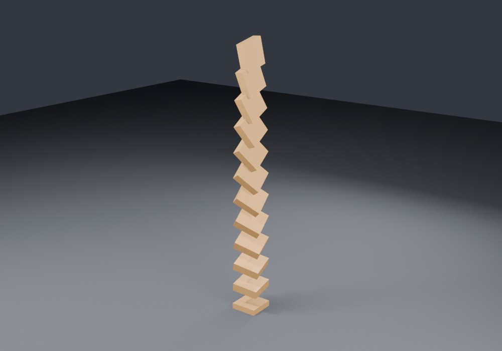

# 08 · 几何节点进阶：循环与仿真

> 几何节点默认是**无状态、无循环**的：数据从左流到右，算一次就结束。
> Repeat Zone 给了它循环，Simulation Zone 给了它记忆。



12 次迭代堆出的旋转塔。每一层的旋转角度和高度都由循环变量 `Iteration` 算出，
没有 12 个重复的节点，只有 10 个节点的一段循环。

---

## 它解决什么问题

### 没有循环时的困境

想堆 30 层台阶？只能复制 30 组节点，或者手工建模。
想让它"每一层比上一层多转 7 度"？只能一层层手调数值。

数据流式的节点图天生不能回头——这是它的优点（容易并行、结果可预测），
也是它的死角（重复与累积表达不出来）。

### 两个循环区的分工

| 循环区 | 迭代次数 | 是否跨帧 | 典型用途 |
|---|---|---|---|
| Repeat Zone | 固定次数，算完就结束 | 否 | 楼梯、螺旋、阵列、递归细分 |
| Simulation Zone | 每帧一次 | **是** | 粒子运动、生长、扩散、弹簧 |

**Repeat 是"一次算 12 遍"，Simulation 是"每帧算一遍，把结果留给下一帧"。**

---

## 核心概念

### Zone（区域）：一对节点夹住中间

两个循环区都是"成对"的：

```
Repeat Input  ──►  [中间的逻辑]  ──►  Repeat Output
Simulation Input ─► [中间的逻辑] ──►  Simulation Output
```

中间那块叫 zone。Input 提供入口与循环变量，Output 收集结果。

### Iteration（迭代序号）

Repeat Zone 内可以拿到 `Iteration`（从 0 开始的整数）。
用它驱动旋转、位移、缩放，就有了"每一层都不同"的效果。

### 状态项（State Item）

Simulation Output 上要声明"哪些数据需要跨帧保留"，叫 state item。
比如一个几何体、一个速度向量。

第一帧时 state 是空的，之后每帧把上一帧的结果喂回来。

### 配对必须手动做

这是本章最大的坑：**用 Python 创建 Simulation Input 不会自动生成配对的 Output**，
Repeat 也一样。必须显式调用：

```python
rin.pair_with_output(rout)
```

不配对的话，zone 是断开的，节点图会静默地什么都不做。

---

## 可运行代码

### Repeat Zone：12 层螺旋塔

```python
import bpy, math

ng = bpy.data.node_groups.new("RepeatTower", "GeometryNodeTree")
ng.interface.new_socket("Geometry", in_out="OUTPUT", socket_type="NodeSocketGeometry")

gi = ng.nodes.new("NodeGroupInput");   gi.location = (-900, 0)
go = ng.nodes.new("NodeGroupOutput");  go.location = (760, 0)

# ① 建一对 zone 并配对
rin = ng.nodes.new("GeometryNodeRepeatInput");   rin.location = (-620, 0)
rout = ng.nodes.new("GeometryNodeRepeatOutput"); rout.location = (480, 0)
rin.pair_with_output(rout)          # ← 少了这行，整个图是死的

# ② 迭代次数（它是 Repeat Input 上的一个输入 socket）
for inp in rin.inputs:
    if inp.name == "Iterations":
        inp.default_value = 12

# ③ 每层的基础几何
cube = ng.nodes.new("GeometryNodeMeshCube")
cube.location = (-320, -260)
cube.inputs["Size"].default_value = (0.32, 0.32, 0.10)

# ④ Iteration × 0.28 = 这一层的抬高
mul = ng.nodes.new("ShaderNodeMath"); mul.operation = "MULTIPLY"
mul.location = (-320, 60)
mul.inputs[1].default_value = 0.28

comb = ng.nodes.new("ShaderNodeCombineXYZ"); comb.location = (-140, 60)

# ⑤ Iteration × 7° = 这一层的旋转
ang = ng.nodes.new("ShaderNodeMath"); ang.operation = "MULTIPLY"
ang.location = (-320, -80)
ang.inputs[1].default_value = math.radians(7)

tr = ng.nodes.new("GeometryNodeTransform");    tr.location = (60, -140)
join = ng.nodes.new("GeometryNodeJoinGeometry"); join.location = (280, -40)

ng.links.new(rin.outputs["Iteration"], mul.inputs[0])
ng.links.new(mul.outputs["Value"], comb.inputs["Z"])
ng.links.new(rin.outputs["Iteration"], ang.inputs[0])
ng.links.new(ang.outputs["Value"], tr.inputs["Rotation"])
ng.links.new(cube.outputs["Mesh"], tr.inputs["Geometry"])
ng.links.new(comb.outputs["Vector"], tr.inputs["Translation"])

# ⑥ 累积：上一轮的结果 + 这一轮的新方块
ng.links.new(rin.outputs["Geometry"], join.inputs[0])
ng.links.new(tr.outputs["Geometry"], join.inputs[0])

ng.links.new(join.outputs["Geometry"], rout.inputs["Geometry"])
ng.links.new(rout.outputs["Geometry"], go.inputs["Geometry"])

# ⑦ 挂到一个空物体上
bpy.ops.object.empty_add(location=(0, 0, 0))
ob = bpy.context.active_object
ob.modifiers.new("GN", "NODES").node_group = ng

print("节点数 =", len(ng.nodes))
```

输出 `节点数 = 10`，场景里出现 12 层螺旋塔。

**为什么只需要 10 个节点画 12 层？** 因为循环把"重复"从空间（节点数量）
搬到了时间（迭代次数）。想变 30 层，只改一个数字。

### Simulation Zone：结构骨架

Simulation 比 Repeat 多一步——每一步都要告诉你"上一帧留下了什么"：

```python
import bpy

ng = bpy.data.node_groups.new("SimDemo", "GeometryNodeTree")
ng.interface.new_socket("Geometry", in_out="OUTPUT", socket_type="NodeSocketGeometry")

si = ng.nodes.new("GeometryNodeSimulationInput")
so = ng.nodes.new("GeometryNodeSimulationOutput")

si.pair_with_output(so)             # 同样必须手动配对

# 查看已经存在的状态项（新建时默认就有一个 Geometry）
print("状态项 =", [i.name for i in so.state_items])

# 需要额外状态时再添加（第一个参数是 socket 类型，第二个是名字）
so.state_items.new("GEOMETRY", "Accumulated")
so.state_items.new("VECTOR", "Velocity")

# 时间驱动：Delta Time 在 si.outputs 里
print("si 输出 =", [(s.name, s.type) for s in si.outputs])
print("so 输入 =", [(s.name, s.type) for s in so.inputs])
```

输出：

```
状态项 = ['Geometry']
si 输出 = [('Delta Time', 'VALUE'), ('Geometry', 'GEOMETRY'), ('', 'CUSTOM')]
so 输入 = [('Skip', 'BOOLEAN'), ('Geometry', 'GEOMETRY'), ('', 'CUSTOM')]
```

**注意 `Delta Time`**：它只在 Simulation Zone 里存在，Repeat Zone 没有。
所有"按时间累积"的运算（速度 × 时间 = 位移）都必须用它，而不是硬编码 1/24。

---

## 实测踩坑

### ① `pair_with_output` 不调用 = 静默失效

```python
rin = ng.nodes.new("GeometryNodeRepeatInput")
rout = ng.nodes.new("GeometryNodeRepeatOutput")
# 直接连线……❌ 不报错，但循环不执行
rin.pair_with_output(rout)      # ✅
```

最阴的地方是**不报错**。你会以为节点连错了，实际是没配对。

### ② 迭代次数是 socket，不是属性

```python
rin.iterations = 12           # ❌ AttributeError
rin.inputs["Iterations"].default_value = 12   # ✅
```

Repeat Input 把迭代次数做成了输入插槽，所以也可以用节点驱动它（做出"动态层数"）。

### ③ `state_items.new()` 的参数顺序

```python
so.state_items.new("Geometry", "GEOMETRY")   # ❌ 报 "enum 'Geometry' not found"
so.state_items.new("GEOMETRY", "Geometry")   # ✅ 类型在前，名字在后
```

报错信息里的枚举列表包含 `GEOMETRY`/`FLOAT`/`VECTOR` 等，全部大写。

### ④ Join Geometry 只有一个输入插槽

```python
join.inputs[0]      # 反复 link 这一个 socket，会自动追加
```

不像数学节点有 A/B 之分。想让三样东西合并，就连三次 `inputs[0]`。

### ⑤ 后台模式下 Simulation 不推进

和物理一样：`frame_set(90)` 不会模拟。必须：

```python
for f in range(1, 91):
    scene.frame_set(f)
```

而且 Simulation Zone 还需要场景里真的在播放/更新帧，静态渲染单帧只能看到第 1 帧的状态。

### ⑥ 读取 GN 输出的几何不能用 `evaluated_get().data`

如果宿主是 Empty：

```python
ev.data.vertices        # ❌ NoneType（Empty 没有 mesh data）
```

要这样取：

```python
me = bpy.data.meshes.new_from_object(ob.evaluated_get(dg))
print(len(me.vertices))
```

我在写验证脚本时就撞了这个，`RESULT_NA: 'NoneType' object has no attribute 'vertices'`。

### ⑦ Rotate 用弧度

```python
ang.inputs[1].default_value = 7           # ❌ 7 弧度 ≈ 401°，看起来像随机
ang.inputs[1].default_value = math.radians(7)
```

节点里的角度、`rotation_euler` 都是弧度。界面显示成度只是 UI 的换算。

---

## 什么时候用哪个

| 需求 | 选择 |
|---|---|
| 楼梯、蜂巢、螺旋、阵列 | Repeat Zone |
| 递归细分、分形 | Repeat Zone（注意别设太大，指数爆炸） |
| 生长、扩散、粒子运动、弹簧 | Simulation Zone |
| 一次性静态排布 | 其实不需要循环区，普通实例化就够 |

**判断标准：结果依赖"上一帧"吗？** 依赖就用 Simulation，不依赖就用 Repeat。

---

## 性能提醒

- Repeat 的迭代次数是**乘法级**开销：12 层 × 每层 8 个面 = 96 个面，但 200 层 × 500 面 = 10 万面
- Simulation 每帧都要重新求值整个下游，帧数越多越慢
- 循环区内部尽量不要放"重"节点（Voronoi 3D、高分辨率噪声），否则每迭代一次都重算

调参时先把迭代次数设成 3，确认形态对了再往上加。

---

## 本章要点

- 节点图默认无循环、无状态；两个 zone 补上这两种能力
- 配对必须手动 `pair_with_output`，不配对不报错但失效
- Repeat 用 `Iteration` 驱动参数，Simulation 用 `Delta Time` 累积
- 迭代次数是 socket 不是属性
- 判断用哪个：结果依赖上一帧吗

下一章离开场景内容，讲怎么把这一切放进无人值守的批处理流程。
